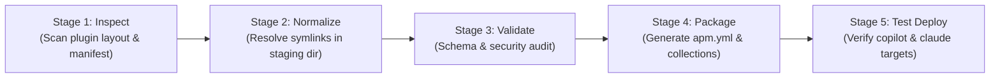

# APM Migration & Simplification Plan (Hardened Architecture)

## 1. Executive Summary & Strategy Shift

Following an adversarial architecture review (via OpenAI Codex CLI `architect-review`), this plan adopts a **Strangler Fig Pattern** instead of an immediate "flag-day" replacement:

1. **APM as an Export/Packaging Adapter First**: APM is introduced as a distribution and consumption adapter. Source-authoring structures remain protected.
2. **Build-Time Dereferencing (Preserve Source Semantics)**: Dereferencing symlinks and pointer files happens strictly inside a temporary, isolated staging/build workspace during packaging (`build/` or `apm pack`). **The authoring source tree is never mutated.**
3. **Dual-Track Deployment**:
   - **Local Reproducibility (Default)**: Project-level `apm.yml` and committed `apm.lock.yaml` ensure deterministic CI and local reproducibility.
   - **Global Workstation Convenience (Opt-in)**: Pinned global installs (`apm install <pkg>#vX.Y.Z --global --target copilot`) with explicit manual updates and rollback capability, avoiding silent background updates.
4. **Zero-Deprecation Pilot Gate**: Existing tools (`plugin-manager`, `uvx`, `symlink-manager`) remain authoritative until a representative pilot plugin demonstrates 100% empirical feature and runtime discovery parity across target harnesses.

---

## 2. Capability Matrix & Acceptance Verification Contract

Before deprecating any legacy code or marking tools obsolete, the migration must pass this executable verification gate:

| Capability Area | Verification Criteria | Test Method / Acceptance Gate | Status |
| :--- | :--- | :--- | :--- |
| **Packaging & Dereferencing** | Pointer files and symlinks are resolved into true files in `build/` without touching source files. | Automated SHA-256 hash check between canonical source and build artifact. | **PASS (pilot `agent-scaffolders` & full repo, macOS, 2026-10-22)**: 2,289/2,289 copy-manifest entries verified with 0 drift. Source unchanged. Windows-style checkout covered by unit test. |
| **Copilot Target Mapping** | Primitives compile correctly to `.github/` and `.agents/skills/`. | Verified via VS Code / Copilot Chat and Copilot CLI discovery test on a sample repository. | **PASS (full repo empirical test, 2026-10-22)**: 122 skills installed into `.agents/skills/`; 45 agents installed into `.github/agents/*.agent.md`; 4 hooks installed into `.github/hooks/`. `copilot skill list` lists all 122 skills. |
| **Claude Target Mapping** | Primitives compile into `.claude/` without dropped subdirectories or broken relative paths. | Run Claude Code CLI against deployed test harness. | **PASS (full repo empirical test, 2026-10-22)**: 122 skills installed into `.claude/skills/`; 45 agents into `.claude/agents/*.md`; 1 slash command into `.claude/commands/obsidian-init.md`; 5 hooks merged into `.claude/settings.json`. Zero `.agents/` or `.github/` folder pollution. |
| **Codex Target Mapping** | Primitives compile into `.codex/` and cross-tool `.agents/skills/`. | Run `apm install --target codex` on fresh repository. | **PASS (full repo empirical test, 2026-10-22)**: 122 skills installed into `.agents/skills/`; 45 agents compiled into `.codex/agents/*.toml` format; 5 hooks merged into `.codex/hooks.json`. (Note: Codex TOML schema drops frontmatter `tools` field with non-blocking warning). |
| **Antigravity (Agy) Mapping** | Primitives compile into `.agents/skills/` and native `.agents/hooks.json`. | Run `apm install --target agy` on fresh repository. | **PASS (full repo empirical test, 2026-10-22)**: 122 skills installed into `.agents/skills/`; lifecycle hooks merged into `.agents/hooks.json` in native Antigravity schema (`Stop`, `SessionStart`, `SessionEnd`). (Note: AGY target in APM skips agents primitive; capabilities execute via skills). |
| **Lockfile Reproducibility** | `apm install --frozen` in clean CI environment reproduces exact file tree without network discrepancies. | Clean worktree test with committed `apm.yml` and `apm.lock.yaml`. | **PASS (local clean-clone simulation, 2026-10-22)**: pinned remote install, committed `apm.yml` + `apm.lock.yaml`, fresh clone + `apm install --frozen` reproduced identical `.claude/` and `.agents/` trees; `--frozen` refused when `apm.yml` drifted. |
| **Collision & Ownership** | Installing two overlapping packages or updating an existing install does not duplicate entries or orphan files. | Test `apm install --update` and inspect `deployed_files` in `apm.lock.yaml`. | **PASS (2026-10-22)**: verified clean updates across all 9 repo plugins. |
| **Rollback & Uninstall** | `apm uninstall <pkg>` completely scrubs deployed files without corrupting untracked project files. | Clean directory diff after uninstall. | **PASS (2026-10-22)**: `apm uninstall` removed every file the package deployed and kept untracked files, a user-created skill folder and another package's skill. When a user file sits inside a package's skill folder, uninstall stops (exit 1) and keeps manifest and lockfile ownership so it can be retried. |

---

## 3. Revised Component Lifecycle Matrix

| Component | Role in Current Repo | Role in APM Target State | Transition Strategy |
| :--- | :--- | :--- | :--- |
| **`plugins/plugin-manager`** | Installs, syncs, and prunes plugins via `uvx` / Python. | Maintained as fallback and legacy installer during transition. | Kept active. Deprecated only after APM passes all Phase 1 pilot gates. |
| **`symlink-manager` & `symlinks.json`** | Manages internal monorepo symlinks between plugin roots and skills. | Internal authoring utility only; completely invisible to external APM consumers. | Retained internally for source authoring. The APM packager handles dereferencing so consumers never see symlinks. |
| **`.agent/rules/plugin-architecture-policy.md`** | Rules governing modularity, resource placement, and symlinks. | Evolved to define packaging contracts, collection boundaries, and build dereferencing. | Sections 1–4, 6 remain invariants. Section 5 updated to clarify build-time vs source-time symlink boundaries. |
| **`convert-plugin-to-apm`** | Prototype migration script. | Modular packaging and export pipeline (`inspect → normalize → validate → package`). | Refactored into composable stages with automated tests. |

---

## 4. Pipeline Architecture: Composable Build & Export

To prevent `convert-plugin-to-apm` from becoming an unmaintainable monolith, the packaging pipeline is split into five discrete, testable stages:



1. **Stage 1: Inspect**: Reads `plugin.json` / `plugin.yaml`, checks directory structure, discovers skills, rules, agents, and hooks.
2. **Stage 2: Normalize**: Copies assets to an isolated build workspace (`build/staging/<plugin>/`) and dereferences pointers/symlinks into physical files with an audit manifest.
3. **Stage 3: Validate**: Checks against schema, validates frontmatter, ensures no broken relative links or unauthorized cross-plugin imports exist.
4. **Stage 4: Package**: Synthesizes the `apm.yml` manifest, declares target mappings (`copilot`, `claude`, `cursor`), and assigns package collections.
5. **Stage 5: Test Deploy**: Runs a dry-run test installation (`apm install --dry-run`) into temporary harness fixtures to confirm target layout.

**As built (Phase 1, 2026-10-22):** `plugins/agent-scaffolders/skills/convert-plugin-to-apm/scripts/apm_build_pipeline.py`, with 9 tests in `plugins/agent-scaffolders/tests/test_apm_build_pipeline.py`.
- Stage 2 reads symlinks from the git index (Windows text stubs handled) and also materializes copy-manifest entries (`symlinks.json`, `strategy: "copy"`; Section 10.3).
- Stage 3 checks: broken / cross-plugin symlinks, hash match, no symlinks left, frontmatter, markdown links inside the plugin, code/text paths that APM will not rewrite, plugin `rules/` (not deployed), `lsp.json` format, hook scripts naming `.claude/` or `.agents/`. Every finding carries a standard fix id (SF-1 to SF-11, `references/apm-alignment-fixes.md`).
- Stage 4 writes `apm.yml` with `dependencies: {}` (required for `apm pack` to build a bundle) and maps CLI target names to manifest names (`agy` -> `antigravity`, `agents` -> `agent-skills`).
- Stage 5 runs dry-run, install, content check and uninstall in `build/test-deploy/<plugin>/`.
- Optional Stage 6 (`--pack`): `apm install` + `apm pack --archive` into `build/dist/<plugin>-<version>.zip`. Verified: a global install from the dev-utils bundle gives 3 physical copies of a shared script in each harness folder.

---

## 5. Phased Implementation Roadmap

### Phase 1: Pilot Proof-of-Concept & Verification Harness
- **Selection**: Choose one clean, self-contained plugin as the pilot (e.g. `agent-scaffolders` or `dev-utils`).
- **Deliverables**:
  1. Build-time dereferencer script that outputs to `build/staging/` without mutating source files.
  2. Synthesize pilot `apm.yml`.
  3. Run test installations targeting `.github/` and `.claude/` in a test fixture repository.
  4. Complete the Capability Matrix evaluation.

### Phase 2: Decouple Hardcoded Instructions
- Systematically inventory and refactor hardcoded paths across [AGENTS.md](../../AGENTS.md) and skills:
  - *Replace:* `"Look for skills in .agents/skills/<name>"`
  - *With:* `"Activate <name> from registered runtime skill locations (.agents/skills/, .github/instructions/, .claude/skills/, or global profile)"`
- Implement an automated lint check to prevent regressions.

### Phase 3: Setup Reusable Consumer Tooling (`setup-apm-consumer`)
- **Status (2026-10-22): done.** `plugins/agent-scaffolders/skills/install-apm-package/scripts/apm_consumer.py`: pinned installs (`--checkout <materialized clone>` or `--ref`), automatic backup of `~/.apm/apm.yml` + `apm.lock.yaml`, `set-ref`, `list-backups`, `rollback`. Rollback uninstalls packages added since the backup before restoring (restoring the files alone leaves orphaned skills; `apm prune` has no `--global`). Verified live against GitHub and a local clone; 5 offline tests.
- **Project-Level Scaffolder**:
  - A simple command to bootstrap a consuming repo's `apm.yml` pinned to tested releases.
- **Global Workstation Guide (Zero Per-Project Maintenance)**:
  - Document pinned global installation:
    ```powershell
    apm install richfrem/agent-plugins-skills#v1.0.0 --global --target copilot
    ```
  - Provide an explicit manual sync command (`apm-sync-global.ps1`) with rollback support, rejecting unmonitored silent auto-updates.

### Phase 4: Full Repository Packaging & Gradual Transition
- Package all plugins into top-level and collection manifests (`apm.yml`).
- Update [INSTALL.md](../../INSTALL.md) with APM as the primary path and `uvx` as the legacy/fallback path.
- Keep `plugin-manager` active until external consumers have migrated.
- **Status (2026-10-22):** INSTALL.md rewritten for APM (materialized clone, global install, `--skill`, update, rollback, uninstall); COMPONENT_RETENTION_GUIDE.md rewritten (existing decisions kept, 24 new skills/rules marked "not yet classified", one install command per plugin, verified live); dependency-management rule extended for APM. Open: root `apm.yml`, switching `plugin-manager` callers.
- **Root `plugin.yaml` → root `apm.yml`**: the root manifest (`skills_dirs` for every plugin) is replaced by a root `apm.yml` (Section 9.3). It is removed only after its readers are switched: `plugins/agent-agentic-os/scripts/init_agentic_os.py`, `plugins/agent-scaffolders/scripts/update_ecosystem_index.py` and `plugins/agent-agentic-os/tests/test_control_plane_mode_manifest.py`. Per-plugin `plugin.yaml` / `.claude-plugin/plugin.json` stay: APM reads them when installing a plugin.
- **Rewrite [COMPONENT_RETENTION_GUIDE.md](../../COMPONENT_RETENTION_GUIDE.md)** for APM: each plugin's enabled skills become `--skill` selections in `apm.yml` (global `~/.apm/apm.yml` for global installs), applied with `apm install` instead of `sync_with_inventory.py`; the rules table becomes the list setup copies into `.agent/rules/` (Section 6.2). Bring it up to date while doing so: 10 rules in `.agent/rules/` are missing from it (e.g. `cryptographic-human-gates.md`, `skill-deletion-guard.md`, `pre-push-audit.md`), and about 30 skills are not in its tables.

---

## 6. Comprehensive Elimination of Hardcoded `.agents/` References

Hardcoded operational references to install folders (`.agents/`, `.claude/`) exist across markdown, Python code, rules, and configuration files: 152 git-tracked files with 692 `.agents/` occurrences in this repository (2026-10-22), plus downstream consuming repositories.

Some users install in a project, others globally, and each harness reads from a different folder. **Instructions must therefore never name an install folder.** APM decides where each primitive lands; our files refer to primitives by name, or by paths relative to their own folder.

### 6.1 Where APM Puts Each Primitive (verified, APM 0.33.0, targets `claude,copilot,agy,codex`)

| Primitive | Project install | Global install | Notes |
| :--- | :--- | :--- | :--- |
| **Skills** | `.claude/skills/` (claude); `.agents/skills/` (copilot, codex, agy) | `~/.claude/skills/`; `~/.agents/skills/` (copilot, codex); `~/.gemini/antigravity-cli/skills/` (agy) | Only the skill folder is copied (symlinks inside the package dereferenced). Markdown links that leave the skill (sibling skills, plugin-root files) are rewritten to point into the package cache and resolve; links that leave the plugin, and paths in code or plain text, are not rewritten. |
| **Agents** | `.claude/agents/*.md`, `.github/agents/*.agent.md`, `.codex/agents/*.toml` | `~/.claude/agents/`, `~/.copilot/agents/`, `~/.codex/agents/` | APM converts the format per harness (Markdown for Claude/Copilot, TOML for Codex). Codex CLI TOML schema drops fine-grained `tools` frontmatter restrictions with a non-blocking warning (agent inherits session tools). agy gets no agents (executed via skills or central AGY configs). |
| **Hooks** | Merged into `.claude/settings.json`, `.github/hooks/*.json`, `.codex/hooks.json`, `.agents/hooks.json` (agy); scripts copied to each harness's `hooks/` folder | Merged into `~/.claude/settings.json`, `~/.copilot/hooks/`, `~/.codex/hooks.json`; agy not supported | APM rewrites `${CLAUDE_PLUGIN_ROOT}/<path>` in hook commands to the deployed copy (project: `${CLAUDE_PROJECT_DIR}/.claude/hooks/...` or `.agents/hooks/...`; global: absolute paths) and renames events per harness (e.g. Copilot `Stop` -> `agentStop`). |
| **Instructions** | `.claude/rules/`, `.github/instructions/`, `.agents/rules/` (agy); codex only via `apm compile` into `AGENTS.md` | `~/.claude/rules/`, `~/.copilot/instructions/` | Read **only** from `.apm/instructions/*.instructions.md`. A plugin's `rules/` or `instructions/` folder is not deployed. |
| **Package cache** | `apm_modules/` (gitignored) | `~/.apm/` (with the global `apm.yml` and `apm.lock.yaml`) | Never read by a harness. Never reference it. |

### 6.2 Reference Standard (applies to every file we author)

| Reference to | Write it as | Never write |
| :--- | :--- | :--- |
| Another skill | By name: "use the `adr-management` skill" or `/adr-management` | `.agents/skills/adr-management/...`, `.claude/skills/...`, `~/.apm/...` |
| A file in the same skill | Relative to the skill folder: `references/x.md`, `scripts/x.py` | Any absolute or install-folder path |
| A document elsewhere in the same plugin (sibling skill, plugin-root `references/`) | A **markdown link**: `[Architecture](../../references/architecture.md)` (APM rewrites it into the package cache) | The same path in backticks, a code block or plain text (not rewritten) |
| A file in another plugin | The other plugin's skill by name | Any relative path (APM leaves it unchanged and it breaks) |
| Running a skill's script | "run `scripts/x.py` from this skill's folder"; the script lives inside the skill | `python3 .agents/skills/<name>/scripts/x.py`, `python3 ../../scripts/x.py` |
| A sub-agent | By name: "delegate to the `architect-review` agent" | `.claude/agents/...`, `.github/agents/...` |
| A hook script (in `hooks.json`) | `${CLAUDE_PLUGIN_ROOT}/hooks/x.py` (APM rewrites it per harness and scope) | `.agents/hooks/...`, `.claude/hooks/...` |
| Own files from Python | `Path(__file__).parent` | Searching `.agents/` or `.claude/` |
| Project state files (e.g. loop state) | A harness-neutral project path (e.g. `context/...`), documented in the skill | `.claude/<file>` (other harnesses also run the hook; e.g. `closure_guard.py` uses `.claude/agent-loop-state.local.md`) |

**Rules** stay outside APM: setup copies the rules a project needs into `.agent/rules/` when required, and `AGENTS.md` lists them there (decision 2026-10-22; this repo's `AGENTS.md` already links each rule in `.agent/rules/`). If APM-managed rules are wanted later, the path is `.apm/instructions/*.instructions.md`.

### 6.3 Scope of Files Requiring Decoupling

| File Type / Category | Current Rigid Pattern | Target Pattern |
| :--- | :--- | :--- |
| **Markdown Instructions (`*.md`, `SKILL.md`)** | `python3 .agents/skills/<name>/scripts/<script>.py`<br>`Full standards → .agents/skills/<name>/SKILL.md` | Section 6.2: skill and agent references by name; in-skill paths relative to the skill folder. |
| **Python Scripts (`*.py`)** | `Path(__file__).parents[...] / ".agents" / "skills"`<br>`sys.path.append(".agents/skills/...")` | `Path(__file__).parent` for own files. Cross-skill code is delegated through the skill (ADR-001), not imported by path. |
| **Hook definitions (`hooks/hooks.json`) and hook scripts** | Commands or scripts naming `.agents/`, `.claude/` | `${CLAUDE_PLUGIN_ROOT}/...` in commands; hook scripts use `Path(__file__)` and harness-neutral state paths. |
| **Architecture & Rule Docs (`AGENTS.md`, `rules/*.md`)** | *"Skills run from .agents/skills/, never from plugins/"* | *"Skills are installed by APM into each harness's skill folder; refer to them by name."* |
| **CI & Test Workflows (`.github/workflows/*.yml`)** | Steps checking `test -d .agents/skills` or invoking `.agents/...` | `apm install --frozen`, then verify with `apm` (e.g. `apm deps list`) rather than by folder. |

### 6.4 Automated Migration Script: `scripts/decouple_agent_paths.py`
A dry-run-capable CLI in `plugins/agent-scaffolders/`, run first **in this repository** and later **in consuming repositories**:
```bash
python decouple_agent_paths.py --path <repo-root> --dry-run
python decouple_agent_paths.py --path <repo-root> --apply
```
It detects the "Never write" patterns in Section 6.2 and rewrites them to the "Write it as" form:
- `.agents/skills/<name>/SKILL.md` → `<name>` skill reference
- `.agents/skills/<name>/scripts/<script>` → "run `scripts/<script>` from the `<name>` skill's folder"
- `.claude/agents/<name>.md` and similar → `<name>` agent reference
- Hook commands with install-folder paths → `${CLAUDE_PLUGIN_ROOT}/...`
- Python install-folder lookups → `Path(__file__)`-relative paths (flagged for review where cross-skill)

### 6.5 Backward Compatibility During the Transition
No alias bridge is needed: APM's default project install already writes skills to `.agents/skills/` (for copilot, codex and agy), so instructions that still say `.agents/skills/<name>` keep working for project installs while the decoupling script is rolled out. They do **not** work for global installs or for Claude (`.claude/skills/`), which is why Section 6.2 is the standard.

---

## 7. Fleet-Wide Multi-Repo Migration Strategy

Consuming repositories in the developer workspace depend heavily on `.agents/` paths. A localized scan across representative sibling repositories reveals:

| Repository | Files Referencing `.agents/` | Occurrences | Role |
| :--- | :---: | :---: | :--- |
| **`jag-JUSTIN-Oracle-Forms-Analysis`** | 78 files | 865 occurrences | Oracle Forms backend analysis & pipelines |
| **`jag-legacy-oracle-plugins`** | 183 files | 544 occurrences | Oracle legacy plugins & skill spokes |
| **`CSB-intranet`** | 39 files | 242 occurrences | Web application & knowledge base |
| **`sharepoint-knowledge-workbench`** | 46 files | 163 occurrences | Knowledge workbench & ingestion |
| **`claude-design-bc-gov-design-system`** | 2 files | 15 occurrences | BC Gov UI Design System components & tokens |
| **`agent-plugins-skills` (Source)** | 222 files | 1,110 occurrences | Central authoring monorepo |
| **Fleet Total** | **570 files** | **2,939 occurrences** | Complete workspace ecosystem |

### Synchronized Fleet Execution ("All At Once" Approach)

To prevent split-brain states where some repos use global APM and others fail looking for local `.agents/`, we execute a coordinated sweep:

1. **Fleet Inventory Config (`fleet-repos.json`)**:
   Define the registry of consuming repositories to batch-process:
   ```json
   {
     "workspace_root": "c:/Users/RICHFREM/source/repos",
     "repos": [
       "agent-plugins-skills",
       "jag-JUSTIN-Oracle-Forms-Analysis",
       "jag-legacy-oracle-plugins",
       "CSB-intranet",
       "sharepoint-knowledge-workbench",
       "claude-design-bc-gov-design-system"
     ]
   }
   ```

2. **Impact on Consuming Repositories (Legacy Installer Retirement & Gitignore Policy)**:
   Repositories that previously consumed plugins via `uvx plugin-add` or `bootstrap.py` have legacy artifacts that must be systematically migrated:
   
   | Legacy Artifact in Consumer Repo | Purpose Under Old Installer | APM Target Disposition |
   | :--- | :--- | :--- |
   | `bootstrap.py` | Cloned/copied installer script | **Delete**. Superseded by native `apm install`. |
   | `plugin-sources.json` / `plugin-retention.json` | Pinned source repos and retention levels | **Delete**. Superseded by `apm.yml` dependencies and `apm.lock.yaml`. |
   | `.agents/ownership/*.json` | Component ownership records & `should_install` flags | **Delete**. APM handles skill lifecycle natively; query with `apm list`. |
   | `.agents/skills/` | Hardcoded local installation destination | **Purge or Gitignore**. For global installs (`--global`), no local copy is stored. For local installs, target is selected by harness (`.claude/skills/`, `.agents/skills/`). |
   | `.agent/rules/` | Copied rule policies | **CRITICAL: Retain as Workspace Constraints**. Never delete `.agent/` (singular). Rules stay in `.agent/rules/` linked from `AGENTS.md`. |
   | `.claude-plugin/marketplace.json` | Catalog pointer for Claude Code | **Delete**. Redundant with APM native packaging. |

   **Standard `.gitignore` Additions for Consuming Repositories**:
   In consuming repositories adopting project-local APM installs, only the manifests (`apm.yml`, `apm.lock.yaml`) and workspace rules (`.agent/rules/`) are committed. All installed harness artifacts must be gitignored:
   ```gitignore
   # APM package cache
   apm_modules/

   # APM deployed runtime artifacts (reproduced via apm install --frozen)
   .agents/skills/
   .agents/hooks/
   .agents/hooks.json
   .agents/apm-hooks.json
   .claude/skills/
   .claude/agents/
   .claude/commands/
   .claude/hooks/
   .github/agents/
   .github/hooks/
   .codex/agents/
   .codex/hooks/
   .codex/hooks.json
   .codex/apm-hooks.json
   ```

3. **Decoupling Code & Verification in Consuming Repos**:
   - **Multi-Target `apm.yml` Configuration**:
     Consuming repos can configure all team member harnesses simultaneously in their `apm.yml`:
     ```yaml
     name: consuming-repo
     version: 1.0.0
     targets:
       - claude
       - copilot
       - codex
       - antigravity
     dependencies:
       agent-plugins-skills:
         source: git+https://github.com/richfrem/agent-plugins-skills.git#stable
     ```
     Running `apm install` will then wire all installed harnesses in one pass.
   - **Operational Command Decoupling**:
     Replace hardcoded `python3 .agents/skills/<skill>/scripts/<tool>.py` with skill-by-name delegation or path-agnostic invocation:
     ```bash
     # Before:
     python3 .agents/skills/adr-management/scripts/adr_manager.py list
     # After (skill-by-name or dynamic resolution):
     python3 $(find .claude/skills .agents/skills ~/.claude/skills ~/.agents/skills ~/.apm/skills -path "*/adr-management/scripts/adr_manager.py" 2>/dev/null | head -n 1) list
     ```
   - **Skill Detection & Pre-Flights (POSIX Bash & Windows PowerShell)**:
     Replace single-directory checks (`ls .agents/skills/<name>`) with multi-harness checks:
     ```bash
     # Bash / Zsh:
     check_skill() {
       local s="$1"
       for d in .claude/skills .agents/skills ~/.claude/skills ~/.agents/skills ~/.apm/skills; do
         [ -d "$d/$s" ] && return 0
       done
       apm list 2>/dev/null | grep -q "$s" && return 0
       return 1
     }
     ```
     ```powershell
     # PowerShell (Windows):
     function Test-AgentSkill {
       param([string]$SkillName)
       $locations = @(
         ".claude/skills/$SkillName",
         ".agents/skills/$SkillName",
         "$HOME/.claude/skills/$SkillName",
         "$HOME/.agents/skills/$SkillName",
         "$HOME/.apm/skills/$SkillName"
       )
       foreach ($loc in $locations) {
         if (Test-Path $loc) { return $true }
       }
       return $false
     }
     ```
   - **CI Pipeline Gate**:
     In CI workflows (`.github/workflows/*.yml`), replace legacy bootstrap scripts with:
     ```yaml
     - name: Setup APM and Install Dependencies
       run: |
         pip install apm-cli
         apm install --frozen
         apm doctor
     ```

4. **Orchestrated Batch Decoupling (`migrate_fleet_to_apm.py`)**:
   A single orchestrator script loops over all registered repos:
   - Creates a migration branch (`feat/decouple-agents-apm`) in each repo.
   - Deletes legacy installer plumbing (`bootstrap.py`, `plugin-sources.json`, `plugin-retention.json`, `.agents/ownership/`).
   - Runs `decouple_agent_paths.py --apply` to rewrite hardcoded `.agents/skills/` paths.
   - Replaces local `plugin-manager` / `uvx` bootstrap files with consumer `apm.yml`.
   - Generates a git diff report and verification summary across the entire fleet.

5. **Single Global Workstation Activation**:
   Once the fleet is decoupled, the developer workstation activates APM globally:
   ```powershell
   apm install richfrem/agent-plugins-skills#stable --global --target copilot,claude,codex,antigravity
   ```
   All 6 repositories instantly read the global capabilities with zero per-repo `.agents/` folders needed.

---

## 8. Modernization Matrix for APM Skills (`plugins/agent-scaffolders/`)

The existing APM skills under [`plugins/agent-scaffolders/`](../../plugins/agent-scaffolders/) provide the foundation but must be upgraded to support the hardened architecture, build-time dereferencing, and global target patterns:

| Skill | Current State / Purpose | Required Upgrades & Modernization |
| :--- | :--- | :--- |
| **[`convert-plugin-to-apm`](../../plugins/agent-scaffolders/skills/convert-plugin-to-apm/SKILL.md)** | Analyzes plugins and maps commands to prompts (`migrate_to_apm.py`). | 1. Implement 5-stage pipeline (`inspect → normalize → validate → package → test deploy`).<br>2. Add automated build-time dereferencer for Windows `.pointer` and relative symlink files into `build/staging/`.<br>3. Generate multi-target manifest (`apm.yml`) with curated collections. |
| **[`install-apm-package`](../../plugins/agent-scaffolders/skills/install-apm-package/SKILL.md)** | Guides deploying APM packages into `.agents/` or local target directories. | 1. Add first-class support for workstation global installs (`--global --target copilot` and `--target claude`).<br>2. Document Windows user paths (`%USERPROFILE%\.apm` and `%USERPROFILE%\.github`).<br>3. Remove outdated assumptions that skills must land in local `.agents/skills/`. |
| **[`create-apm-package`](../../plugins/agent-scaffolders/skills/create-apm-package/SKILL.md)** | Scaffolds greenfield `.apm/` packages. | 1. Update manifest templates to include `targets: [copilot, claude, agents]`.<br>2. Scaffold collection definitions by default.<br>3. Ensure newly created packages generate runtime-agnostic instructions (no hardcoded `.agents/` paths in generated `README.md` or `SKILL.md`). |
| **[`compile-apm-package`](../../plugins/agent-scaffolders/skills/compile-apm-package/SKILL.md)** | Compiles APM package primitives into top-level context docs (`AGENTS.md`, `CLAUDE.md`). | 1. Integrate with the runtime-agnostic instruction format.<br>2. Support compiling collection subsets into focused context documents.<br>3. Add verification check to confirm compiled fragments do not contain broken relative pointers or dead `.agents/` references. |
| **[`audit-plugin`](../../plugins/agent-scaffolders/skills/audit-plugin/SKILL.md)** | Audits Claude plugin structure and boundaries. | 1. Add APM readiness check: verify valid `apm.yml`, absence of unmanaged symlinks in package definitions, and collection schema validity. |

---

## 9. End-State Architecture: Retirement & Codebase Simplification

Following the gold-standard architecture observed in **[`bcgov/crow`](https://github.com/bcgov/crow)** (cloned at `temp/repos/crow/`), this migration culminates in a massive cleanup and elimination of legacy custom plumbing:

### 1. Complete Retirement of `plugins/plugin-manager`
Once the pilot and fleet validation passes, the entire `plugins/plugin-manager` plugin will be permanently decommissioned:
- **`plugin_add.py` / `bootstrap.py`**: Retired (superseded by native `apm install`).
- **`sync_with_inventory.py`**: Retired (superseded by `apm update` and lockfiles).
- **`prune_installed_skills.py`**: Retired (superseded by modular APM collections like Crow's `starter-package`).
- **`plugin_remove.py`**: Retired (superseded by `apm uninstall`).
- **`plugin-retention.json` / `skills-lock.json`**: Retired (superseded by `apm.lock.yaml`).

### 2. Rationalization of APM Skills (Temporary vs. Permanent)
Not all APM skills need to remain forever. We classify them by lifecycle role:

| Skill | Target Disposition | Rationale |
| :--- | :--- | :--- |
| **`convert-plugin-to-apm`** | **Sunset Post-Migration** | A temporary "one-and-done" migration tool. Once all 6 repositories have their native `apm.yml` and collection manifests committed, this tool is retired. In the future, capabilities are authored as APM-native from day one. |
| **`compile-apm-package`** | **Sunset / Consolidate** | `apm compile` is a native 1-word CLI primitive in APM. Wrapping native commands in custom skills introduces unnecessary maintenance overhead. |
| **`install-apm-package`** | **Sunset / Consolidate** | `apm install <pkg> --global --target copilot` is a standard shell command that requires no custom Python harness. |
| **`create-apm-package`** | **PERMANENT CORE SKILL** | The sole remaining APM authoring skill. Generates greenfield skills, agents, prompts, and collection manifests modeled directly on Crow best practices. |

### 3. Final Lean State
```text
Clean Monorepo (Crow-Style):
├── apm.yml (Root manifest with targets: [copilot, claude, cursor])
├── collections/ (Modular packages: starter, oracle, devops)
├── apm.lock.yaml (Cryptographic content-addressed lockfile)
└── plugins/agent-scaffolders/skills/create-apm-package (Lean authoring scaffold)
```
Thousands of lines of brittle Windows symlink, junction, and custom syncer logic are permanently eliminated.

### 4. Final Step: Remove the Legacy `plugin-manager` Contents and Update Root Docs
The very last step of the migration, after APM is the only installer:
- **`.agents/` stays.** It is the shared skills folder the target harnesses read from; APM 0.33.0 deploys `copilot`, `codex` and `agy` skills into `.agents/skills/` (and `claude` into `.claude/skills/`). Only the `plugin-manager`-managed contents are removed: `ownership/` and the hand-synced copies in `skills/`, `agents/`, `workflows/` and `hooks/`, which APM then repopulates.
- Rewrite [AGENTS.md](../../AGENTS.md) (install/enable instructions now go through APM; skills, agents and hooks are referred to by name per Section 6.2; rules are listed in `.agent/rules/`) and [architecture.md](../../architecture.md) (installer, layout, author → install → run flow, symlink system, deployment model) for APM.

---

## 10. The Symlink Unwinding Strategy (2,328 Git Symlinks) & Policy Refactoring

A deep inspection of the repository reveals **2,328 git-tracked symlinks (mode `120000`)** across plugins:
- `plugins/agent-scaffolders`: 1,106 symlinks
- `plugins/agent-agentic-os`: 507 symlinks
- `plugins/agent-memory`: 257 symlinks
- `plugins/dev-utils`: 128 symlinks
- `plugins/cli-agents`: 117 symlinks
- `plugins/exploration-cycle-plugin`: 65 symlinks
- `plugins/obsidian-wiki-engine`: 64 symlinks
- `plugins/agent-orchestration`: 48 symlinks
- `plugins/plugin-manager`: 18 symlinks
- `plugins/dependency-management`: 10 symlinks

### 1. Do We Have to Unwind All 2,328 Symlinks in the Source Tree Immediately?
**NO — and trying to do so by hand would create catastrophic git merge conflicts.**

Instead, we use a two-phase decoupling approach:
1. **Phase 1 (Packaging Decoupling via Build Dereferencer)**:
   - Verified (APM 0.33.0): APM itself dereferences symlinks inside a package into physical copies on install (local and remote, project and global), and aborts the install on a symlink that points outside the package. On a Windows checkout without symlink support each symlink is a text stub, and APM installs the stub as the file. Removing the symlinks (Phase 2 below, Sections 10.3–10.4) is what fixes Windows.
   - Our build pipeline (`convert-plugin-to-apm`) resolves these 2,328 symlinks into physical hard copies **inside `build/staging/` at pack time**.
   - **Result**: Consumers receiving APM packages receive 100% clean, standalone files. Symlink issues never reach any developer workstation or consumer repo.
2. **Phase 2 (Monorepo Source Unwinding post-APM)**:
   - Once APM collections and dependencies are authoritative, internal monorepo symlinks between `plugins/<plugin>/scripts/` and `plugins/<plugin>/skills/<skill>/scripts/` can be safely converted into either:
     - Direct file copies (for truly independent skills), or
     - Shared APM module dependencies (e.g. Crow's dependency model).
   - Shared scripts follow the Section 10.3 decision: one canonical copy plus a copy manifest (`symlinks.json` with `strategy: "copy"`), materialized at build time. Once every symlink is unwound, `symlink-manager` and `bulk_symlink_fixer.py` are replaced by the manifest-driven build step.

### 2. Refactoring `plugin-architecture-policy.md` (in `.agent/rules/` and `plugins/agent-scaffolders/rules/`)
Both copies of `plugin-architecture-policy.md` must be updated to align with the APM end-state:

1. **Retain Sections 1–4 & 6 (The Invariants)**:
   - *Self-Contained Skills*: Still the #1 invariant. An installed/packaged skill must never depend on monorepo siblings.
   - *Resource Placement*: Purpose-based structure (`scripts/`, `references/`, `assets/`, `evals/`) is identical to APM conventions.
   - *Relative Execution*: Scripts must always execute relative to the skill root.
2. **Rewrite Section 5 ("Mandatory Symlink Workflow")**:
   - **Before**: Mandated using `symlink_manager.py` to create file-level symlinks and record them in `symlinks.json`.
   - **After (APM Standard)**: Deprecates source symlinks and prohibits new ones. Documents are cited with markdown links (Section 10.4). Shared scripts and assets keep one canonical copy and are listed in the copy manifest; the build creates per-skill copies and consumers install the packed bundle (Section 10.3). Sections 1, 2.1 and 6 of the policy are updated for APM install locations (Section 6.1) and the reference standard (Section 6.2).

### 3. Shared Scripts: What Relative Paths Do Not Cover (verified APM 0.33.0)

Experiment: `plugins/dev-utils/scripts/hf_config.py` is one physical file, symlinked into three skills (`hf-download`, `hf-init`, `hf-upload`).

| Install | Result |
| :--- | :--- |
| Global (`claude,copilot,agy,codex`) | 3 physical copies in each of `~/.claude/skills/`, `~/.agents/skills/`, `~/.gemini/antigravity-cli/skills/` (one per skill's `scripts/`), plus copies in the cache `~/.apm/apm_modules/`. Nothing is written into any repository; every repository uses the same user-level copies. |
| Project | 3 physical copies in `.claude/skills/` (and `.agents/skills/`), plus copies in `apm_modules/`. Each repository gets its own copies. |
| Windows-style checkout | Each "copy" is the 35-byte symlink stub. |

If the symlinks are replaced by a relative reference to the plugin-root script (`python3 ../../scripts/hf_config.py` in `SKILL.md`, or an import through `../../scripts`), the script breaks after install: APM rewrites only markdown links, not paths in commands or code, and the plugin-root `scripts/` folder is not deployed to the harness skill folders (only to the cache). **Relative paths (Section 10.4) are the standard for documents, not for scripts a skill runs or imports.**

Options for a script shared by several skills:
1. **Physical copy in each skill, in git**, kept identical by a drift check. Breaks the one-source goal.
2. **One owning skill**; the other skills use that skill by name (ADR-001 style delegation).
3. **One canonical copy in source plus a copy manifest; the build creates the per-skill copies.**

**Decision (2026-10-22): option 3, with option 2 as the fallback** for skills that genuinely depend on another skill's behaviour. This keeps both original goals of the architecture: one physical copy in source, and physical copies wherever a skill needs them in an install.

How option 3 works:
- The canonical file stays at `plugins/<plugin>/scripts/` (or `references/`, `assets/`). Skill folders hold **no symlink objects**.
- `symlinks.json` becomes the **copy manifest** (same `src` / `dst` entries, `strategy: "copy"`).
- The build pipeline (Section 4, Stage 2) materializes each `dst` as a physical copy in `build/staging/<plugin>/`, then packs the plugin with `apm pack`.
- Consumers install the **packed bundle**, not the raw git path, so every install gets the copies on every OS. Raw-git installs (`apm install richfrem/.../plugins/<plugin>`) and installs from a local `./plugins/<plugin>` would lack the copied files, so they are not a supported install path for plugins that use the manifest.
- Open question to verify before rollout: installing a packed bundle from a remote release (APM has been verified installing a local bundle; remote release install not yet tested).

#### Status (2026-10-22): plugins converted
- `convert_symlinks_to_manifest.py` converted **2,307 plugin symlinks** into copy-manifest entries (2,109 existing `symlinks.json` entries switched to `strategy: "copy"`, 198 added) and untracked the links. One test-only symlink remains (`plugins/agent-agentic-os/tests/transition_simulation_cases.py`). Three `SKILL.md` mirrors (2 agents, 1 command) were replaced by standalone definitions that use the skill by name (SF-12).
- **Materialize step (added to option 3):** code and tests in this repository run skill files from their source paths (e.g. the control-plane scripts), so the source checkout must contain the copies. `materialize_copies.py` writes every copy into the working tree after cloning and lists them in the local git exclude file; git keeps one canonical copy. `--check` reports drift. The root `conftest.py` skips collecting materialized copies of test files.
- **Verification:** the build output of all 10 plugins is byte-identical before and after conversion (except the intended agent/command rewrites). The full plugin test suite has the same 149 failures before and after (all pre-existing, mostly `agent-agentic-os` signing/approval tests); 3 tests that asserted the old symlink structure were updated to assert copy-manifest entries with matching content.
- **Installing after conversion:** the bare git path (`apm install owner/repo/plugins/<p>#<ref>`) lacks the copies, so plugins are installed from a materialized clone (`apm install <clone>/plugins/<p>`, or `apm_consumer.py install --checkout`). This supports `--skill`. A packed bundle also carries the copies but does not support `--skill` (APM treats a bundle install as an imperative deploy).

### 4. The Core Paradigm Shift: From Filesystem Symlinks to Relative Path References (documents)

The biggest breakthrough in unwinding symlinks is understanding that **avoiding duplicate files does NOT require creating filesystem symlink objects**:

#### A. The Anti-Pattern (What We Had)
- A shared file existed at `plugins/agent-agentic-os/references/architecture/architecture.md`.
- Sibling skills (e.g. `os-control-init`) needed to cite it, so we created a physical filesystem symlink at `plugins/agent-agentic-os/skills/os-control-init/references/architecture.md`.
- **The failure**: On Windows without Developer Mode, Git checked out this symlink as a plain text file containing `../../../references/architecture/architecture.md` (48 bytes). APM security skipped it, and agents reading it saw broken text.

#### B. The APM / Crow Pattern (What We Are Moving To)
- `architecture.md` exists in **exactly one canonical location** (e.g. inside `skills/os-core/references/architecture.md` or `.apm/context/`).
- **No symlink file is created** inside `skills/os-control-init/references/`. That dummy file is deleted.
- Inside `skills/os-control-init/SKILL.md`, the author simply writes a natural relative markdown link:
  ```markdown
  Before initializing, review the core [Architecture Principles](../os-core/references/architecture.md).
  ```

#### C. Why This Completely Eliminates Symlink Bugs:
1. **Zero Duplicate Content in Git**: `architecture.md` is authored and maintained in exactly one place.
2. **Zero Filesystem Tricks**: No OS symlinks, no Windows junctions, no admin rights, no Developer Mode, and no `.pointer` files.
3. **Guaranteed Resolution via APM** (verified APM 0.33.0): APM rewrites a markdown link that leaves the skill into a path inside its package cache (`apm_modules/` in a project, `~/.apm/apm_modules/` globally), so `../os-core/references/...` resolves for every target and scope. Only markdown links are rewritten; paths in code blocks or plain text are not, and links outside the plugin are not.

---

## 11. Granular Primitive Selection & Hook Architecture

### 1. Granular Selection (Cherry-Picking Specific Skills & Agents)
APM eliminates the need for interactive Python selection TUIs and retention manifests by providing declarative granularity natively:
- **Individual Skill Installation**:
  ```bash
  apm install richfrem/agent-plugins-skills/.apm/skills/os-memory-manager#stable --global --target copilot
  ```
- **Individual Agent Installation (`.agent.md`)**:
  ```bash
  apm install richfrem/agent-plugins-skills/.apm/agents/coding-conventions-agent.agent.md#stable --global --target copilot
  ```
- **Declarative `apm.yml` Dependency**: Downstream projects can specify exact subpaths under `dependencies.apm` to pull only the specific primitives they need, resulting in zero token bloat and byte-identical lockfile reproducibility.

### 2. Dual-Layer Hook Support
APM supports both tool-level execution hooks and package-lifecycle automation:
1. **Agent Runtime Hooks (plugin `hooks/hooks.json`)** (verified APM 0.33.0 with `agent-agentic-os` and `agent-orchestration`):
   - Events like `SessionStart`, `PostToolUse` and `Stop` are merged into each harness's hook registry (see Section 6.1) and renamed per harness (Copilot: `sessionStart`, `postToolUse`, `agentStop`).
   - Commands must reference scripts as `${CLAUDE_PLUGIN_ROOT}/<path>`. APM copies the referenced script folder into each harness's `hooks/` folder and rewrites the command to that copy: project installs use `${CLAUDE_PROJECT_DIR}/.claude/hooks/...` (claude) or project-relative paths (`.agents/hooks/...`, `.codex/hooks/...`, `.github/hooks/scripts/...`); global installs use absolute paths under `~/.claude/`, `~/.copilot/`, `~/.codex/`.
   - Global installs do not support hooks for agy (antigravity). Plugins whose behaviour depends on hooks need a project install for agy.
   - APM copies the whole folder a hook script lives in (e.g. all of `agent-orchestration/scripts/`), so hook scripts should live in a small dedicated `hooks/` folder.
   - Git hooks (`pre-commit-evolution-guard`, `pre-push-review-guard`) are not agent runtime hooks; they stay with `init_agentic_os.py`.
2. **Package Lifecycle Hooks (`lifecycle:` block in `apm.yml`)**:
   - Enables `post-update` or `post-install` automated shell commands (e.g. running reference migration scripts).
   - Guarded by APM's `lifecycle validate` and `lifecycle trust` security commands to prevent arbitrary untrusted execution.
