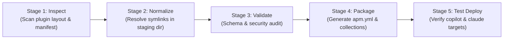

# APM Migration & Simplification Plan (Hardened Architecture)

## 1. Executive Summary & Strategy Shift

Following an adversarial architecture review (via OpenAI Codex CLI `architect-review`), this plan adopts a **Strangler Fig Pattern** instead of an immediate "flag-day" replacement:

1. **APM as an Export/Packaging Adapter First**: APM is introduced as a distribution and consumption adapter. Source-authoring structures remain protected.
2. **Build-Time Dereferencing (Preserve Source Semantics)**: Dereferencing symlinks and pointer files happens strictly inside a temporary, isolated staging/build workspace during packaging (`build/` or `apm pack`). **The authoring source tree is never mutated.**
3. **Dual-Track Deployment**:
   - **Local Reproducibility (Default)**: Project-level `apm.yml` and committed `apm.lock.yaml` ensure deterministic CI and local reproducibility.
   - **Global Workstation Convenience (Opt-in)**: Pinned global installs (`apm install <pkg>#vX.Y.Z --global --target copilot`) with explicit manual updates and rollback capability, avoiding silent background updates.
4. **Zero-Deprecation Pilot Gate**: Existing tools (`plugin-manager`, `uvx`, `symlink-manager`) remain authoritative until a representative pilot plugin demonstrates 100% empirical feature and runtime discovery parity across target harnesses.

---

## 2. Capability Matrix & Acceptance Verification Contract

Before deprecating any legacy code or marking tools obsolete, the migration must pass this executable verification gate:

| Capability Area | Verification Criteria | Test Method / Acceptance Gate | Status |
| :--- | :--- | :--- | :--- |
| **Packaging & Dereferencing** | Pointer files and symlinks are resolved into true files in `build/` without touching source files. | Automated SHA-256 hash check between canonical source and build artifact. | PENDING |
| **Copilot Target Mapping** | Primitives compile correctly to `.github/copilot-instructions.md` and `.github/instructions/*.instructions.md`. | Verified via VS Code / Copilot Chat discovery test on a sample repository. | PENDING |
| **Claude Target Mapping** | Primitives compile into `.claude/` without dropped subdirectories or broken relative paths. | Run Claude Code CLI against deployed test harness. | PENDING |
| **Lockfile Reproducibility** | `apm install --frozen` in clean CI environment reproduces exact file tree without network discrepancies. | GitHub Actions clean worktree test. | PENDING |
| **Collision & Ownership** | Installing two overlapping packages or updating an existing install does not duplicate entries or orphan files. | Test `apm install --update` and inspect `deployed_files` in `apm.lock.yaml`. | PENDING |
| **Rollback & Uninstall** | `apm uninstall <pkg>` completely scrubs deployed files without corrupting untracked project files. | Clean directory diff after uninstall. | PENDING |

---

## 3. Revised Component Lifecycle Matrix

| Component | Role in Current Repo | Role in APM Target State | Transition Strategy |
| :--- | :--- | :--- | :--- |
| **`plugins/plugin-manager`** | Installs, syncs, and prunes plugins via `uvx` / Python. | Maintained as fallback and legacy installer during transition. | Kept active. Deprecated only after APM passes all Phase 1 pilot gates. |
| **`symlink-manager` & `symlinks.json`** | Manages internal monorepo symlinks between plugin roots and skills. | Internal authoring utility only; completely invisible to external APM consumers. | Retained internally for source authoring. The APM packager handles dereferencing so consumers never see symlinks. |
| **`.agent/rules/plugin-architecture-policy.md`** | Rules governing modularity, resource placement, and symlinks. | Evolved to define packaging contracts, collection boundaries, and build dereferencing. | Sections 1–4, 6 remain invariants. Section 5 updated to clarify build-time vs source-time symlink boundaries. |
| **`convert-plugin-to-apm`** | Prototype migration script. | Modular packaging and export pipeline (`inspect → normalize → validate → package`). | Refactored into composable stages with automated tests. |

---

## 4. Pipeline Architecture: Composable Build & Export

To prevent `convert-plugin-to-apm` from becoming an unmaintainable monolith, the packaging pipeline is split into five discrete, testable stages:



1. **Stage 1: Inspect**: Reads `plugin.json` / `plugin.yaml`, checks directory structure, discovers skills, rules, agents, and hooks.
2. **Stage 2: Normalize**: Copies assets to an isolated build workspace (`build/staging/<plugin>/`) and dereferences pointers/symlinks into physical files with an audit manifest.
3. **Stage 3: Validate**: Checks against schema, validates frontmatter, ensures no broken relative links or unauthorized cross-plugin imports exist.
4. **Stage 4: Package**: Synthesizes the `apm.yml` manifest, declares target mappings (`copilot`, `claude`, `cursor`), and assigns package collections.
5. **Stage 5: Test Deploy**: Runs a dry-run test installation (`apm install --dry-run`) into temporary harness fixtures to confirm target layout.

---

## 5. Phased Implementation Roadmap

### Phase 1: Pilot Proof-of-Concept & Verification Harness
- **Selection**: Choose one clean, self-contained plugin as the pilot (e.g. `agent-scaffolders` or `dev-utils`).
- **Deliverables**:
  1. Build-time dereferencer script that outputs to `build/staging/` without mutating source files.
  2. Synthesize pilot `apm.yml`.
  3. Run test installations targeting `.github/` and `.claude/` in a test fixture repository.
  4. Complete the Capability Matrix evaluation.

### Phase 2: Decouple Hardcoded Instructions
- Systematically inventory and refactor hardcoded paths across [AGENTS.md](file:///c:/Users/RICHFREM/source/repos/agent-plugins-skills/AGENTS.md) and skills:
  - *Replace:* `"Look for skills in .agents/skills/<name>"`
  - *With:* `"Activate <name> from registered runtime skill locations (.agents/skills/, .github/instructions/, .claude/skills/, or global profile)"`
- Implement an automated lint check to prevent regressions.

### Phase 3: Setup Reusable Consumer Tooling (`setup-apm-consumer`)
- **Project-Level Scaffolder**:
  - A simple command to bootstrap a consuming repo's `apm.yml` pinned to tested releases.
- **Global Workstation Guide (Zero Per-Project Maintenance)**:
  - Document pinned global installation:
    ```powershell
    apm install richfrem/agent-plugins-skills#v1.0.0 --global --target copilot
    ```
  - Provide an explicit manual sync command (`apm-sync-global.ps1`) with rollback support, rejecting unmonitored silent auto-updates.

### Phase 4: Full Repository Packaging & Gradual Transition
- Package all plugins into top-level and collection manifests (`apm.yml`).
- Update [INSTALL.md](file:///c:/Users/RICHFREM/source/repos/agent-plugins-skills/INSTALL.md) with APM as the primary path and `uvx` as the legacy/fallback path.
- Keep `plugin-manager` active until external consumers have migrated.

---

## 6. Comprehensive Elimination of Hardcoded `.agents/` References

Over 400 lines across this repository (and dozens of consuming downstream repositories) contain hardcoded operational references to `.agents/` across markdown, Python code, rules, and configuration files.

When developers use **workstation-level global installations** (`apm install ... --global --target copilot`):
- Files reside centrally under `%USERPROFILE%\.apm\` and `%USERPROFILE%\.github` (or `.claude` / `.agents`).
- Downstream consumer repositories have **zero `.agents/` directory on disk**.
- Any file in any repo (source or consumer) that assumes `.agents/` exists will fail.

### Complete Scope of Files Requiring Decoupling

| File Type / Category | Current Rigid Pattern | APM / Workstation Target Pattern |
| :--- | :--- | :--- |
| **Markdown Instructions (`*.md`, `SKILL.md`)** | `python3 .agents/skills/<name>/scripts/<script>.py`<br>`Full standards → .agents/skills/<name>/SKILL.md` | `Activate the '<name>' skill or run scripts/<script>.py relative to the skill root`<br>`Full standards → Refer to '<name>' skill in your active harness or global profile` |
| **Python Scripts (`*.py`)** | `Path(__file__).parents[...] / ".agents" / "skills"`<br>`sys.path.append(".agents/skills/...")` | Use standard dynamic lookup: check skill-local directory first (`Path(__file__).parent`), then active harness (`.github/`, `.claude/`, `.agents/`), then `%USERPROFILE%` global fallback. |
| **Architecture & Rule Docs (`AGENTS.md`, `rules/*.md`)** | *"Skills run from .agents/skills/, never from plugins/"* | *"Skills run from your registered harness environment (.github/skills/, .claude/skills/, .agents/skills/, or global workstation profile)"* |
| **CI & Test Workflows (`.github/workflows/*.yml`)** | Steps checking `test -d .agents/skills` or invoking `.agents/...` | Update CI steps to use `apm install --frozen` and verify against target harness paths (`.github/` or `.agents/`). |

---

### The 3-Pillar Solution for This Repo and Consuming Repos:

#### 1. Runtime-Agnostic Instruction Standard
We establish a canonical, harness-agnostic way to cite skills across all instructions, prompts, and rules:
- **OLD (Rigid / Stale)**:
  `python3 .agents/skills/symlink-manager/scripts/symlink_manager.py diagnose`
- **NEW (Skill-Centric / Portable)**:
  `Activate the 'symlink-manager' skill or execute scripts/symlink_manager.py relative to the skill root`
- **NEW (Document / Convention Links)**:
  `Full standards → Refer to the 'coding-conventions-agent' skill in your active harness (.agents/skills/, .github/skills/, or global profile)`

#### 2. Automated Migration Script: `scripts/decouple_agent_paths.py`
We will build a dedicated, dry-run-capable CLI tool in `plugins/agent-scaffolders/` that can be executed both **in this repository** and **in external consuming repositories**:
```bash
# Preview changes across any repository
python decouple_agent_paths.py --path <repo-root> --dry-run

# Apply batch transformation to all .md, .py, .yaml, and config files
python decouple_agent_paths.py --path <repo-root> --apply
```
This script detects and transforms known patterns:
- `.agents/skills/<name>/SKILL.md` → `<name>` skill reference
- `.agents/skills/<name>/scripts/<script>` → portable skill script invocation
- Python path discovery → harness-aware resolver helper (`find_skill_resource()`)
- Hardcoded directory assertions → dynamic harness checks

#### 3. Backward-Compatibility Fallback (Harness Symlink / Alias Bridge)
In APM's `apm.yml`, we can configure multi-target compilation or an APM post-install hook to guarantee legacy links remain intact during the transition:
```yaml
# apm.yml
targets:
  - copilot   # Materializes into .github/
  - agents    # Materializes into .agents/ (ensures zero disruption for legacy instructions)
```
By mapping primitives into both `.github/` (for Copilot native context) and `.agents/` (or providing an alias bridge), older instructions in consuming repositories that still reference `.agents/` will **continue to work seamlessly without crashing**, giving consuming teams ample time to run the decoupling script.

---

## 7. Fleet-Wide Multi-Repo Migration Strategy

Consuming repositories in the developer workspace depend heavily on `.agents/` paths. A localized scan across representative sibling repositories reveals:

| Repository | Files Referencing `.agents/` | Occurrences | Role |
| :--- | :---: | :---: | :--- |
| **`jag-JUSTIN-Oracle-Forms-Analysis`** | 78 files | 865 occurrences | Oracle Forms backend analysis & pipelines |
| **`jag-legacy-oracle-plugins`** | 183 files | 544 occurrences | Oracle legacy plugins & skill spokes |
| **`CSB-intranet`** | 39 files | 242 occurrences | Web application & knowledge base |
| **`sharepoint-knowledge-workbench`** | 46 files | 163 occurrences | Knowledge workbench & ingestion |
| **`claude-design-bc-gov-design-system`** | 2 files | 15 occurrences | BC Gov UI Design System components & tokens |
| **`agent-plugins-skills` (Source)** | 222 files | 1,110 occurrences | Central authoring monorepo |
| **Fleet Total** | **570 files** | **2,939 occurrences** | Complete workspace ecosystem |

### Synchronized Fleet Execution ("All At Once" Approach)

To prevent split-brain states where some repos use global APM and others fail looking for local `.agents/`, we execute a coordinated sweep:

1. **Fleet Inventory Config (`fleet-repos.json`)**:
   Define the registry of consuming repositories to batch-process:
   ```json
   {
     "workspace_root": "c:/Users/RICHFREM/source/repos",
     "repos": [
       "agent-plugins-skills",
       "jag-JUSTIN-Oracle-Forms-Analysis",
       "jag-legacy-oracle-plugins",
       "CSB-intranet",
       "sharepoint-knowledge-workbench",
       "claude-design-bc-gov-design-system"
     ]
   }
   ```

2. **Orchestrated Batch Decoupling (`migrate_fleet_to_apm.py`)**:
   A single orchestrator script loops over all registered repos:
   - Creates a migration branch (`feat/decouple-agents-apm`) in each repo.
   - Runs `decouple_agent_paths.py --apply`.
   - Replaces local `plugin-manager` / `uvx` bootstrap files with consumer `apm.yml`.
   - Generates a git diff report and verification summary across the entire fleet.

3. **Single Global Workstation Activation**:
   Once the fleet is decoupled, the developer workstation activates APM globally:
   ```powershell
   apm install richfrem/agent-plugins-skills#stable --global --target copilot
   ```
   All 6 repositories instantly read the global capabilities with zero per-repo `.agents/` folders needed.

---

## 8. Modernization Matrix for APM Skills (`plugins/agent-scaffolders/`)

The existing APM skills under [`plugins/agent-scaffolders/`](plugins/agent-scaffolders/) provide the foundation but must be upgraded to support the hardened architecture, build-time dereferencing, and global target patterns:

| Skill | Current State / Purpose | Required Upgrades & Modernization |
| :--- | :--- | :--- |
| **[`convert-plugin-to-apm`](plugins/agent-scaffolders/skills/convert-plugin-to-apm/SKILL.md)** | Analyzes plugins and maps commands to prompts (`migrate_to_apm.py`). | 1. Implement 5-stage pipeline (`inspect → normalize → validate → package → test deploy`).<br>2. Add automated build-time dereferencer for Windows `.pointer` and relative symlink files into `build/staging/`.<br>3. Generate multi-target manifest (`apm.yml`) with curated collections. |
| **[`install-apm-package`](plugins/agent-scaffolders/skills/install-apm-package/SKILL.md)** | Guides deploying APM packages into `.agents/` or local target directories. | 1. Add first-class support for workstation global installs (`--global --target copilot` and `--target claude`).<br>2. Document Windows user paths (`%USERPROFILE%\.apm` and `%USERPROFILE%\.github`).<br>3. Remove outdated assumptions that skills must land in local `.agents/skills/`. |
| **[`create-apm-package`](plugins/agent-scaffolders/skills/create-apm-package/SKILL.md)** | Scaffolds greenfield `.apm/` packages. | 1. Update manifest templates to include `targets: [copilot, claude, agents]`.<br>2. Scaffold collection definitions by default.<br>3. Ensure newly created packages generate runtime-agnostic instructions (no hardcoded `.agents/` paths in generated `README.md` or `SKILL.md`). |
| **[`compile-apm-package`](plugins/agent-scaffolders/skills/compile-apm-package/SKILL.md)** | Compiles APM package primitives into top-level context docs (`AGENTS.md`, `CLAUDE.md`). | 1. Integrate with the runtime-agnostic instruction format.<br>2. Support compiling collection subsets into focused context documents.<br>3. Add verification check to confirm compiled fragments do not contain broken relative pointers or dead `.agents/` references. |
| **[`audit-plugin`](plugins/agent-scaffolders/skills/audit-plugin/SKILL.md)** | Audits Claude plugin structure and boundaries. | 1. Add APM readiness check: verify valid `apm.yml`, absence of unmanaged symlinks in package definitions, and collection schema validity. |

---

## 9. End-State Architecture: Retirement & Codebase Simplification

Following the gold-standard architecture observed in **[`bcgov/crow`](https://github.com/bcgov/crow)** (cloned at `temp/repos/crow/`), this migration culminates in a massive cleanup and elimination of legacy custom plumbing:

### 1. Complete Retirement of `plugins/plugin-manager`
Once the pilot and fleet validation passes, the entire `plugins/plugin-manager` plugin will be permanently decommissioned:
- **`plugin_add.py` / `bootstrap.py`**: Retired (superseded by native `apm install`).
- **`sync_with_inventory.py`**: Retired (superseded by `apm update` and lockfiles).
- **`prune_installed_skills.py`**: Retired (superseded by modular APM collections like Crow's `starter-package`).
- **`plugin_remove.py`**: Retired (superseded by `apm uninstall`).
- **`plugin-retention.json` / `skills-lock.json`**: Retired (superseded by `apm.lock.yaml`).

### 2. Rationalization of APM Skills (Temporary vs. Permanent)
Not all APM skills need to remain forever. We classify them by lifecycle role:

| Skill | Target Disposition | Rationale |
| :--- | :--- | :--- |
| **`convert-plugin-to-apm`** | **Sunset Post-Migration** | A temporary "one-and-done" migration tool. Once all 6 repositories have their native `apm.yml` and collection manifests committed, this tool is retired. In the future, capabilities are authored as APM-native from day one. |
| **`compile-apm-package`** | **Sunset / Consolidate** | `apm compile` is a native 1-word CLI primitive in APM. Wrapping native commands in custom skills introduces unnecessary maintenance overhead. |
| **`install-apm-package`** | **Sunset / Consolidate** | `apm install <pkg> --global --target copilot` is a standard shell command that requires no custom Python harness. |
| **`create-apm-package`** | **PERMANENT CORE SKILL** | The sole remaining APM authoring skill. Generates greenfield skills, agents, prompts, and collection manifests modeled directly on Crow best practices. |

### 3. Final Lean State
```text
Clean Monorepo (Crow-Style):
├── apm.yml (Root manifest with targets: [copilot, claude, cursor])
├── collections/ (Modular packages: starter, oracle, devops)
├── apm.lock.yaml (Cryptographic content-addressed lockfile)
└── plugins/agent-scaffolders/skills/create-apm-package (Lean authoring scaffold)
```
Thousands of lines of brittle Windows symlink, junction, and custom syncer logic are permanently eliminated.

---

## 10. The Symlink Unwinding Strategy (2,328 Git Symlinks) & Policy Refactoring

A deep inspection of the repository reveals **2,328 git-tracked symlinks (mode `120000`)** across plugins:
- `plugins/agent-scaffolders`: 1,106 symlinks
- `plugins/agent-agentic-os`: 507 symlinks
- `plugins/agent-memory`: 257 symlinks
- `plugins/dev-utils`: 128 symlinks
- `plugins/cli-agents`: 117 symlinks
- `plugins/exploration-cycle-plugin`: 65 symlinks
- `plugins/obsidian-wiki-engine`: 64 symlinks
- `plugins/agent-orchestration`: 48 symlinks
- `plugins/plugin-manager`: 18 symlinks
- `plugins/dependency-management`: 10 symlinks

### 1. Do We Have to Unwind All 2,328 Symlinks in the Source Tree Immediately?
**NO — and trying to do so by hand would create catastrophic git merge conflicts.**

Instead, we use a two-phase decoupling approach:
1. **Phase 1 (Packaging Decoupling via Build Dereferencer)**:
   - APM packages require zero symlinks because APM's security checks (`is_symlink()`) skip them.
   - Our build pipeline (`convert-plugin-to-apm`) resolves these 2,328 symlinks into physical hard copies **inside `build/staging/` at pack time**.
   - **Result**: Consumers receiving APM packages receive 100% clean, standalone files. Symlink issues never reach any developer workstation or consumer repo.
2. **Phase 2 (Monorepo Source Unwinding post-APM)**:
   - Once APM collections and dependencies are authoritative, internal monorepo symlinks between `plugins/<plugin>/scripts/` and `plugins/<plugin>/skills/<skill>/scripts/` can be safely converted into either:
     - Direct file copies (for truly independent skills), or
     - Shared APM module dependencies (e.g. Crow's dependency model).
   - Once unwound, `symlinks.json`, `symlink-manager`, and `bulk_symlink_fixer.py` are completely deleted.

### 2. Refactoring `plugin-architecture-policy.md` (in `.agent/rules/` and `plugins/agent-scaffolders/rules/`)
Both copies of `plugin-architecture-policy.md` must be updated to align with the APM end-state:

1. **Retain Sections 1–4 & 6 (The Invariants)**:
   - *Self-Contained Skills*: Still the #1 invariant. An installed/packaged skill must never depend on monorepo siblings.
   - *Resource Placement*: Purpose-based structure (`scripts/`, `references/`, `assets/`, `evals/`) is identical to APM conventions.
   - *Relative Execution*: Scripts must always execute relative to the skill root.
2. **Rewrite Section 5 ("Mandatory Symlink Workflow")**:
   - **Before**: Mandated using `symlink_manager.py` to create file-level symlinks and record them in `symlinks.json`.
   - **After (APM Standard)**: Deprecates source symlinks. Declares that shared resources are distributed via APM Package Collections or dereferenced build packages. Prohibits introducing new symlinks in newly scaffolded plugins.

### 3. The Core Paradigm Shift: From Filesystem Symlinks to Relative Path References

The biggest breakthrough in unwinding symlinks is understanding that **avoiding duplicate files does NOT require creating filesystem symlink objects**:

#### A. The Anti-Pattern (What We Had)
- A shared file existed at `plugins/agent-agentic-os/references/architecture/architecture.md`.
- Sibling skills (e.g. `os-control-init`) needed to cite it, so we created a physical filesystem symlink at `plugins/agent-agentic-os/skills/os-control-init/references/architecture.md`.
- **The failure**: On Windows without Developer Mode, Git checked out this symlink as a plain text file containing `../../../references/architecture/architecture.md` (48 bytes). APM security skipped it, and agents reading it saw broken text.

#### B. The APM / Crow Pattern (What We Are Moving To)
- `architecture.md` exists in **exactly one canonical location** (e.g. inside `skills/os-core/references/architecture.md` or `.apm/context/`).
- **No symlink file is created** inside `skills/os-control-init/references/`. That dummy file is deleted.
- Inside `skills/os-control-init/SKILL.md`, the author simply writes a natural relative markdown link:
  ```markdown
  Before initializing, review the core [Architecture Principles](../os-core/references/architecture.md).
  ```

#### C. Why This Completely Eliminates Symlink Bugs:
1. **Zero Duplicate Content in Git**: `architecture.md` is authored and maintained in exactly one place.
2. **Zero Filesystem Tricks**: No OS symlinks, no Windows junctions, no admin rights, no Developer Mode, and no `.pointer` files.
3. **Guaranteed Resolution via APM**: Because APM installs sibling skills side-by-side into the harness (e.g. `%USERPROFILE%\.github\skills\` or `.claude/skills/`), the relative path `../os-core/references/...` resolves naturally on disk on **every operating system** (Windows, macOS, Linux).

---

## 11. Granular Primitive Selection & Hook Architecture

### 1. Granular Selection (Cherry-Picking Specific Skills & Agents)
APM eliminates the need for interactive Python selection TUIs and retention manifests by providing declarative granularity natively:
- **Individual Skill Installation**:
  ```bash
  apm install richfrem/agent-plugins-skills/.apm/skills/os-memory-manager#stable --global --target copilot
  ```
- **Individual Agent Installation (`.agent.md`)**:
  ```bash
  apm install richfrem/agent-plugins-skills/.apm/agents/coding-conventions-agent.agent.md#stable --global --target copilot
  ```
- **Declarative `apm.yml` Dependency**: Downstream projects can specify exact subpaths under `dependencies.apm` to pull only the specific primitives they need, resulting in zero token bloat and byte-identical lockfile reproducibility.

### 2. Dual-Layer Hook Support
APM supports both tool-level execution hooks and package-lifecycle automation:
1. **Agent Runtime Hooks (`.apm/hooks/*.json`)**:
   - Captures tool events like `PreToolUse`, `PostToolUse`, `SessionStart`, and `Stop`.
   - When deployed (`apm install --target claude`), APM compiles and merges these definitions into the native harness hook registry (e.g. `.claude/hooks/hooks.json` or `.github/hooks/`).
2. **Package Lifecycle Hooks (`lifecycle:` block in `apm.yml`)**:
   - Enables `post-update` or `post-install` automated shell commands (e.g. running reference migration scripts).
   - Guarded by APM's `lifecycle validate` and `lifecycle trust` security commands to prevent arbitrary untrusted execution.
