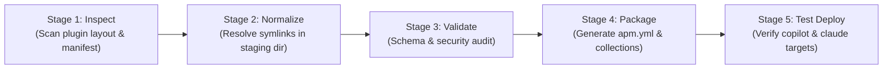

# APM Migration & Simplification Plan (Hardened Architecture)

## 1. Executive Summary & Strategy Shift

Following an adversarial architecture review (via OpenAI Codex CLI `architect-review`), this plan adopts a **Strangler Fig Pattern** instead of an immediate "flag-day" replacement:

1. **APM as an Export/Packaging Adapter First**: APM is introduced as a distribution and consumption adapter. Source-authoring structures remain protected.
2. **Build-Time Dereferencing (Preserve Source Semantics)**: Dereferencing symlinks and pointer files happens strictly inside a temporary, isolated staging/build workspace during packaging (`build/` or `apm pack`). **The authoring source tree is never mutated.**
3. **Dual-Track Deployment**:
   - **Local Reproducibility (Default)**: Project-level `apm.yml` and committed `apm.lock.yaml` ensure deterministic CI and local reproducibility.
   - **Global Workstation Convenience (Opt-in)**: Pinned global installs (`apm install <pkg>#vX.Y.Z --global --target copilot`) with explicit manual updates and rollback capability, avoiding silent background updates.
4. **Zero-Deprecation Pilot Gate**: Existing tools (`plugin-manager`, `uvx`, `symlink-manager`) remain authoritative until a representative pilot plugin demonstrates 100% empirical feature and runtime discovery parity across target harnesses.

---

## 2. Capability Matrix & Acceptance Verification Contract

Before deprecating any legacy code or marking tools obsolete, the migration must pass this executable verification gate:

| Capability Area | Verification Criteria | Test Method / Acceptance Gate | Status |
| :--- | :--- | :--- | :--- |
| **Packaging & Dereferencing** | Pointer files and symlinks are resolved into true files in `build/` without touching source files. | Automated SHA-256 hash check between canonical source and build artifact. | **PASS (pilot `agent-scaffolders` & full repo, macOS, 2026-10-22)**: 2,289/2,289 copy-manifest entries verified with 0 drift. Source unchanged. Windows-style checkout covered by unit test. |
| **Copilot Target Mapping** | Primitives compile correctly to `.github/` and `.agents/skills/`. | Verified via VS Code / Copilot Chat and Copilot CLI discovery test on a sample repository. | **PASS (full repo empirical test, 2026-10-22)**: 122 skills installed into `.agents/skills/`; 45 agents installed into `.github/agents/*.agent.md`; 4 hooks installed into `.github/hooks/`. `copilot skill list` lists all 122 skills. |
| **Claude Target Mapping** | Primitives compile into `.claude/` without dropped subdirectories or broken relative paths. | Run Claude Code CLI against deployed test harness. | **PASS (full repo empirical test, 2026-10-22)**: 122 skills installed into `.claude/skills/`; 45 agents into `.claude/agents/*.md`; 1 slash command into `.claude/commands/obsidian-init.md`; 5 hooks merged into `.claude/settings.json`. Zero `.agents/` or `.github/` folder pollution. |
| **Codex Target Mapping** | Primitives compile into `.codex/` and cross-tool `.agents/skills/`. | Run `apm install --target codex` on fresh repository. | **PASS (full repo empirical test, 2026-10-22)**: 122 skills installed into `.agents/skills/`; 45 agents compiled into `.codex/agents/*.toml` format; 5 hooks merged into `.codex/hooks.json`. (Note: Codex TOML schema drops frontmatter `tools` field with non-blocking warning). |
| **Antigravity (Agy) Mapping** | Primitives compile into `.agents/skills/` and native `.agents/hooks.json`. | Run `apm install --target agy` on fresh repository. | **PASS (full repo empirical test, 2026-10-22)**: 122 skills installed into `.agents/skills/`; lifecycle hooks merged into `.agents/hooks.json` in native Antigravity schema (`Stop`, `SessionStart`, `SessionEnd`). (Note: AGY target in APM skips agents primitive; capabilities execute via skills). |
| **Lockfile Reproducibility** | `apm install --frozen` in clean CI environment reproduces exact file tree without network discrepancies. | Clean worktree test with committed `apm.yml` and `apm.lock.yaml`. | **PASS (local clean-clone simulation, 2026-10-22)**: pinned remote install, committed `apm.yml` + `apm.lock.yaml`, fresh clone + `apm install --frozen` reproduced identical `.claude/` and `.agents/` trees; `--frozen` refused when `apm.yml` drifted. |
| **Collision & Ownership** | Installing two overlapping packages or updating an existing install does not duplicate entries or orphan files. | Test `apm install --update` and inspect `deployed_files` in `apm.lock.yaml`. | **PASS (2026-10-22)**: verified clean updates across all 9 repo plugins. |
| **Rollback & Uninstall** | `apm uninstall <pkg>` completely scrubs deployed files without corrupting untracked project files. | Clean directory diff after uninstall. | **PASS (2026-10-22)**: `apm uninstall` removed every file the package deployed and kept untracked files, a user-created skill folder and another package's skill. When a user file sits inside a package's skill folder, uninstall stops (exit 1) and keeps manifest and lockfile ownership so it can be retried. |

---

## 3. Revised Component Lifecycle Matrix

| Component | Role in Current Repo | Role in APM Target State | Transition Strategy |
| :--- | :--- | :--- | :--- |
| **`plugins/plugin-manager`** | Installs, syncs, and prunes plugins via `uvx` / Python. | Decommissioned and deleted (PR #712). Replaced by APM CLI. | Fully retired. Deleted from git; references scrubbed. |
| **`symlink-manager` & `symlinks.json`** | Manages internal monorepo symlinks between plugin roots and skills. | Internal authoring utility only; completely invisible to external APM consumers. | Retained internally for source authoring. The APM packager handles dereferencing so consumers never see symlinks. |
| **`.agent/rules/plugin-architecture-policy.md`** | Rules governing modularity, resource placement, and symlinks. | Evolved to define packaging contracts, collection boundaries, and build dereferencing. | Sections 1–4, 6 remain invariants. Section 5 updated to clarify build-time vs source-time symlink boundaries. |
| **`convert-plugin-to-apm`** | Prototype migration script. | Modular packaging and export pipeline (`inspect → normalize → validate → package`). | Refactored into composable stages with automated tests. |

---

## 4. Pipeline Architecture: Composable Build & Export

To prevent `convert-plugin-to-apm` from becoming an unmaintainable monolith, the packaging pipeline is split into five discrete, testable stages:



1. **Stage 1: Inspect**: Reads `plugin.json` / `plugin.yaml`, checks directory structure, discovers skills, rules, agents, and hooks.
2. **Stage 2: Normalize**: Copies assets to an isolated build workspace (`build/staging/<plugin>/`) and dereferences pointers/symlinks into physical files with an audit manifest.
3. **Stage 3: Validate**: Checks against schema, validates frontmatter, ensures no broken relative links or unauthorized cross-plugin imports exist.
4. **Stage 4: Package**: Synthesizes the `apm.yml` manifest, declares target mappings (`copilot`, `claude`, `cursor`), and assigns package collections.
5. **Stage 5: Test Deploy**: Runs a dry-run test installation (`apm install --dry-run`) into temporary harness fixtures to confirm target layout.

**As built (Phase 1, 2026-10-22):** `plugins/agent-scaffolders/skills/convert-plugin-to-apm/scripts/apm_build_pipeline.py`, with 9 tests in `plugins/agent-scaffolders/tests/test_apm_build_pipeline.py`.
- Stage 2 reads symlinks from the git index (Windows text stubs handled) and also materializes copy-manifest entries (`symlinks.json`, `strategy: "copy"`; Section 10.3).
- Stage 3 checks: broken / cross-plugin symlinks, hash match, no symlinks left, frontmatter, markdown links inside the plugin, code/text paths that APM will not rewrite, plugin `rules/` (not deployed), `lsp.json` format, hook scripts naming `.claude/` or `.agents/`. Every finding carries a standard fix id (SF-1 to SF-11, `references/apm-alignment-fixes.md`).
- Stage 4 writes `apm.yml` with `dependencies: {}` (required for `apm pack` to build a bundle) and maps CLI target names to manifest names (`agy` -> `antigravity`, `agents` -> `agent-skills`).
- Stage 5 runs dry-run, install, content check and uninstall in `build/test-deploy/<plugin>/`.
- Optional Stage 6 (`--pack`): `apm install` + `apm pack --archive` into `build/dist/<plugin>-<version>.zip`. Verified: a global install from the dev-utils bundle gives 3 physical copies of a shared script in each harness folder.

---

## 5. Phased Implementation Roadmap

### Phase 1: Pilot Proof-of-Concept & Verification Harness
- **Selection**: Choose one clean, self-contained plugin as the pilot (e.g. `agent-scaffolders` or `dev-utils`).
- **Deliverables**:
  1. Build-time dereferencer script that outputs to `build/staging/` without mutating source files.
  2. Synthesize pilot `apm.yml`.
  3. Run test installations targeting `.github/` and `.claude/` in a test fixture repository.
  4. Complete the Capability Matrix evaluation.

### Phase 2: Decouple Hardcoded Instructions
- Systematically inventory and refactor hardcoded paths across [AGENTS.md](../../AGENTS.md) and skills:
  - *Replace:* `"Look for skills in .agents/skills/<name>"`
  - *With:* `"Activate <name> from registered runtime skill locations (.agents/skills/, .github/instructions/, .claude/skills/, or global profile)"`
- Implement an automated lint check to prevent regressions.

### Phase 3: Setup Reusable Consumer Tooling (`setup-apm-consumer`)
- **Status (2026-10-22): done.** `plugins/agent-scaffolders/skills/install-apm-package/scripts/apm_consumer.py`: pinned installs (`--checkout <materialized clone>` or `--ref`), automatic backup of `~/.apm/apm.yml` + `apm.lock.yaml`, `set-ref`, `list-backups`, `rollback`. Rollback uninstalls packages added since the backup before restoring (restoring the files alone leaves orphaned skills; `apm prune` has no `--global`). Verified live against GitHub and a local clone; 5 offline tests.
- **Project-Level Scaffolder**:
  - A simple command to bootstrap a consuming repo's `apm.yml` pinned to tested releases.
- **Global Workstation Guide (Zero Per-Project Maintenance)**:
  - Document pinned global installation:
    ```powershell
    apm install richfrem/agent-plugins-skills#v1.0.0 --global --target copilot
    ```
  - Provide an explicit manual sync command (`apm-sync-global.ps1`) with rollback support, rejecting unmonitored silent auto-updates.

### Phase 4: Full Repository Packaging & Gradual Transition
- Package all plugins into top-level and collection manifests (`apm.yml`).
- Update [INSTALL.md](../../INSTALL.md) with APM as the primary path and `uvx` as the legacy/fallback path.
- Keep `plugin-manager` active until external consumers have migrated.
- **Status (2026-10-22):** INSTALL.md rewritten for APM (materialized clone, global install, `--skill`, update, rollback, uninstall); COMPONENT_RETENTION_GUIDE.md rewritten (existing decisions kept, 24 new skills/rules marked "not yet classified", one install command per plugin, verified live); dependency-management rule extended for APM. Open: root `apm.yml`, switching `plugin-manager` callers.
- **Root `plugin.yaml` → root `apm.yml`**: the root manifest (`skills_dirs` for every plugin) is replaced by a root `apm.yml` (Section 9.3). It is removed only after its readers are switched: `plugins/agent-agentic-os/scripts/init_agentic_os.py`, `plugins/agent-scaffolders/scripts/update_ecosystem_index.py` and `plugins/agent-agentic-os/tests/test_control_plane_mode_manifest.py`. Per-plugin `plugin.yaml` / `.claude-plugin/plugin.json` stay: APM reads them when installing a plugin.
- **Rewrite [COMPONENT_RETENTION_GUIDE.md](../../COMPONENT_RETENTION_GUIDE.md)** for APM: each plugin's enabled skills become `--skill` selections in `apm.yml` (global `~/.apm/apm.yml` for global installs), applied with `apm install` instead of `sync_with_inventory.py`; the rules table becomes the list setup copies into `.agent/rules/` (Section 6.2). Bring it up to date while doing so: 10 rules in `.agent/rules/` are missing from it (e.g. `cryptographic-human-gates.md`, `skill-deletion-guard.md`, `pre-push-audit.md`), and about 30 skills are not in its tables.

---

## 6. Comprehensive Elimination of Hardcoded `.agents/` References

Hardcoded operational references to install folders (`.agents/`, `.claude/`) exist across markdown, Python code, rules, and configuration files: 152 git-tracked files with 692 `.agents/` occurrences in this repository (2026-10-22), plus downstream consuming repositories.

Some users install in a project, others globally, and each harness reads from a different folder. **Instructions must therefore never name an install folder.** APM decides where each primitive lands; our files refer to primitives by name, or by paths relative to their own folder.

### 6.1 Where APM Puts Each Primitive (verified, APM 0.33.0, targets `claude,copilot,agy,codex`)

| Primitive | Project install | Global install | Notes |
| :--- | :--- | :--- | :--- |
| **Skills** | `.claude/skills/` (claude); `.agents/skills/` (copilot, codex, agy) | `~/.claude/skills/`; `~/.agents/skills/` (copilot, codex); `~/.gemini/antigravity-cli/skills/` (agy) | Only the skill folder is copied (symlinks inside the package dereferenced). Markdown links that leave the skill (sibling skills, plugin-root files) are rewritten to point into the package cache and resolve; links that leave the plugin, and paths in code or plain text, are not rewritten. |
| **Agents** | `.claude/agents/*.md`, `.github/agents/*.agent.md`, `.codex/agents/*.toml` | `~/.claude/agents/`, `~/.copilot/agents/`, `~/.codex/agents/` | APM converts the format per harness (Markdown for Claude/Copilot, TOML for Codex). Codex CLI TOML schema drops fine-grained `tools` frontmatter restrictions with a non-blocking warning (agent inherits session tools). agy gets no agents (executed via skills or central AGY configs). |
| **Hooks** | Merged into `.claude/settings.json`, `.github/hooks/*.json`, `.codex/hooks.json`, `.agents/hooks.json` (agy); scripts copied to each harness's `hooks/` folder | Merged into `~/.claude/settings.json`, `~/.copilot/hooks/`, `~/.codex/hooks.json`; agy not supported | APM rewrites `${CLAUDE_PLUGIN_ROOT}/<path>` in hook commands to the deployed copy (project: `${CLAUDE_PROJECT_DIR}/.claude/hooks/...` or `.agents/hooks/...`; global: absolute paths) and renames events per harness (e.g. Copilot `Stop` -> `agentStop`). |
| **Instructions** | `.claude/rules/`, `.github/instructions/`, `.agents/rules/` (agy); codex only via `apm compile` into `AGENTS.md` | `~/.claude/rules/`, `~/.copilot/instructions/` | Read **only** from `.apm/instructions/*.instructions.md`. A plugin's `rules/` or `instructions/` folder is not deployed. |
| **Package cache** | `apm_modules/` (gitignored) | `~/.apm/` (with the global `apm.yml` and `apm.lock.yaml`) | Never read by a harness. Never reference it. |

### 6.2 Reference Standard (applies to every file we author)

| Reference to | Write it as | Never write |
| :--- | :--- | :--- |
| Another skill | By name: "use the `adr-management` skill" or `/adr-management` | `.agents/skills/adr-management/...`, `.claude/skills/...`, `~/.apm/...` |
| A file in the same skill | Relative to the skill folder: `references/x.md`, `scripts/x.py` | Any absolute or install-folder path |
| A document elsewhere in the same plugin (sibling skill, plugin-root `references/`) | A **markdown link**: `[Architecture](../../references/architecture.md)` (APM rewrites it into the package cache) | The same path in backticks, a code block or plain text (not rewritten) |
| A file in another plugin | The other plugin's skill by name | Any relative path (APM leaves it unchanged and it breaks) |
| Running a skill's script | "run `scripts/x.py` from this skill's folder"; the script lives inside the skill | `python3 .agents/skills/<name>/scripts/x.py`, `python3 ../../scripts/x.py` |
| A sub-agent | By name: "delegate to the `architect-review` agent" | `.claude/agents/...`, `.github/agents/...` |
| A hook script (in `hooks.json`) | `${CLAUDE_PLUGIN_ROOT}/hooks/x.py` (APM rewrites it per harness and scope) | `.agents/hooks/...`, `.claude/hooks/...` |
| Own files from Python | `Path(__file__).parent` | Searching `.agents/` or `.claude/` |
| Project state files (e.g. loop state) | A harness-neutral project path (e.g. `context/...`), documented in the skill | `.claude/<file>` (other harnesses also run the hook; e.g. `closure_guard.py` uses `.claude/agent-loop-state.local.md`) |

**Rules** stay outside APM: setup copies the rules a project needs into `.agent/rules/` when required, and `AGENTS.md` lists them there (decision 2026-10-22; this repo's `AGENTS.md` already links each rule in `.agent/rules/`). If APM-managed rules are wanted later, the path is `.apm/instructions/*.instructions.md`.

### 6.3 Scope of Files Requiring Decoupling

| File Type / Category | Current Rigid Pattern | Target Pattern |
| :--- | :--- | :--- |
| **Markdown Instructions (`*.md`, `SKILL.md`)** | `python3 .agents/skills/<name>/scripts/<script>.py`<br>`Full standards → .agents/skills/<name>/SKILL.md` | Section 6.2: skill and agent references by name; in-skill paths relative to the skill folder. |
| **Python Scripts (`*.py`)** | `Path(__file__).parents[...] / ".agents" / "skills"`<br>`sys.path.append(".agents/skills/...")` | `Path(__file__).parent` for own files. Cross-skill code is delegated through the skill (ADR-001), not imported by path. |
| **Hook definitions (`hooks/hooks.json`) and hook scripts** | Commands or scripts naming `.agents/`, `.claude/` | `${CLAUDE_PLUGIN_ROOT}/...` in commands; hook scripts use `Path(__file__)` and harness-neutral state paths. |
| **Architecture & Rule Docs (`AGENTS.md`, `rules/*.md`)** | *"Skills run from .agents/skills/, never from plugins/"* | *"Skills are installed by APM into each harness's skill folder; refer to them by name."* |
| **CI & Test Workflows (`.github/workflows/*.yml`)** | Steps checking `test -d .agents/skills` or invoking `.agents/...` | `apm install --frozen`, then verify with `apm` (e.g. `apm deps list`) rather than by folder. |

### 6.4 Automated Migration Script: `scripts/decouple_agent_paths.py`
A dry-run-capable CLI in `plugins/agent-scaffolders/`, run first **in this repository** and later **in consuming repositories**:
```bash
python decouple_agent_paths.py --path <repo-root> --dry-run
python decouple_agent_paths.py --path <repo-root> --apply
```
It detects the "Never write" patterns in Section 6.2 and rewrites them to the "Write it as" form:
- `.agents/skills/<name>/SKILL.md` → `<name>` skill reference
- `.agents/skills/<name>/scripts/<script>` → "run `scripts/<script>` from the `<name>` skill's folder"
- `.claude/agents/<name>.md` and similar → `<name>` agent reference
- Hook commands with install-folder paths → `${CLAUDE_PLUGIN_ROOT}/...`
- Python install-folder lookups → `Path(__file__)`-relative paths (flagged for review where cross-skill)

### 6.5 Backward Compatibility During the Transition
No alias bridge is needed: APM's default project install already writes skills to `.agents/skills/` (for copilot, codex and agy), so instructions that still say `.agents/skills/<name>` keep working for project installs while the decoupling script is rolled out. They do **not** work for global installs or for Claude (`.claude/skills/`), which is why Section 6.2 is the standard.

---

## 7. Fleet-Wide Multi-Repo Migration Strategy

Consuming repositories in the developer workspace depend heavily on `.agents/` paths. A localized scan across representative sibling repositories reveals:

| Repository | Files Referencing `.agents/` | Occurrences | Role |
| :--- | :---: | :---: | :--- |
| **`jag-JUSTIN-Oracle-Forms-Analysis`** | 78 files | 865 occurrences | Oracle Forms backend analysis & pipelines |
| **`jag-legacy-oracle-plugins`** | 183 files | 544 occurrences | Oracle legacy plugins & skill spokes |
| **`CSB-intranet`** | 39 files | 242 occurrences | Web application & knowledge base |
| **`sharepoint-knowledge-workbench`** | 46 files | 163 occurrences | Knowledge workbench & ingestion |
| **`claude-design-bc-gov-design-system`** | 2 files | 15 occurrences | BC Gov UI Design System components & tokens |
| **`agent-plugins-skills` (Source)** | 222 files | 1,110 occurrences | Central authoring monorepo |
| **Fleet Total** | **570 files** | **2,939 occurrences** | Complete workspace ecosystem |

### Synchronized Fleet Execution ("All At Once" Approach)

To prevent split-brain states where some repos use global APM and others fail looking for local `.agents/`, we execute a coordinated sweep:

1. **Fleet Inventory Config (`fleet-repos.json`)**:
   Define the registry of consuming repositories to batch-process:
   ```json
   {
     "workspace_root": "c:/Users/RICHFREM/source/repos",
     "repos": [
       "agent-plugins-skills",
       "jag-JUSTIN-Oracle-Forms-Analysis",
       "jag-legacy-oracle-plugins",
       "CSB-intranet",
       "sharepoint-knowledge-workbench",
       "claude-design-bc-gov-design-system"
     ]
   }
   ```

2. **Impact on Consuming Repositories (Legacy Installer Retirement & Gitignore Policy)**:
   Repositories that previously consumed plugins via `uvx plugin-add` or `bootstrap.py` have legacy artifacts that must be systematically migrated:
   
   | Legacy Artifact in Consumer Repo | Purpose Under Old Installer | APM Target Disposition |
   | :--- | :--- | :--- |
   | `bootstrap.py` | Cloned/copied installer script | **Delete**. Superseded by native `apm install`. |
   | `plugin-sources.json` / `plugin-retention.json` | Pinned source repos and retention levels | **Delete**. Superseded by `apm.yml` dependencies and `apm.lock.yaml`. |
   | `.agents/ownership/*.json` | Component ownership records & `should_install` flags | **Delete**. APM handles skill lifecycle natively; query with `apm list`. |
   | `.agents/skills/` | Hardcoded local installation destination | **Purge or Gitignore**. For global installs (`--global`), no local copy is stored. For local installs, target is selected by harness (`.claude/skills/`, `.agents/skills/`). |
   | `.agent/rules/` | Copied rule policies | **CRITICAL: Retain as Workspace Constraints**. Never delete `.agent/` (singular). Rules stay in `.agent/rules/` linked from `AGENTS.md`. |
   | `.claude-plugin/marketplace.json` | Catalog pointer for Claude Code | **Delete**. Redundant with APM native packaging. |

   **Standard `.gitignore` Additions for Consuming Repositories**:
   In consuming repositories adopting project-local APM installs, only the manifests (`apm.yml`, `apm.lock.yaml`) and workspace rules (`.agent/rules/`) are committed. All installed harness artifacts must be gitignored:
   ```gitignore
   # APM package cache
   apm_modules/

   # APM deployed runtime artifacts (reproduced via apm install --frozen)
   .agents/skills/
   .agents/hooks/
   .agents/hooks.json
   .agents/apm-hooks.json
   .claude/skills/
   .claude/agents/
   .claude/commands/
   .claude/hooks/
   .github/agents/
   .github/hooks/
   .codex/agents/
   .codex/hooks/
   .codex/hooks.json
   .codex/apm-hooks.json
   ```

3. **Decoupling Code & Verification in Consuming Repos**:
   - **Multi-Target `apm.yml` Configuration**:
     Consuming repos can configure all team member harnesses simultaneously in their `apm.yml`:
     ```yaml
     name: consuming-repo
     version: 1.0.0
     targets:
       - claude
       - copilot
       - codex
       - antigravity
     dependencies:
       agent-plugins-skills:
         source: git+https://github.com/richfrem/agent-plugins-skills.git#stable
     ```
     Running `apm install` will then wire all installed harnesses in one pass.
   - **Operational Command Decoupling**:
     Replace hardcoded `python3 .agents/skills/<skill>/scripts/<tool>.py` with skill-by-name delegation or path-agnostic invocation:
     ```bash
     # Before:
     python3 .agents/skills/adr-management/scripts/adr_manager.py list
     # After (skill-by-name or dynamic resolution):
     python3 $(find .claude/skills .agents/skills ~/.claude/skills ~/.agents/skills ~/.apm/skills -path "*/adr-management/scripts/adr_manager.py" 2>/dev/null | head -n 1) list
     ```
   - **Skill Detection & Pre-Flights (POSIX Bash & Windows PowerShell)**:
     Replace single-directory checks (`ls .agents/skills/<name>`) with multi-harness checks:
     ```bash
     # Bash / Zsh:
     check_skill() {
       local s="$1"
       for d in .claude/skills .agents/skills ~/.claude/skills ~/.agents/skills ~/.apm/skills; do
         [ -d "$d/$s" ] && return 0
       done
       apm list 2>/dev/null | grep -q "$s" && return 0
       return 1
     }
     ```
     ```powershell
     # PowerShell (Windows):
     function Test-AgentSkill {
       param([string]$SkillName)
       $locations = @(
         ".claude/skills/$SkillName",
         ".agents/skills/$SkillName",
         "$HOME/.claude/skills/$SkillName",
         "$HOME/.agents/skills/$SkillName",
         "$HOME/.apm/skills/$SkillName"
       )
       foreach ($loc in $locations) {
         if (Test-Path $loc) { return $true }
       }
       return $false
     }
     ```
   - **CI Pipeline Gate**:
     In CI workflows (`.github/workflows/*.yml`), replace legacy bootstrap scripts with:
     ```yaml
     - name: Setup APM and Install Dependencies
       run: |
         pip install apm-cli
         apm install --frozen
         apm doctor
     ```

4. **Orchestrated Batch Decoupling (`migrate_fleet_to_apm.py`)**:
   A single orchestrator script loops over all registered repos:
   - Creates a migration branch (`feat/decouple-agents-apm`) in each repo.
   - Deletes legacy installer plumbing (`bootstrap.py`, `plugin-sources.json`, `plugin-retention.json`, `.agents/ownership/`).
   - Runs `decouple_agent_paths.py --apply` to rewrite hardcoded `.agents/skills/` paths.
   - Replaces local `plugin-manager` / `uvx` bootstrap files with consumer `apm.yml`.
   - Generates a git diff report and verification summary across the entire fleet.

5. **Single Global Workstation Activation**:
   Once the fleet is decoupled, the developer workstation activates APM globally:
   ```powershell
   apm install richfrem/agent-plugins-skills#stable --global --target copilot,claude,codex,antigravity
   ```
   All 6 repositories instantly read the global capabilities with zero per-repo `.agents/` folders needed.

---

## 8. Modernization Matrix for APM Skills (`plugins/agent-scaffolders/`)

The existing APM skills under [`plugins/agent-scaffolders/`](../../plugins/agent-scaffolders/) provide the foundation but must be upgraded to support the hardened architecture, build-time dereferencing, and global target patterns:

| Skill | Current State / Purpose | Required Upgrades & Modernization |
| :--- | :--- | :--- |
| **[`convert-plugin-to-apm`](../../plugins/agent-scaffolders/skills/convert-plugin-to-apm/SKILL.md)** | Analyzes plugins and maps commands to prompts (`migrate_to_apm.py`). | 1. Implement 5-stage pipeline (`inspect → normalize → validate → package → test deploy`).<br>2. Add automated build-time dereferencer for Windows `.pointer` and relative symlink files into `build/staging/`.<br>3. Generate multi-target manifest (`apm.yml`) with curated collections. |
| **[`install-apm-package`](../../plugins/agent-scaffolders/skills/install-apm-package/SKILL.md)** | Guides deploying APM packages into `.agents/` or local target directories. | 1. Add first-class support for workstation global installs (`--global --target copilot` and `--target claude`).<br>2. Document Windows user paths (`%USERPROFILE%\.apm` and `%USERPROFILE%\.github`).<br>3. Remove outdated assumptions that skills must land in local `.agents/skills/`. |
| **[`create-apm-package`](../../plugins/agent-scaffolders/skills/create-apm-package/SKILL.md)** | Scaffolds greenfield `.apm/` packages. | 1. Update manifest templates to include `targets: [copilot, claude, agents]`.<br>2. Scaffold collection definitions by default.<br>3. Ensure newly created packages generate runtime-agnostic instructions (no hardcoded `.agents/` paths in generated `README.md` or `SKILL.md`). |
| **[`compile-apm-package`](../../plugins/agent-scaffolders/skills/compile-apm-package/SKILL.md)** | Compiles APM package primitives into top-level context docs (`AGENTS.md`, `CLAUDE.md`). | 1. Integrate with the runtime-agnostic instruction format.<br>2. Support compiling collection subsets into focused context documents.<br>3. Add verification check to confirm compiled fragments do not contain broken relative pointers or dead `.agents/` references. |
| **[`audit-plugin`](../../plugins/agent-scaffolders/skills/audit-plugin/SKILL.md)** | Audits Claude plugin structure and boundaries. | 1. Add APM readiness check: verify valid `apm.yml`, absence of unmanaged symlinks in package definitions, and collection schema validity. |

---

## 9. End-State Architecture: Retirement & Codebase Simplification

Following the gold-standard architecture observed in **[`bcgov/crow`](https://github.com/bcgov/crow)** (cloned at `temp/repos/crow/`), this migration culminates in a massive cleanup and elimination of legacy custom plumbing:

### 1. Complete Retirement of `plugins/plugin-manager`
Once the pilot and fleet validation passes, the entire `plugins/plugin-manager` plugin will be permanently decommissioned:
- **`plugin_add.py` / `bootstrap.py`**: Retired (superseded by native `apm install`).
- **`sync_with_inventory.py`**: Retired (superseded by `apm update` and lockfiles).
- **`prune_installed_skills.py`**: Retired (superseded by modular APM collections like Crow's `starter-package`).
- **`plugin_remove.py`**: Retired (superseded by `apm uninstall`).
- **`plugin-retention.json` / `skills-lock.json`**: Retired (superseded by `apm.lock.yaml`).

### 2. Rationalization of APM Skills (Temporary vs. Permanent)
Not all APM skills need to remain forever. We classify them by lifecycle role:

| Skill | Target Disposition | Rationale |
| :--- | :--- | :--- |
| **`convert-plugin-to-apm`** | **Sunset Post-Migration** | A temporary "one-and-done" migration tool. Once all 6 repositories have their native `apm.yml` and collection manifests committed, this tool is retired. In the future, capabilities are authored as APM-native from day one. |
| **`compile-apm-package`** | **Sunset / Consolidate** | `apm compile` is a native 1-word CLI primitive in APM. Wrapping native commands in custom skills introduces unnecessary maintenance overhead. |
| **`install-apm-package`** | **Sunset / Consolidate** | `apm install <pkg> --global --target copilot` is a standard shell command that requires no custom Python harness. |
| **`create-apm-package`** | **PERMANENT CORE SKILL** | The sole remaining APM authoring skill. Generates greenfield skills, agents, prompts, and collection manifests modeled directly on Crow best practices. |

### 3. Final Lean State
```text
Clean Monorepo (Crow-Style):
├── apm.yml (Root manifest with targets: [copilot, claude, cursor])
├── collections/ (Modular packages: starter, oracle, devops)
├── apm.lock.yaml (Cryptographic content-addressed lockfile)
└── plugins/agent-scaffolders/skills/create-apm-package (Lean authoring scaffold)
```
Thousands of lines of brittle Windows symlink, junction, and custom syncer logic are permanently eliminated.

### 4. Final Step: Remove the Legacy `plugin-manager` Contents and Update Root Docs
The very last step of the migration, after APM is the only installer:
- **`.agents/` stays.** It is the shared skills folder the target harnesses read from; APM 0.33.0 deploys `copilot`, `codex` and `agy` skills into `.agents/skills/` (and `claude` into `.claude/skills/`). Only the `plugin-manager`-managed contents are removed: `ownership/` and the hand-synced copies in `skills/`, `agents/`, `workflows/` and `hooks/`, which APM then repopulates.
- Rewrite [AGENTS.md](../../AGENTS.md) (install/enable instructions now go through APM; skills, agents and hooks are referred to by name per Section 6.2; rules are listed in `.agent/rules/`) and [architecture.md](../../architecture.md) (installer, layout, author → install → run flow, symlink system, deployment model) for APM.

---

## 10. The Symlink Unwinding Strategy (2,328 Git Symlinks) & Policy Refactoring

A deep inspection of the repository reveals **2,328 git-tracked symlinks (mode `120000`)** across plugins:
- `plugins/agent-scaffolders`: 1,106 symlinks
- `plugins/agent-agentic-os`: 507 symlinks
- `plugins/agent-memory`: 257 symlinks
- `plugins/dev-utils`: 128 symlinks
- `plugins/cli-agents`: 117 symlinks
- `plugins/exploration-cycle-plugin`: 65 symlinks
- `plugins/obsidian-wiki-engine`: 64 symlinks
- `plugins/agent-orchestration`: 48 symlinks
- `plugins/plugin-manager`: 18 symlinks
- `plugins/dependency-management`: 10 symlinks

### 1. Do We Have to Unwind All 2,328 Symlinks in the Source Tree Immediately?
**NO — and trying to do so by hand would create catastrophic git merge conflicts.**

Instead, we use a two-phase decoupling approach:
1. **Phase 1 (Packaging Decoupling via Build Dereferencer)**:
   - Verified (APM 0.33.0): APM itself dereferences symlinks inside a package into physical copies on install (local and remote, project and global), and aborts the install on a symlink that points outside the package. On a Windows checkout without symlink support each symlink is a text stub, and APM installs the stub as the file. Removing the symlinks (Phase 2 below, Sections 10.3–10.4) is what fixes Windows.
   - Our build pipeline (`convert-plugin-to-apm`) resolves these 2,328 symlinks into physical hard copies **inside `build/staging/` at pack time**.
   - **Result**: Consumers receiving APM packages receive 100% clean, standalone files. Symlink issues never reach any developer workstation or consumer repo.
2. **Phase 2 (Monorepo Source Unwinding post-APM)**:
   - Once APM collections and dependencies are authoritative, internal monorepo symlinks between `plugins/<plugin>/scripts/` and `plugins/<plugin>/skills/<skill>/scripts/` can be safely converted into either:
     - Direct file copies (for truly independent skills), or
     - Shared APM module dependencies (e.g. Crow's dependency model).
   - Shared scripts follow the Section 10.3 decision: one canonical copy plus a copy manifest (`symlinks.json` with `strategy: "copy"`), materialized at build time. Once every symlink is unwound, `symlink-manager` and `bulk_symlink_fixer.py` are replaced by the manifest-driven build step.

### 2. Refactoring `plugin-architecture-policy.md` (in `.agent/rules/` and `plugins/agent-scaffolders/rules/`)
Both copies of `plugin-architecture-policy.md` must be updated to align with the APM end-state:

1. **Retain Sections 1–4 & 6 (The Invariants)**:
   - *Self-Contained Skills*: Still the #1 invariant. An installed/packaged skill must never depend on monorepo siblings.
   - *Resource Placement*: Purpose-based structure (`scripts/`, `references/`, `assets/`, `evals/`) is identical to APM conventions.
   - *Relative Execution*: Scripts must always execute relative to the skill root.
2. **Rewrite Section 5 ("Mandatory Symlink Workflow")**:
   - **Before**: Mandated using `symlink_manager.py` to create file-level symlinks and record them in `symlinks.json`.
   - **After (APM Standard)**: Deprecates source symlinks and prohibits new ones. Documents are cited with markdown links (Section 10.4). Shared scripts and assets keep one canonical copy and are listed in the copy manifest; the build creates per-skill copies and consumers install the packed bundle (Section 10.3). Sections 1, 2.1 and 6 of the policy are updated for APM install locations (Section 6.1) and the reference standard (Section 6.2).

### 3. Shared Scripts: What Relative Paths Do Not Cover (verified APM 0.33.0)

Experiment: `plugins/dev-utils/scripts/hf_config.py` is one physical file, symlinked into three skills (`hf-download`, `hf-init`, `hf-upload`).

| Install | Result |
| :--- | :--- |
| Global (`claude,copilot,agy,codex`) | 3 physical copies in each of `~/.claude/skills/`, `~/.agents/skills/`, `~/.gemini/antigravity-cli/skills/` (one per skill's `scripts/`), plus copies in the cache `~/.apm/apm_modules/`. Nothing is written into any repository; every repository uses the same user-level copies. |
| Project | 3 physical copies in `.claude/skills/` (and `.agents/skills/`), plus copies in `apm_modules/`. Each repository gets its own copies. |
| Windows-style checkout | Each "copy" is the 35-byte symlink stub. |

If the symlinks are replaced by a relative reference to the plugin-root script (`python3 ../../scripts/hf_config.py` in `SKILL.md`, or an import through `../../scripts`), the script breaks after install: APM rewrites only markdown links, not paths in commands or code, and the plugin-root `scripts/` folder is not deployed to the harness skill folders (only to the cache). **Relative paths (Section 10.4) are the standard for documents, not for scripts a skill runs or imports.**

Options for a script shared by several skills:
1. **Physical copy in each skill, in git**, kept identical by a drift check. Breaks the one-source goal.
2. **One owning skill**; the other skills use that skill by name (ADR-001 style delegation).
3. **One canonical copy in source plus a copy manifest; the build creates the per-skill copies.**

**Decision (2026-10-22): option 3, with option 2 as the fallback** for skills that genuinely depend on another skill's behaviour. This keeps both original goals of the architecture: one physical copy in source, and physical copies wherever a skill needs them in an install.

How option 3 works:
- The canonical file stays at `plugins/<plugin>/scripts/` (or `references/`, `assets/`). Skill folders hold **no symlink objects**.
- `symlinks.json` becomes the **copy manifest** (same `src` / `dst` entries, `strategy: "copy"`).
- The build pipeline (Section 4, Stage 2) materializes each `dst` as a physical copy in `build/staging/<plugin>/`, then packs the plugin with `apm pack`.
- Consumers install the **packed bundle**, not the raw git path, so every install gets the copies on every OS. Raw-git installs (`apm install richfrem/.../plugins/<plugin>`) and installs from a local `./plugins/<plugin>` would lack the copied files, so they are not a supported install path for plugins that use the manifest.
- Open question to verify before rollout: installing a packed bundle from a remote release (APM has been verified installing a local bundle; remote release install not yet tested).

#### Status (2026-10-22): plugins converted
- `convert_symlinks_to_manifest.py` converted **2,307 plugin symlinks** into copy-manifest entries (2,109 existing `symlinks.json` entries switched to `strategy: "copy"`, 198 added) and untracked the links. One test-only symlink remains (`plugins/agent-agentic-os/tests/transition_simulation_cases.py`). Three `SKILL.md` mirrors (2 agents, 1 command) were replaced by standalone definitions that use the skill by name (SF-12).
- **Materialize step (added to option 3):** code and tests in this repository run skill files from their source paths (e.g. the control-plane scripts), so the source checkout must contain the copies. `materialize_copies.py` writes every copy into the working tree after cloning and lists them in the local git exclude file; git keeps one canonical copy. `--check` reports drift. The root `conftest.py` skips collecting materialized copies of test files.
- **Verification:** the build output of all 10 plugins is byte-identical before and after conversion (except the intended agent/command rewrites). The full plugin test suite has the same 149 failures before and after (all pre-existing, mostly `agent-agentic-os` signing/approval tests); 3 tests that asserted the old symlink structure were updated to assert copy-manifest entries with matching content.
- **Installing after conversion:** the bare git path (`apm install owner/repo/plugins/<p>#<ref>`) lacks the copies, so plugins are installed from a materialized clone (`apm install <clone>/plugins/<p>`, or `apm_consumer.py install --checkout`). This supports `--skill`. A packed bundle also carries the copies but does not support `--skill` (APM treats a bundle install as an imperative deploy).

### 4. The Core Paradigm Shift: From Filesystem Symlinks to Relative Path References (documents)

The biggest breakthrough in unwinding symlinks is understanding that **avoiding duplicate files does NOT require creating filesystem symlink objects**:

#### A. The Anti-Pattern (What We Had)
- A shared file existed at `plugins/agent-agentic-os/references/architecture/architecture.md`.
- Sibling skills (e.g. `os-control-init`) needed to cite it, so we created a physical filesystem symlink at `plugins/agent-agentic-os/skills/os-control-init/references/architecture.md`.
- **The failure**: On Windows without Developer Mode, Git checked out this symlink as a plain text file containing `../../../references/architecture/architecture.md` (48 bytes). APM security skipped it, and agents reading it saw broken text.

#### B. The APM / Crow Pattern (What We Are Moving To)
- `architecture.md` exists in **exactly one canonical location** (e.g. inside `skills/os-core/references/architecture.md` or `.apm/context/`).
- **No symlink file is created** inside `skills/os-control-init/references/`. That dummy file is deleted.
- Inside `skills/os-control-init/SKILL.md`, the author simply writes a natural relative markdown link:
  ```markdown
  Before initializing, review the core [Architecture Principles](../os-core/references/architecture.md).
  ```

#### C. Why This Completely Eliminates Symlink Bugs:
1. **Zero Duplicate Content in Git**: `architecture.md` is authored and maintained in exactly one place.
2. **Zero Filesystem Tricks**: No OS symlinks, no Windows junctions, no admin rights, no Developer Mode, and no `.pointer` files.
3. **Guaranteed Resolution via APM** (verified APM 0.33.0): APM rewrites a markdown link that leaves the skill into a path inside its package cache (`apm_modules/` in a project, `~/.apm/apm_modules/` globally), so `../os-core/references/...` resolves for every target and scope. Only markdown links are rewritten; paths in code blocks or plain text are not, and links outside the plugin are not.

---

## 11. Granular Primitive Selection & Hook Architecture

### 1. Granular Selection (Cherry-Picking Specific Skills & Agents)
APM eliminates the need for interactive Python selection TUIs and retention manifests by providing declarative granularity natively:
- **Individual Skill Installation**:
  ```bash
  apm install richfrem/agent-plugins-skills/.apm/skills/os-memory-manager#stable --global --target copilot
  ```
- **Individual Agent Installation (`.agent.md`)**:
  ```bash
  apm install richfrem/agent-plugins-skills/.apm/agents/coding-conventions-agent.agent.md#stable --global --target copilot
  ```
- **Declarative `apm.yml` Dependency**: Downstream projects can specify exact subpaths under `dependencies.apm` to pull only the specific primitives they need, resulting in zero token bloat and byte-identical lockfile reproducibility.

### 2. Dual-Layer Hook Support
APM supports both tool-level execution hooks and package-lifecycle automation:
1. **Agent Runtime Hooks (plugin `hooks/hooks.json`)** (verified APM 0.33.0 with `agent-agentic-os` and `agent-orchestration`):
   - Events like `SessionStart`, `PostToolUse` and `Stop` are merged into each harness's hook registry (see Section 6.1) and renamed per harness (Copilot: `sessionStart`, `postToolUse`, `agentStop`).
   - Commands must reference scripts as `${CLAUDE_PLUGIN_ROOT}/<path>`. APM copies the referenced script folder into each harness's `hooks/` folder and rewrites the command to that copy: project installs use `${CLAUDE_PROJECT_DIR}/.claude/hooks/...` (claude) or project-relative paths (`.agents/hooks/...`, `.codex/hooks/...`, `.github/hooks/scripts/...`); global installs use absolute paths under `~/.claude/`, `~/.copilot/`, `~/.codex/`.
   - Global installs do not support hooks for agy (antigravity). Plugins whose behaviour depends on hooks need a project install for agy.
   - APM copies the whole folder a hook script lives in (e.g. all of `agent-orchestration/scripts/`), so hook scripts should live in a small dedicated `hooks/` folder.
   - Git hooks (`pre-commit-evolution-guard`, `pre-push-review-guard`) are not agent runtime hooks; they stay with `init_agentic_os.py`.
2. **Package Lifecycle Hooks (`lifecycle:` block in `apm.yml`)**:
   - Enables `post-update` or `post-install` automated shell commands (e.g. running reference migration scripts).
   - Guarded by APM's `lifecycle validate` and `lifecycle trust` security commands to prevent arbitrary untrusted execution.

---

## 12. Consuming Repository Migration Plan & Lessons Learned

With the upstream monorepo migration completed and merged into `main` (PR #712, PR #713), downstream consuming repositories (beginning with `sharepoint-workbench`) transition to APM package consumption.

### 1. Key Lessons Learned from Monorepo Refactoring

| Lesson / Friction Point | Root Cause | Solution for Consuming Repos (e.g., SharePoint Workbench) |
| :--- | :--- | :--- |
| **Legacy Stale Skills in Context** | Old `.agents/skills/` folder lingered with deprecated `plugin-installer`, `plugin-syncer`, `plugin-remover` after git checkout. | **Purge `.agents/` before installing**: Remove the untracked `.agents/` directory completely (`rm -rf .agents .claude`) before running `apm install`. |
| **Broken Symlinks on Windows** | Symlink files checked out on Windows without Developer Mode became 35-byte text stubs. | **Consume via APM packages or materialized clones only**: APM resolves files as true physical copies. If installing from a local clone of `agent-plugins-skills`, ensure `materialize_copies.py` has run on that clone first. |
| **Context Window Bloat** | Installing all 122 skills into a focused domain repo overflows agent context with irrelevant instructions. | **Granular skill pinning (`--skill`)**: Do NOT install all plugins in downstream repos. Use `apm.yml` `skills:` list or `--skill` to install only required skills (e.g. `dev-utils`, `git-operations`, `coding-conventions`, domain-specific skills). |
| **Untracked Copilot Agents in Git Status** | APM's `copilot` target generates `.github/agents/*.agent.md`, which dirties `git status` if `.github/*` has negative exceptions. | **Configure `.gitignore` cleanly**: Ensure `.github/agents/`, `.github/hooks/`, `.agents/`, `.claude/`, `.codex/`, and `apm_modules/` are cleanly ignored in downstream projects unless explicitly vendor-tracked. |
| **Hardcoded `.agents/` Script Invocations** | Scripts or docs calling `python .agents/skills/<name>/scripts/...` directly break when installation targets change. | **Decouple invocations**: Run scripts by name through the runtime harness or via relative paths within self-contained skill execution contexts. |
| **Control Plane Independence** | Control plane toggles (`control_plane_mode.py`) previously expected legacy `.agents/ownership/*.json` and `plugin-syncer`. | **Decoupled mode toggle**: `control_plane_mode.py` operates without `ownership/*.json`. Projects can enable or disable gating independently of APM manifests. |

### 2. Execution Playbook for `sharepoint-workbench` (Tomorrow's Session)

1. **Pre-Migration Audit**:
   - Check existing `.agents/ownership/` to catalog which skills `sharepoint-workbench` currently utilizes.
   - Run existing characterization test suite to establish the baseline.
2. **Scrub Legacy Installation Artifacts**:
   ```bash
   rm -rf .agents/ .claude/ .codex/ apm_modules/
   ```
3. **Initialize or Update `apm.yml`**:
   - Declare package dependencies targeting `agent-plugins-skills` (or specific plugins from local checkout / git release tag).
   - Set targets:
     ```yaml
     targets:
       - claude
       - copilot
       - codex
       - agy
     dependencies:
       apm:
         ./plugins/dev-utils:
           skills:
             - coding-conventions-agent
             - link-checker-agent
             - symlink-manager
     ```
4. **Install with APM**:
   ```bash
   apm install
   ```
5. **Verify Runtime & Lockfile**:
   - Confirm `apm.lock.yaml` is generated and commit `apm.yml` + `apm.lock.yaml`.
   - Verify deployed skills in `.agents/skills/` and `.claude/skills/`.
6. **Execute Characterization Tests**:
   - Verify `sharepoint-workbench` workflows and tests pass with 100% parity.

---

## 13. Architectural Evolution: Cohesive Self-Contained Skills vs. Copy-Manifest Sprawl

### 1. Friction Discovered with the Hub-and-Spoke Copy Manifest
While the Copy Manifest (`symlinks.json` with `strategy: "copy"` + `materialize_copies.py`) successfully eliminated broken filesystem symlinks on Windows, it introduced secondary friction points when evaluated against standard Git-tracked repository workflows:
1. **GitHub Visibility & Clone Integrity**: Because materialized copies were excluded via `.git/info/exclude`, repositories viewed on GitHub appeared to have missing `scripts/` directories inside individual skills, confusing users and developers cloning without running post-clone materialize scripts.
2. **Maintainer Edit Hazards**: Developers editing files in `.claude/skills/` or `plugins/<plugin>/skills/<skill>/scripts/` risked modifying materialized ephemeral copies rather than the canonical root, resulting in overwritten or lost work upon re-running `materialize_copies.py`.
3. **Artificial Micro-Skill Fragmentation**: Skills were previously partitioned into hyper-granular micro-skills (e.g., 5 separate skills for `agy-cli-agent`, `claude-cli-agent`, `codex-cli-agent`, `copilot-cli-agent`, and `local-llm-bridge`, each requiring duplicate materialized copies of `run_agent.py`, `model_catalog.py`, and JSON fixtures), driving copy-manifest entries up to 2,289.

### 2. The Two Architectural Solutions
To achieve true APM native self-containment while eliminating duplicate files and manifest sprawl, the repository is transitioning to two complementary structural solutions:

#### Solution A: Cohesive Skill Consolidation (Multi-Backend / Workflow Clustering)
Where multiple skills share execution logic, underlying scripts, and related tooling, collapse them into a single, cohesive, self-contained skill:
- **Central Dispatcher (`SKILL.md`)**: A clean progressive-disclosure router that guides model decisions and provides top-level invocation syntax across backends or modes.
- **Modular References (`references/`)**: Detailed, backend-specific setup guides, execution flags, model catalogs, and deep operational references are split into modular markdown documents loaded on demand.
- **Git-Tracked Real Files (`scripts/`)**: The shared scripts reside directly inside the consolidated skill's `scripts/` folder as real, git-tracked files with zero need for symlinks or copy manifests.

#### Solution B: 1-to-1 Resource Co-location (Exclusive Resource Ownership)
Where a script, asset, or reference document residing at `plugins/<plugin>/scripts/` is only used by a single skill (e.g., `sync_instruction_files.py` used solely by `agent-file-synchronization`):
- Move the file directly into that skill's own directory (`skills/<skill>/scripts/`).
- Remove the plugin-root copy and remove its entry from `symlinks.json`.
- `audit_skill.py` immediately validates the skill as clean because `canonical.is_file()` is false at the plugin root, confirming the file is uniquely owned and self-contained.

### 3. Pilot Implementation: `cli-agent` Consolidation
The `cli-agents` plugin serves as the inaugural pilot for Solution A:
- **Consolidated Primitives (8 legacy skills collapsed into 1)**:
  - `agy-cli-agent` (Agy / Gemini CLI execution)
  - `claude-cli-agent` (Claude CLI execution)
  - `codex-cli-agent` (Codex CLI execution)
  - `copilot-cli-agent` (Copilot CLI execution)
  - `local-llm-bridge` (Local Gemma 4 / llama-server bridge)
  - `local-llm-setup` (Absorbed into reference: `references/local-llm-setup-deep-reference.md` and server control scripts)
  - `update-cli-models` (Absorbed into reference: `references/model-catalog-maintenance.md` and `sync_cheapest_models.py`)
  - `project-setup` (Absorbed into reference: `references/project-setup.md`, `project-capability-baseline.md`, and `capability_profile.py`)
- **Self-Contained Sibling Skills (Solution B)**:
  - `agt-security` (Retained as self-contained sibling skill with co-located scripts)
  - `maf-adapter` (Retained as self-contained sibling skill with co-located test harness)
- **Retired Primitives**:
  - `agent-file-synchronization` (REMOVED_OBSOLETE: AGENTS.md is now single canonical project instruction file)
- **New Skill Directory**: `plugins/cli-agents/skills/cli-agent/`
  - Self-contained, git-tracked real copies of `run_agent.py`, `model_catalog.py`, `sync_cheapest_models.py`, `run_server.py`, `routing_proxy.py`, `capability_profile.py`, and test suites.
  - Complete backend dispatch documentation in `references/` (`agy-cli-dispatch.md`, `claude-cli-dispatch.md`, `project-setup.md`, etc.).
  - Side-by-side verification: The legacy micro-skills remain intact during testing until full feature parity is verified and approved.

### 4. Historical Context & Backlog Note: `agt-security`
During the audit of `plugins/cli-agents/skills/`, user clarification established that `agt-security` was originally intended to capture operational learning and governance for Microsoft's **Agent Governance Toolkit (AGT)**. An earlier sub-agent had erroneously scaffolded the skill around academic "Agentic Group Theory". This historical discrepancy is formally logged: `agt-security` will be restructured or replaced in a follow-on task to align with Microsoft Agent Governance Toolkit specifications.

### 5. Mandatory Peer-Agent Audit Gate Protocol (Plugin-by-Plugin Lifecycle)
To ensure zero regression, complete documentation integrity, and verifiable self-containment, all subsequent plugin refactorings must follow this standardized 7-step lifecycle:

```
[1. Inventory CSV] ──► [2. Consolidate Skills] ──► [3. Co-locate Files]
                                                             │
[6. Doc Remediation] ◄── [5. Peer-Agent Audit]  ◄── [4. Pytest & Audit]
        │
        ▼
[7. Retire Old Skills]
```

1. **Step 1: Inventory & Ledger Initialization**:
   - Create a dedicated migration inventory CSV (`docs/plans/<plugin>_migration_inventory.csv`) cataloging every file under the plugin before any changes occur (`Old Path, New Path, Action, Notes`).
2. **Step 2: Cohesive Skill Consolidation & Reference Augmentation**:
   - Construct the new consolidated skill(s).
   - Augment dispatch and setup references to fully capture all operational rules, constraints, prompt guards, and verification protocols from retiring `SKILL.md` files.
3. **Step 3: Self-Contained Resource Co-location**:
   - Move all scripts, personas, assets, and tests directly into their single owning skill.
   - Eliminate plugin-root `scripts/` and `assets/`. Keep only plugin-level governance docs in `references/`.
4. **Step 4: Deterministic Local Verification**:
   - Run automated test suites from within the new skill (`pytest`).
   - Run structural linter (`audit_skill.py --mode source`).
5. **Step 5: Independent Peer-Agent Audit Gate**:
   - Generate a dedicated peer audit prompt (`docs/plans/<plugin>_refactoring_audit_prompt.md`), modeled directly after the canonical [`docs/plans/cli_agents_refactoring_audit_prompt.md`](cli_agents_refactoring_audit_prompt.md).
   - Dispatch an independent reviewer agent (e.g. Claude CLI or Codex) with authorization to fix issues directly across all affected plugin files and save its complete report to `docs/plans/<plugin>_audit_findings.md`.

#### 5.1 Standard Peer Audit Prompt Template Specification
Every subsequent plugin migration must scaffold its audit prompt using the structure established in `cli_agents_refactoring_audit_prompt.md`:
1. **Architectural Context**: Cites Section 13 of this plan, target self-contained skills, sibling skills, and deprecated skills.
2. **Knowledge Parity Checklist**: Explicit side-by-side table comparing each retiring `SKILL.md` against target references to verify zero knowledge loss (prompt guards, review delimiters, flags, error recoveries).
3. **Relative Path Integrity**: Mandatory audit of local skill paths (`scripts/...`, `references/...`) preventing stale `../../` links.
4. **Deterministic Verification Commands**: Exact commands to run unit tests from the skill directory (`PYTHONPATH=... pytest ...`) and `audit_skill.py`.
5. **Full-Scope Fix Authorization**: Authorizes the reviewer to fix issues across all affected files (skills, metadata, tests, rules) rather than restricting to a single file.
6. **Persistent Output Destination**: Mandates saving findings to `docs/plans/<plugin>_audit_findings.md`.
6. **Step 6: Path Assumption & Documentation Remediation**:
   - Update all repository documentation, rules, and cross-plugin references that cited deprecated root paths or old micro-skill names using the inventory CSV as the truth map.
7. **Step 7: Formal Retirement of Legacy Skills**:
   - Remove legacy micro-skills only after Steps 1–6 have received an `APPROVED` verdict.

### 6. Changed Path Assumptions & Documentation Remediation Strategy
The shift from hub-and-spoke symlinks to self-contained skills invalidates legacy path conventions across the repository:

| Old Path Assumption (Deprecated) | New Path Assumption (Current Standard) | Remediation Required |
| :--- | :--- | :--- |
| `plugins/<p>/scripts/<script>.py` | `plugins/<p>/skills/<s>/scripts/<script>.py` | Update all scripts, CI workflows, and docs citing plugin-root scripts. |
| `python3 ../../scripts/<script>.py` | `python3 scripts/<script>.py` | Fix markdown examples to execute strictly relative to the skill root. |
| `plugins/<p>/skills/<micro-skill>/` | `plugins/<p>/skills/<consolidated-skill>/` | Update orchestration rules, loop protocols, and maps citing collapsed micro-skills. |
| `symlinks.json` (`dst: ...`) | Real Git-tracked physical files | Purge copy-manifest entries for reconstructed plugins. |

### 7. Plugin-by-Plugin Migration Rollout Waves
Following the validation and completion of the `cli-agents` pilot, the remaining 8 plugins will be refactored systematically across 4 staged waves using the 7-step lifecycle:

| Wave | Plugin | Skills / Root Scripts | Primary Architectural Treatment |
| :--- | :--- | :--- | :--- |
| **Wave 0 (Pilot)** | `cli-agents` | 12 skills → 3 skills (0 root scripts) | **Status: Under Peer Re-Audit**. **Solution A**: Consolidated 8 micro-skills into unified `cli-agent`. Retained `agt-security` & `maf-adapter` (Solution B). Eliminated `agent-file-synchronization`. 136/136 tests pass; `audit_skill.py` reports PASS. Awaiting final audit approval before Step 7 legacy skill retirement. |
| **Wave 1** | `dependency-management` | 1 skill (0 root scripts) | **Verified Self-Contained**: 1 skill (`dependency-management`). Zero root scripts. Audit path resolution. |
| **Wave 1** | `agent-orchestration` | 10 skills (7 root scripts) | **Solution A & B**: Consolidate loop pattern micro-skills (e.g. `dual-loop`, `agent-swarm`, `orchestrator`, `learning-loop`, `graph-execution`, `graph-planner`). Move graph tools into `graph-planner`/`graph-execution`. |
| **Wave 1** | `obsidian-wiki-engine` | 10 skills (14 root scripts) | **Solution A**: Consolidate Karpathy-style wiki distillation and querying into unified obsidian skills; co-locate vault CRUD and graph traversal tools. |
| **Wave 2** | `agent-memory` | 13 skills (21 root scripts) | **Solution A**: Consolidate Vector DB tools (`vector-db-init`, `ingest`, `search`, `cleanup`, `audit`, `launch`) into cohesive `vector-db` skill; consolidate RLM tools into `rlm-engine` skill. |
| **Wave 2** | `exploration-cycle-plugin` | 20 skills (16 root scripts) | **Solution A**: Consolidate exploratory sub-skills (`exploration-workflow`, `discovery-planning`, `prototype-builder`, `vibe-*` migrators) into cohesive workflow stages with modular references. |
| **Wave 3** | `dev-utils` | 19 skills (39 root scripts) | **Solution B**: High 1-to-1 co-location (`coding-conventions`, `link-checker`, `humanize`, `symlink-manager`). Move each utility script directly into its owning skill. |
| **Wave 3** | `agent-scaffolders` | 9 skills (12 root scripts) | **Solution A & B**: Consolidate scaffolding tools (`create-skill`, `create-sub-agent`, `create-rule`, `create-plugin`, `create-hook`, etc.) into cohesive generation skills; co-locate auditing tools. |
| **Wave 4** | `agent-agentic-os` | 13 skills (32 root scripts) | **Core Control Plane**: Systematic unwinding of OS control plane and lab loops with cryptographic gate preservation. |

---

### 8. Institutional Memory & Best Practices from Pilot Wave 0 (`cli-agents`)

The inaugural pilot refactoring established critical execution patterns and architectural rules that apply directly to all subsequent plugin waves:

1. **Python Import Isolation in Co-Located Scripts**:
   - When moving production and test scripts from plugin roots into `skills/<skill>/scripts/`, test runners invoking `pytest` from the repository root do not automatically place the sub-directory on `sys.path`.
   - **Pattern**: Every test script residing in `scripts/` must include:
     ```python
     import os, sys
     sys.path.insert(0, os.path.dirname(__file__))
     ```
   - This ensures tests execute deterministically whether invoked via `pytest` from root, from the plugin directory, or from the installed skill directory.

2. **Progressive Disclosure & Exact Line Budgets**:
   - `audit_skill.py` enforces an 80-line progressive disclosure budget for `SKILL.md` (`size.lean` check).
   - In consolidated skills covering multiple backends or workflows, do NOT attempt to document multi-step procedures inline. Keep `SKILL.md` as a high-level router with a routing table, constraints, and standard command templates, delegating deep setup, error matrices, and schema specs to modular files in `references/`.

3. **Single Unified Fallback Matrix vs. Fragmented Stubs**:
   - Fragmenting operational fallback trees across multiple micro-documents (e.g. `claude-cli-agent-fallback-tree.md` vs `copilot-cli-agent-fallback-tree.md`) creates severe policy drift (such as conflicting guidelines around `--dangerously-skip-permissions` under `--isolated`).
   - **Standard**: Maintain one authoritative, unified `references/fallback-tree.md` structured as a clear markdown table covering all backends, errors, and remediations.

4. **Synchronized Unmasking (`.git/info/exclude` + `symlinks.json`)**:
   - When converting a plugin from copy-manifest management to Git tracking, immediately:
     1. Purge all entries for that plugin from `symlinks.json`.
     2. Remove all exclusion rules for that plugin from `.git/info/exclude`.
     3. Stage both the root deletions and the target skill additions together in Git so files are recognized as clean renames rather than lost scripts.

5. **Multi-Agent Audit Gate Verification Protocol**:
   - The independent peer-agent audit protocol (using Claude Code / external CLI) is an essential safety barrier. The initial audit caught subtle knowledge omissions (such as prompt protection string verbatim requirements, review delimiter formatting, and contract test text markers). Addressing findings directly into the consolidated skill guarantees 100% operational fidelity before deleting legacy skills.
| **Wave 3** | `agent-scaffolders` | 24 skills (55 root scripts) | **Solution A & B**: Consolidate authoring auditors (`audit-skill`, `audit-rule`, `audit-plugin`, `audit-sub-agent`, `audit-agents-md`) into unified `agent-auditor`; consolidate APM packagers. |
| **Wave 4** | `agent-agentic-os` | 14 skills (31 root scripts) | **Core Control Plane & Lab**: Consolidate `os-control-*` family (`os-control-intake`, `simulator`, `health`, `worktree`, `init`, `signing-setup`) and `os-lab-*` family (`os-lab-loop`, `os-lab-planner`, `os-lab-scorer`, `os-lab-log`, `os-lab-backport`, `os-lab-memory`). |


---

### 9. Reviewer Lessons from the `cli-agents` Pilot & Next-Plugin Recommendation

Recorded by the independent reviewer (Claude Code) after three audit rounds and the remediation pass. These complement §13.8; each lesson names the defect it would have prevented.

#### 9.1 Lessons to apply in every wave

1. **Search for cross-plugin consumers before deleting plugin-root files.** Deleting `plugins/cli-agents/references/` silently broke the agent-agentic-os control plane (`adapters.py` hard-coded that path; `resolve_recommended_model` failed closed). No cli-agents test could catch it. Before Step 3, run
   `git ls-files | grep -v ^plugins/<p>/ | xargs grep -ln "plugins/<p>/\(scripts\|references\|assets\)/"` and also grep for each retiring skill name. Every hit is an inventory CSV row.
2. **Gate on consumers, not just the plugin.** The first audit command (`pytest .../scripts/`) reported "127 pass" while `tests/` had 4 failures and the plugin tests failed to collect. The audit prompt must run the whole plugin (`pytest plugins/<p>`), every consumer contract test found in lesson 1, and at least one runtime probe of each consumed path.
3. **Baseline the test suite on clean `HEAD` first.** agent-agentic-os carries 148 pre-existing failures/errors. Without a recorded baseline, the change cannot be judged; with one, "no new failures" is provable (`comm -13 baseline.txt branch.txt`).
4. **Unmasking exposes stale materialized copies.** After the `.git/info/exclude` lines go, legacy skills show their old copy-manifest outputs as untracked (`??`). Never `git add` them; delete them with the skill in Step 7.
5. **Check for symlink-pointer stubs.** Copying a git symlink blob produced `fallback-tree.md` containing only `../fallback-tree.md`, and the audit still passed. Find these with `find <skill> -type f -size -200c` and inspect each hit.
6. **Code may hold behaviour the docs dropped.** `run_agent.py` still injected the isolation sentence and `---SOURCE---` blocks after the SKILL.md text was lost. The parity check must grep `scripts/` as well as `references/`, and the docs must state what the code does (including when it does not, e.g. without `--isolated`).
7. **Update every registry, not only the plugin folder.** For cli-agents these were: `plugin.yaml`, `.claude-plugin/plugin.json`, root `__init__.py` (Hermes registration), `plugin-retention.json`, `COMPONENT_RETENTION_GUIDE.md`, control-plane `transition_templates.yaml` and tests, the inventory CSV, and the APM install (`apm.lock.yaml`, `.agents/skills/`, `.claude/skills/`). Add this list to each audit prompt.
8. **Plugin-root `agents/` are host sub-agents, not skill resources.** They have harness frontmatter and are installed as the APM agents primitive. Do not move them into a skill or duplicate them as dispatch personas; a skill can take a caller-supplied persona path.
9. **Retire tooling that existed only to sync micro-skills.** `sync_cli_personas.py`, `cli_persona_lib.py` and the persona-parity test kept 6+ skills identical; after consolidation their tests fail by design. Inventory such tooling in Step 1.
10. **Merge evals during consolidation.** The legacy skills had 56 evals and the new skill 15. Carry over every trigger class and every negative (should-not-trigger) case.
11. **Prefer a constant over a path literal for cross-plugin data.** The control plane now uses `CLI_AGENT_CATALOG_DIR` plus a test that resolves every runtime alias, so the next move fails a test instead of a review gate.
12. **One owner per file when several agents work concurrently.** Two agents edited the same README and this plan at the same time, leaving interleaved content (see the stray table rows above §13.9). Assign file ownership per agent for each wave.
13. **Reviewers report; humans authorize state changes.** Staging, deletion (Step 7), `apm install` and version bumps need explicit user approval. Removing skills is a breaking change for consumers, so bump the plugin's major version.

#### 9.2 Footprint of the candidate plugins (measured 2026-10-23)

| Plugin | Skills | Root `.py` | Copy-manifest entries | Distinct sources | Sources copied into >1 skill | Outside files citing root paths |
|---|---|---|---|---|---|---|
| `dev-utils` | 19 | 39 | 126 | 115 | 9 | 9 |
| `agent-agentic-os` | 14 | 72 | 505 | 217 | 152 | 13 |
| `agent-scaffolders` | 24 | 61 | 1,099 | 218 | 94 | 29 |

#### 9.3 Recommendation: do `dev-utils` next; do `agent-agentic-os` last

**`dev-utils` next.** It is the lowest-risk way to rehearse the lifecycle a second time:
- **Mostly 1-to-1 (Solution B):** 106 of 115 sources go to exactly one skill, so most moves are plain co-location.
- **Two natural Solution A clusters** absorb almost all of the 9 shared sources:
  - The 7 `github-issue-*` skills share `issue_worktree_manage.py` and `body_validator.py`. They become one or two skills.
  - `hf-download`, `hf-init` and `hf-upload` share `hf_config.py`. They become one `huggingface` skill.
- **`symlink-manager` is a retirement candidate** under the no-symlinks policy. Confirm it has no consumers first.
- **Low coupling:** only 9 outside files cite its root paths, and no control-plane code depends on it.

**`agent-agentic-os` last**, as already planned in Wave 4, for these reasons:
- **The `control_plane/` package is shared, not 1-to-1.** `adapters.py`, `ports.py`, `policy.py`, `state_machine.py` and others are each copied into 5–6 `os-control-*` skills. Neither Solution A nor B applies directly. Decide first between:
  - one consolidated `os-control` skill that owns the package, or
  - a documented plugin-level library exception.
- **148 pre-existing test failures/errors** must be fixed or formally baselined before any move (lesson 3).
- **Cryptographic gates** (spec approval, worktree exit, DONE) depend on signing paths. Any move needs `os-control-signing-setup` verification by a human key holder; agents must not run signing commands.
- **It consumes other plugins** (the cli-agents catalogs via `CLI_AGENT_CATALOG_DIR`, scaffolders tooling), so it should migrate after those consumers' paths are stable.

**`agent-scaffolders`** has the largest copy-manifest (1,099 entries), so it is the biggest win. However, it hosts the verifiers this lifecycle depends on (`audit_skill.py`, `materialize_copies.py`) and has the most outside citations (29). Schedule it after `dev-utils`, keep the verifier script paths stable (or ship compatibility entry points) during its own migration, and run the verifiers from a clean `HEAD` worktree while auditing it.

**Suggested order:** superseded by the sequence in §13.10.7, which includes the plugin merges.

#### 9.4 Merge-to-deploy runbook and working agreements (friction found closing the pilot)

**Merge-to-deploy runbook (run in this order, every plugin):**
1. **Commit.** Run every pre-push audit at review time, not only at push time:
   - `audit_skill.py` on each changed skill
   - `audit.py --path plugins/<p>`
   - `audit_plugin_structure.py plugins/<p>`
   - `materialize_copies.py --check`
   - `pytest plugins/<p>` plus the consumer tests from Step 0

   Each test run is recorded with the commit it ran on; rerun only what changed since.
2. **Push.** The `pre-push-review-guard` hook blocks any branch without a control-plane task driven to DONE. Decide **before starting the plugin** which path applies, and record the decision in the inventory CSV notes:
   - (a) register a task and take it through the signed gates, or
   - (b) the user explicitly authorizes `git push --no-verify` for the migration branch.
3. **PR.** "Commit and push" does not authorize a PR (`git-operations.md` rule 7). When the push finishes, say so and ask once whether to open the PR.
4. **After the user merges:** `git checkout main && git pull origin main`. Never deploy from the feature branch: `apm.yml` installs from the local `./plugins/` working tree, so `apm install` deploys whatever is checked out.
5. **Remove retired skill folders from the deployed targets**, by exact name and only those:
   - `.agents/skills/` (antigravity target) and `.claude/skills/` (claude target), as mapped in `apm.lock.yaml` `deployments`;
   - do not wipe `.agents/`, which also holds `hooks/`, `hooks.json` and `apm-hooks.json`;
   - `apm prune` does not help here, because it removes only whole packages absent from `apm.yml`.
6. **`apm install`** (project scope).
7. **Verify:**
   - each target's skill count;
   - the new skill is present and no retired name remains;
   - the plugin's agents are in `.claude/agents/`;
   - `grep` of `apm.lock.yaml` shows no retired skill paths.

   Pilot result: 122 → 114 skills per target, `cli-agent` deployed, 13 personas in `.claude/agents/`, 0 retired paths in the lock.

**Working agreements (agent ↔ user):**
- **Answer first.** A question gets its answer, yes/no first, before any further tool call or work.
- **Stop means stop.** On "stop", halt and report state; do nothing else until told.
- **Statements are not requests.** "I need a clean session" or "I was thinking after commit" gets an acknowledgement, not a new prompt or action.
- **One handoff prompt per task.** Do not regenerate an alternative prompt unless asked.
- **Fix conflicts with stated goals.** A finding that conflicts with a goal the user has already stated (for example "no duplicate copies") is fixed in the same change, not carried as a follow-up "for the user to decide".
- **No test output in plugins.** Run agent-agentic-os tests from the repository root: tests run from inside the plugin write `docs/plans/work-tasks/` under the plugin (`.gitignore` now covers `plugins/*/docs/plans/work-tasks/`).
- **One owner per file.** One agent owns each file at a time; a reviewer reviews, it does not also implement the same files concurrently.
- **Approvals needed:** staging, committing, deleting skills, `apm install`, pushing, `--no-verify` and PRs. Ask once, plainly, and act immediately on the answer.


#### 9.5 Lessons from the dev-utils wave

1. **Purge a plugin's `symlinks.json` entries before running `materialize_copies.py`.** Running it mid-migration restored 6 skill files from their root sources and silently undid edits (removed files reappeared, path fixes reverted, new acceptance criteria overwritten). Purge first, then edit skills.
2. **Pointer stubs are common.** 17 `.mmd` files in dev-utils/dependency-management were one-line `../../../assets/diagrams/…` stubs, 3 pointing at files that never existed. Run the `find … -size -120c` stub scan at Step 0.
3. **Merged evals need semantic review.** A prompt that was a negative for one sibling skill becomes a positive for the merged skill (8 flips in this wave). Old eval files also mixed `prompt` and `query` keys; normalise to `prompt`.
4. **Check consumers before retiring, even when the plan says retire.** `symlink-manager` was planned for retirement but agent-scaffolders still calls it.
5. **Unbundle rule copies and ledgers.** Skills carried byte-identical copies of rules and of `map-debt.md`; reference the installed rule and the repository ledger instead. The link checker treats backticked `references/…` paths as skill-local links, so write repository paths without that prefix.
6. **Run the whole repository's guard tests, not just the touched plugins.** `test_audit_decoupled_state.py` caught a regression introduced in the cli-agents pilot (`python3 .agents/skills/…`).
7. **Byte-identical rewrites of JSON registries.** Re-serialising `symlinks.json` changed `\u2192`-style escapes; write with the file's original escaping so the diff is removals only.
8. **Local, untracked config still needs updating.** `apm.yml` is untracked in this checkout; retiring a plugin requires removing its entry locally or `apm install` fails.
---

### 10. Per-Plugin Consolidation Subplans

Each subplan applies the §13.5 7-step lifecycle and the §13.9.1 lessons. Proposed target skill names are recommendations. Confirm them in each plugin's Step 1 inventory before building.

**Shared conventions for every subplan**

- **Merged skill = router.** Each merged `SKILL.md` stays within the 80-line budget as a router: constraints, a mode/sub-workflow table and command templates. Each absorbed skill's workflow becomes `references/<former-skill>.md`, and its evals merge into the new skill's `evals/evals.json`.
- **Plugin-root `agents/` and `rules/` stay at plugin level.** They are APM primitives (host sub-agents and installed rules), not skill resources (§13.9.1 lesson 8).
- **Shared Python packages** used by several skills that merge into one skill move into that skill's `scripts/`. A package still shared by two remaining skills needs an explicit decision (see `os-control`/`os-lab`).
- **Gerund skill names.** Name every skill in gerund kebab-case (`managing-github-issues`, `checking-links`) and keep one pattern across the plugin; renaming kept skills belongs in the same change. Plugin names are not bound by this. The target names proposed in §13.10.2–13.10.6 are noun-style placeholders: convert them at Step 1 (for example `orchestrator` → `orchestrating-agent-loops`, `graph` → `planning-execution-graphs`, `rlm` → `managing-rlm-cache`, `vector-db` → `managing-vector-db`, `obsidian` → `managing-obsidian-vaults`, `agent-auditor` → `auditing-agent-components`, `os-control` → `running-control-plane`, `os-lab` → `improving-skills-in-lab`).
- **Usage check before building.** At Step 0, list every skill and ask the user which ones they actually use; retire unused skills up front instead of migrating them. In dev-utils, 6 of 20 skills were retired this way mid-build, which cost rework.
- **Step 0 for every plugin:**
  - record a test baseline on clean `HEAD`;
  - search the repo for consumers of the plugin-root paths and of every retiring skill name;
  - list hooks and AGENTS.md lines that name skills.

#### Footprint (measured 2026-10-23)

| Plugin | Skills now → target | Copy-manifest entries | Outside files citing root paths | Outside files naming its skills | Hooks |
|---|---|---|---|---|---|
| `dev-utils` + `dependency-management` | 20 → 8 (done, PR #716) | 136 | 9 | 63 | no |
| `agent-orchestration` | 10 → 3 | 48 | 3 | 110\* | yes |
| `agent-memory` + `obsidian-wiki-engine` → one knowledge plugin | 23 → 4 | 320 | 2 | 24 | no |
| `exploration-cycle-plugin` | 20 → 4 | 65 | 2 | 8 | yes |
| `agent-scaffolders` | 24 → 5 | 1,099 | 29 | 28 | no |
| `agent-agentic-os` | 14 → 2 | 505 | 13 | 43 | yes |

\* Inflated because generic words such as `orchestrator` match. Review the hits by hand.

Overall: 111 skills across 8 plugins become about 26 skills across 6 plugins (dev-utils landed at 8 instead of the planned 12). Two plugin merges (`dependency-management` into `dev-utils`; `agent-memory` with `obsidian-wiki-engine`) account for the plugin reduction.

---

#### 10.1 `dev-utils` (absorbs the `dependency-management` plugin) — DONE (PR #716)

Outcome: 20 skills across 2 plugins → **8 skills in 1 plugin** (v2.0.0). Ledger: `docs/plans/dev_utils_migration_inventory.csv` (302 rows).

| Final skill | From | Solution |
|---|---|---|
| `managing-github-issues` | `github-issue-agent`, `-backlog-agent`, `-prioritizer`, `-refactor-proposer`, `-resolution-reviewer` (5 modes) | A |
| `resolving-github-issues` | `github-issue-worktree-agent`, `github-issue-pr-lifecycle-agent` (2 modes) | A |
| `managing-huggingface-assets` | `hf-init`, `hf-download`, `hf-upload` (3 modes; one copy of `hf_config.py`) | A |
| `bundling-context`, `checking-links`, `enforcing-coding-conventions`, `managing-adrs`, `managing-symlinks` | `context-bundler`, `link-checker-agent`, `coding-conventions-agent`, `adr-management`, `symlink-manager` (renamed; root files co-located) | B |
| *(retired)* | `convert-mermaid`, `optimize-context`, `humanize`, `todo-check`, task-board kit, `managing-dependencies` + its classifier script | — |

Decisions recorded:
- **`symlink-manager` kept** (as `managing-symlinks`): agent-scaffolders' `create-skill`, `create-rule`, guides and a test still call `symlink_manager.py`. Revisit in the agent-scaffolders wave.
- **`enforcing-coding-conventions` kept** although not invoked directly: the `coding-conventions`, `git-operations` and `pre-push-audit` rules run its `workspace_conventions_auditor.py`, and it holds the header templates.
- **`dependency-management` became rule-only**: the rule moved to `dev-utils/rules/` with the `>=` floor-pin rule and a CVE procedure added and its stale copy-manifest items rewritten; the skill's commands targeted another project's paths.
- **Rule copies and ledgers are referenced, not bundled**: skills name the installed rule (`.agent/rules/…`) and the repository-root `map-debt.md` instead of carrying copies.
- **`graph-planning-superpowers-policy.md` deprecation bridge removed**; the policy is `engineering-lifecycle-policy.md` in agent-agentic-os (control-plane policy, not orchestration).
- **Post-merge:** `apm.yml` is local and untracked here; the `./plugins/dependency-management` entry was removed locally so `apm install` works after merge.

#### 10.2 `agent-orchestration`

| Target skill | Absorbs | Solution |
|---|---|---|
| `orchestrator` | `orchestrator`, `select-loop-strategy`, `dual-loop`, `co-pilot-loop`, `agent-swarm`, `learning-loop`, `triple-loop-learning` | A (pattern router; one reference per loop pattern) |
| `graph` | `graph-planner`, `graph-execution` (graph tools co-located) | A |
| `red-team-review` | Kept separate | B |

Decisions and risks:
- **Keep `red-team-review` named as-is.** `graph-planning-superpowers-policy.md` §2.3 (the Phase 1 Fan-Out Trio) and the sub-agent definitions cite it.
- **Update `hooks.json`** if it names absorbed skills.
- **Review the 110 name hits by hand.** They are dominated by the generic word "orchestrator", so a blind find-and-replace is unsafe.

#### 10.3 Knowledge plugin: `agent-memory` + `obsidian-wiki-engine` → one plugin, 4 skills

| Target skill | Absorbs | Solution |
|---|---|---|
| `rlm` | `rlm-init`, `rlm-distill-agent`, `rlm-search`, `rlm-audit`, `rlm-cleanup-agent`, `rlm-curator`, and `obsidian-rlm-distiller` (wiki distillation becomes an `rlm` mode instead of a second distiller) | A |
| `vector-db` | `vector-db-init`, `vector-db-ingest`, `vector-db-search`, `vector-db-audit`, `vector-db-cleanup`, `vector-db-launch` | A |
| `memory-management` | Kept | B |
| `obsidian` | `obsidian-init`, `obsidian-markdown-mastery`, `obsidian-vault-crud`, `obsidian-bases-manager`, `obsidian-canvas-architect`, `obsidian-graph-traversal`, `obsidian-wiki-builder`, `obsidian-query-agent`, `obsidian-wiki-linter`. One router `SKILL.md` with a 9-row mode table; each former skill becomes a reference (about 18 references in total). | A |

Why merge the plugins:
- **They already operate as one "Super-RAG knowledge stack".** `super-rag-setup-agent` lives in obsidian-wiki-engine but provisions RLM, vector-db and the wiki together.
- **They cite each other heavily.** 39 obsidian files mention RLM, vector-db or agent-memory, and 47 agent-memory files mention obsidian or the wiki.
- **The move is mechanical.** No Python imports cross the two plugins, and the shared configuration lives outside both, in `.agent/learning/`.

Decisions and risks:
- **Plugin name.** Choose either to absorb obsidian-wiki-engine into `agent-memory` (one name stays stable) or a new name (for example `agent-knowledge`). Either way, consumers' `apm.yml` entries, marketplace entries, `__init__.py`, `plugin-sources.json`, `local-plugins-inventory.json` and `plugin-retention.json` (while it still exists; §9 marks it retired) change, and plugin-prefixed sub-agent names change. Ship it as a major version.
- **Standalone installs.** Both plugins were designed to work alone. That is preserved at skill level through per-skill installs (`apm_consumer.py install --plugins <plugin> --skill vector-db`, as in `COMPONENT_RETENTION_GUIDE.md`); for example, `vector-db` can be installed without `obsidian`. Document this in the plugin README.
- **Single `obsidian` skill trigger precision.** It must trigger both for vault authoring ("make a canvas", "fix this wikilink") and for the wiki pipeline ("build/lint/query the wiki").
  - Merge all 10 skills' evals first.
  - If routing accuracy or F1 drops below the legacy baseline, fall back to two skills: `obsidian-vault` (init, markdown, crud, bases, canvas, graph) and `obsidian-wiki` (builder, query, linter).
- **`rlm` absorbing `obsidian-rlm-distiller`.** Confirm that the wiki's three-layer output (`summary.md`, `bullets.md`, `deep.md`) is an `rlm` mode, not a separate format. Keep the wiki node frontmatter keys and `meta/agent-memory.json` unchanged.
- **Plugin-root sub-agents.** All 12 stay at the plugin root: 9 RLM/vector agents, `super-rag-setup-agent`, `wiki-init-agent` and the agents README. Update their bodies to route to `rlm`, `vector-db` and `obsidian`.
- **Script name collisions.** Both plugins have `ingest.py` and `audit*.py`. They land in different skills (`vector-db`, `obsidian`), so there is no clash, but the inventory CSV must map each one explicitly.
- **End-to-end check.** After the move, re-run the Super-RAG setup flow for each mode (wiki only, wiki+RLM, wiki+vector, full stack).

#### 10.4 `exploration-cycle-plugin`

| Target skill | Absorbs | Solution |
|---|---|---|
| `exploration-workflow` | `using-exploration-cycle`, `exploration-workflow`, `exploration-session-brief`, `discovery-planning`, `exploration-handoff`, `exploration-optimizer` | A |
| `exploration-capture` | `business-requirements-capture`, `business-workflow-doc`, `user-story-capture` | A |
| `prototyping` | `prototype-builder`, `subagent-driven-prototyping`, `visual-companion` | A |
| `vibe-reengineer` | `vibe-reengineer`, `vibe-browser-audit`, `vibe-behavioral-test-capture`, `vibe-domain-extractor`, `vibe-slice-migrator`, `vibe-spec-packager`, `vibe-to-speckit-superpowers`, `vibe-togaf-architect` | A |

Decisions and risks:
- **The SessionStart hook injects `using-exploration-cycle` and `exploration-workflow`** (`hooks/session_start.py`). Update it in the same change, or every session loses its entry instructions.
- **`discovery-planning` is a HARD-GATE skill** with its own sub-agent. Preserve the gate wording verbatim in `references/discovery-planning.md` and keep the sub-agent at the plugin root.
- **The 15 plugin-root sub-agents stay.** Update their skill references.

#### 10.5 `agent-scaffolders`

| Target skill | Absorbs | Solution |
|---|---|---|
| `agent-auditor` | `audit-skill`, `audit-plugin`, `audit-rule`, `audit-sub-agent`, `audit-agents-md` | A |
| `create-component` | `create-skill`, `create-stateful-skill`, `create-sub-agent`, `create-rule`, `create-hook`, `create-plugin`, `create-mcp-integration`, `create-agents-md` | A |
| `create-deployment` | `create-docker-skill`, `create-azure-agent`, `create-agentic-workflow`, `create-github-action` | A |
| `apm-packaging` | `create-apm-package`, `convert-plugin-to-apm`, `compile-apm-package`, `install-apm-package`, `manage-marketplace` | A |
| `ecosystem-standards` | `ecosystem-standards`, `ecosystem-authoritative-sources` | A |

Decisions and risks:
- **This plugin hosts the migration's own verifiers.** `audit_skill.py` and `materialize_copies.py`, plus `check_skill_boundaries.py` and the whitelists.
  - Keep their invocation paths working until every other plugin is migrated: leave compatibility entry points at the old paths, or update all 29 outside citations atomically.
  - While auditing this plugin, run the verifiers from a clean `HEAD` worktree.
- **The largest copy manifest (1,099 entries)** goes once the move is done. `materialize_copies.py` should then be needed only for plugins not yet migrated, so retire it after Wave 4.
- **`create-skill` triggers very often.** Check the merged `create-component` evals for trigger precision against the other create-* intents.

#### 10.6 `agent-agentic-os` → `os-control` + `os-lab`

| Target skill | Absorbs | Solution |
|---|---|---|
| `os-control` | `os-control-intake`, `os-control-init`, `os-control-health`, `os-control-mode`, `os-control-signing-setup`, `os-control-simulator`, `os-control-worktree` | A (owns the `control_plane/` package) |
| `os-lab` | `os-lab-setup`, `os-lab-planner`, `os-lab-loop`, `os-lab-scorer`, `os-lab-log`, `os-lab-backport`, `os-lab-memory` | A |

Decisions and risks:
- **One owner for `control_plane/`.** `adapters.py`, `ports.py`, `policy.py`, `state_machine.py`, `transition_templates.yaml` and others are copied into 5–6 skills today. They move once into `os-control/scripts/control_plane/`.
  - If `os-lab` still imports control-plane modules, decide between:
    - (a) `os-lab` calls `os-control`'s CLI (`agent_control.py`) instead of importing it; or
    - (b) a documented plugin-level library exception.
  - Prefer (a), which keeps both skills self-contained.
- **Intake trigger precision.** `os-control-intake` is the "CRITICAL INTAKE GATEWAY" and AGENTS.md line 9 routes to it by name. The merged `os-control` description must keep that trigger strength. Update AGENTS.md lines 9 and 42.
- **`os-control-mode` semantics.** It currently toggles only `os-control-intake`, `os-control-simulator` and `os-control-signing-setup` (AGENTS.md line 42). After the merge it toggles `os-control` as a unit. Confirm this is still the intended scope.
- **Cryptographic gates.**
  - `os-control-signing-setup` guides a human through key creation. Its wording moves verbatim to `references/signing-setup.md`.
  - Signing paths and `approver_policy`/`ssh_signing` must keep working.
  - A human key holder verifies Gate 1/Gate 3/DONE end-to-end after the move. Agents never run signing commands.
- **`os-lab-memory` placement.** Its triggers ("remember this", "update memory") are general session memory, not lab-specific. Decide between folding it into `os-lab` and moving it to the knowledge plugin's `memory-management` (§13.10.3).
- **Test baseline is mandatory.** There are 148 pre-existing failures/errors on `HEAD` (2026-10-23). Fix them or record them as the baseline before any move.
- **Consumers.**
  - `transition_templates.yaml` hints name individual `os-control-*` skills.
  - Hooks (`session_start.py`, `update_memory.py`) and 43 outside files name the skills.
  - The control plane consumes `CLI_AGENT_CATALOG_DIR` from cli-agents.

---

#### 10.7 Recommended sequence and next plugin

**Next plugin: `agent-orchestration` (§13.10.2).** `dev-utils` is done (PR #716). Earlier rationale for doing dev-utils first:
- It is the lowest-risk way to repeat the full lifecycle, including the first **plugin merge**.
- `dependency-management` is one skill with no Python, and every file in it is a copy-manifest duplicate. Retiring that plugin exercises every registry step (root `plugin.yaml`, `apm.yml`, `__init__.py`, inventories, retention, whitelists, the rule primitive) with almost no code risk.
- Inside `dev-utils`, 106 of 115 sources go to exactly one skill. The two Solution A clusters (`github-issue`, `huggingface`) absorb nearly all of the 9 shared sources.
- No control-plane code depends on it.

| Order | Plugin work | Skills | Why here |
|---|---|---|---|
| 0 | `cli-agents` pilot | 12 → 3 | **Done** (PR #715 merged, deployed with `apm install`). |
| 1 | `dev-utils` + `dependency-management` | 20 → 8 | **Done** (PR #716, in review). First plugin merge. |
| 2 | **`agent-orchestration`** (next) | 10 → 3 | Small (7 root scripts). Its graph/loop names are cited by policies, so it is better done before scaffolders and agentic-os, which reference it. Hand review the name hits. |
| 3 | Knowledge plugin (`agent-memory` + `obsidian-wiki-engine`) | 23 → 4 | Second plugin merge plus the first many-into-one router whose modes serve different user intents (`obsidian`: vault authoring vs. wiki pipeline; `cli-agent`'s modes were all one intent, dispatch). It needs eval-driven trigger checks, which are easier to learn here than on the control plane. Almost no outside root-path coupling (2). |
| 4 | `exploration-cycle-plugin` | 20 → 4 | Its SessionStart hook injects skill names into every session, so hook-change handling is practised here before agentic-os. |
| 5 | `agent-scaffolders` | 24 → 5 | The largest copy manifest (1,099 entries), but it hosts the verifiers (`audit_skill.py`, `materialize_copies.py`). Do it once most plugins no longer need materialization; keep the verifier entry points stable. |
| 6 | `agent-agentic-os` | 14 → 2 | Last: the shared `control_plane/` package, cryptographic gates, 148 baseline test failures, and it consumes outputs of plugins 0, 3 and 5. |
| 7 | Retire the copy-manifest tooling | — | Once every plugin is migrated, `symlinks.json` is empty: retire `materialize_copies.py` and remove the AGENTS.md copy-manifest instructions. |

**Totals:** 111 skills in 8 plugins become about 26 skills in 6 plugins. Including the `cli-agents` pilot, 123 skills in 9 plugins become about 29 skills in 7 plugins (more if Step 0 usage checks retire further skills).

Before starting each plugin, complete §13.10's Step 0 (test baseline, consumer search, hooks/AGENTS.md scan) and open its inventory CSV (`docs/plans/<plugin>_migration_inventory.csv`).


---

#### 10.8 Inventory ledger requirements (every plugin)

Each plugin's `docs/plans/<plugin>_migration_inventory.csv` is the truth map for Step 6 (documentation remediation) and for anyone later chasing a broken reference. It must record **every** change the migration causes, not only moves inside the plugin.

**Gap found in the pilot.** `cli_agents_migration_inventory.csv` records all moves inside `plugins/cli-agents/`, but has **no rows** for:
- the ~30 consumer files fixed outside the plugin (the agent-agentic-os control plane, transition templates and tests; orchestration and exploration-cycle references; root docs);
- the registries (`__init__.py`, `plugin-retention.json`, `symlinks.json`, `.git/info/exclude`).

Backfill these before the pilot's final approval.

**Columns:** keep `Old Path,New Path,Action,Notes`. For reference rows, `Old Path` is the file containing the reference, `New Path` is the same file, and `Notes` gives the old → new reference text.

**`Action` vocabulary:**

| Action | Use for |
|---|---|
| `MOVED_TO_SKILL` | File moved from the plugin root into its single owning skill (Solution B) |
| `CONSOLIDATED_INTO_SKILL` | Content merged into a consolidated skill or reference (Solution A) |
| `SKILL_RETIRED` | One row per retired skill directory, naming its replacement skill (`New Path`). This is the lookup table for doc remediation. |
| `PLUGIN_RETIRED` | One row per retired or merged plugin, naming the receiving plugin |
| `REMOVED_OBSOLETE` / `REMOVED_DEPRECATED` | Deleted with no replacement; `Notes` says why |
| `REFERENCE_UPDATED` | A file outside (or inside) the plugin whose path or skill-name reference was rewritten |
| `REGISTRY_UPDATED` | `plugin.yaml`, `.claude-plugin/plugin.json`, root `plugin.yaml`, `apm.yml`, `__init__.py`, `plugin-sources.json`, `local-plugins-inventory.json`, `plugin-retention.json`, `COMPONENT_RETENTION_GUIDE.md`, scaffolders whitelists, hooks, AGENTS.md |
| `MANIFEST_PURGED` | `symlinks.json` entries and `.git/info/exclude` lines removed (one row each, with the entry count in `Notes`) |
| `HISTORICAL_LEFT` | A reference deliberately not rewritten (CHANGELOGs, map-debt logs, ADRs, evolution logs, earlier plans); `Notes` says why |

**Audit gate (added to every audit prompt):**
1. Every path in `git status --short` outside `docs/plans/` appears in the CSV.
2. The Step 0 consumer search (plugin-root paths and every retiring skill name) returns only files that have a `REFERENCE_UPDATED` or `HISTORICAL_LEFT` row.
3. Every `SKILL_RETIRED` / `PLUGIN_RETIRED` row names an installed replacement.

**End-state retirements (§13.10.7 order 7) are logged the same way**, in a final `docs/plans/apm_copy_manifest_retirement_inventory.csv`:
- `symlinks.json`
- `materialize_copies.py`
- the copy-manifest lines in `.git/info/exclude`
- the AGENTS.md copy-manifest section
- `plugin-retention.json` and `skills-lock.json`
- `plugin-sources.json` and `local-plugins-inventory.json` (if no consumers remain)
- `symlink-manager`
