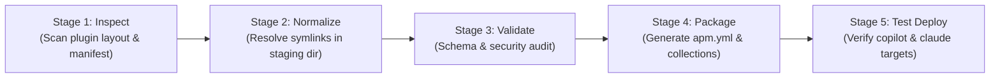

# APM Migration & Simplification Plan (Hardened Architecture)

## 1. Executive Summary & Strategy Shift

Following an adversarial architecture review (via OpenAI Codex CLI `architect-review`), this plan adopts a **Strangler Fig Pattern** instead of an immediate "flag-day" replacement:

1. **APM as an Export/Packaging Adapter First**: APM is introduced as a distribution and consumption adapter. Source-authoring structures remain protected.
2. **Build-Time Dereferencing (Preserve Source Semantics)**: Dereferencing symlinks and pointer files happens strictly inside a temporary, isolated staging/build workspace during packaging (`build/` or `apm pack`). **The authoring source tree is never mutated.**
3. **Dual-Track Deployment**:
   - **Local Reproducibility (Default)**: Project-level `apm.yml` and committed `apm.lock.yaml` ensure deterministic CI and local reproducibility.
   - **Global Workstation Convenience (Opt-in)**: Pinned global installs (`apm install <pkg>#vX.Y.Z --global --target copilot`) with explicit manual updates and rollback capability, avoiding silent background updates.
4. **Zero-Deprecation Pilot Gate**: Existing tools (`plugin-manager`, `uvx`, `symlink-manager`) remain authoritative until a representative pilot plugin demonstrates 100% empirical feature and runtime discovery parity across target harnesses.

---

## 2. Capability Matrix & Acceptance Verification Contract

Before deprecating any legacy code or marking tools obsolete, the migration must pass this executable verification gate:

| Capability Area | Verification Criteria | Test Method / Acceptance Gate | Status |
| :--- | :--- | :--- | :--- |
| **Packaging & Dereferencing** | Pointer files and symlinks are resolved into true files in `build/` without touching source files. | Automated SHA-256 hash check between canonical source and build artifact. | PENDING |
| **Copilot Target Mapping** | Primitives compile correctly to `.github/copilot-instructions.md` and `.github/instructions/*.instructions.md`. | Verified via VS Code / Copilot Chat discovery test on a sample repository. | PENDING |
| **Claude Target Mapping** | Primitives compile into `.claude/` without dropped subdirectories or broken relative paths. | Run Claude Code CLI against deployed test harness. | PENDING |
| **Lockfile Reproducibility** | `apm install --frozen` in clean CI environment reproduces exact file tree without network discrepancies. | GitHub Actions clean worktree test. | PENDING |
| **Collision & Ownership** | Installing two overlapping packages or updating an existing install does not duplicate entries or orphan files. | Test `apm install --update` and inspect `deployed_files` in `apm.lock.yaml`. | PENDING |
| **Rollback & Uninstall** | `apm uninstall <pkg>` completely scrubs deployed files without corrupting untracked project files. | Clean directory diff after uninstall. | PENDING |

---

## 3. Revised Component Lifecycle Matrix

| Component | Role in Current Repo | Role in APM Target State | Transition Strategy |
| :--- | :--- | :--- | :--- |
| **`plugins/plugin-manager`** | Installs, syncs, and prunes plugins via `uvx` / Python. | Maintained as fallback and legacy installer during transition. | Kept active. Deprecated only after APM passes all Phase 1 pilot gates. |
| **`symlink-manager` & `symlinks.json`** | Manages internal monorepo symlinks between plugin roots and skills. | Internal authoring utility only; completely invisible to external APM consumers. | Retained internally for source authoring. The APM packager handles dereferencing so consumers never see symlinks. |
| **`.agent/rules/plugin-architecture-policy.md`** | Rules governing modularity, resource placement, and symlinks. | Evolved to define packaging contracts, collection boundaries, and build dereferencing. | Sections 1–4, 6 remain invariants. Section 5 updated to clarify build-time vs source-time symlink boundaries. |
| **`convert-plugin-to-apm`** | Prototype migration script. | Modular packaging and export pipeline (`inspect → normalize → validate → package`). | Refactored into composable stages with automated tests. |

---

## 4. Pipeline Architecture: Composable Build & Export

To prevent `convert-plugin-to-apm` from becoming an unmaintainable monolith, the packaging pipeline is split into five discrete, testable stages:



1. **Stage 1: Inspect**: Reads `plugin.json` / `plugin.yaml`, checks directory structure, discovers skills, rules, agents, and hooks.
2. **Stage 2: Normalize**: Copies assets to an isolated build workspace (`build/staging/<plugin>/`) and dereferences pointers/symlinks into physical files with an audit manifest.
3. **Stage 3: Validate**: Checks against schema, validates frontmatter, ensures no broken relative links or unauthorized cross-plugin imports exist.
4. **Stage 4: Package**: Synthesizes the `apm.yml` manifest, declares target mappings (`copilot`, `claude`, `cursor`), and assigns package collections.
5. **Stage 5: Test Deploy**: Runs a dry-run test installation (`apm install --dry-run`) into temporary harness fixtures to confirm target layout.

---

## 5. Phased Implementation Roadmap

### Phase 1: Pilot Proof-of-Concept & Verification Harness
- **Selection**: Choose one clean, self-contained plugin as the pilot (e.g. `agent-scaffolders` or `dev-utils`).
- **Deliverables**:
  1. Build-time dereferencer script that outputs to `build/staging/` without mutating source files.
  2. Synthesize pilot `apm.yml`.
  3. Run test installations targeting `.github/` and `.claude/` in a test fixture repository.
  4. Complete the Capability Matrix evaluation.

### Phase 2: Decouple Hardcoded Instructions
- Systematically inventory and refactor hardcoded paths across [AGENTS.md](file:///c:/Users/RICHFREM/source/repos/agent-plugins-skills/AGENTS.md) and skills:
  - *Replace:* `"Look for skills in .agents/skills/<name>"`
  - *With:* `"Activate <name> from registered runtime skill locations (.agents/skills/, .github/instructions/, .claude/skills/, or global profile)"`
- Implement an automated lint check to prevent regressions.

### Phase 3: Setup Reusable Consumer Tooling (`setup-apm-consumer`)
- **Project-Level Scaffolder**:
  - A simple command to bootstrap a consuming repo's `apm.yml` pinned to tested releases.
- **Global Workstation Guide (Zero Per-Project Maintenance)**:
  - Document pinned global installation:
    ```powershell
    apm install richfrem/agent-plugins-skills#v1.0.0 --global --target copilot
    ```
  - Provide an explicit manual sync command (`apm-sync-global.ps1`) with rollback support, rejecting unmonitored silent auto-updates.

### Phase 4: Full Repository Packaging & Gradual Transition
- Package all plugins into top-level and collection manifests (`apm.yml`).
- Update [INSTALL.md](file:///c:/Users/RICHFREM/source/repos/agent-plugins-skills/INSTALL.md) with APM as the primary path and `uvx` as the legacy/fallback path.
- Keep `plugin-manager` active until external consumers have migrated.

---

## 6. Eliminating Hardcoded `.agents/` Instruction Staleness

Over 400 lines across this repository (and dozens of consuming downstream repositories) contain hardcoded operational instructions like:
- `python3 .agents/skills/<skill>/scripts/<script>.py`
- `Full standards → .agents/skills/<skill>/SKILL.md`
- `Skills run from .agents/skills/, never from plugins/ directly`

When an APM consumer installs via `--target copilot`, those files land in `.github/`, not `.agents/`. If an agent is told to look strictly in `.agents/`, it fails.

### The 3-Pillar Solution for This Repo and Consuming Repos:

#### 1. Runtime-Agnostic Instruction Standard
We establish a canonical, harness-agnostic way to cite skills across all instructions, prompts, and rules:
- **OLD (Rigid / Stale)**:
  `python3 .agents/skills/symlink-manager/scripts/symlink_manager.py diagnose`
- **NEW (Skill-Centric / Portable)**:
  `Activate the 'symlink-manager' skill or execute scripts/symlink_manager.py relative to the skill root`
- **NEW (Document / Convention Links)**:
  `Full standards → Refer to the 'coding-conventions-agent' skill in your active harness (.agents/skills/, .github/skills/, or global profile)`

#### 2. Automated Migration Script: `scripts/decouple_agent_paths.py`
We will build a dedicated, dry-run-capable CLI tool in `plugins/agent-scaffolders/` that can be executed both **in this repository** and **in external consuming repositories**:
```bash
python decouple_agent_paths.py --path <repo-root> --dry-run
python decouple_agent_paths.py --path <repo-root> --apply
```
This script detects and transforms known patterns:
- `.agents/skills/<name>/SKILL.md` → `<name>` skill reference
- `.agents/skills/<name>/scripts/<script>` → portable skill script invocation
- `.agents/` hardcoded path requirements → fallback path resolver

#### 3. Backward-Compatibility Fallback (Harness Symlink / Alias Bridge)
In APM's `apm.yml`, we can configure multi-target compilation or an APM post-install hook to guarantee legacy links remain intact during the transition:
```yaml
# apm.yml
targets:
  - copilot   # Materializes into .github/
  - agents    # Materializes into .agents/ (ensures zero disruption for legacy instructions)
```
By mapping primitives into both `.github/` (for Copilot native context) and `.agents/` (or providing an alias bridge), older instructions in consuming repositories that still reference `.agents/` will **continue to work seamlessly without crashing**, giving consuming teams ample time to run the decoupling script.
