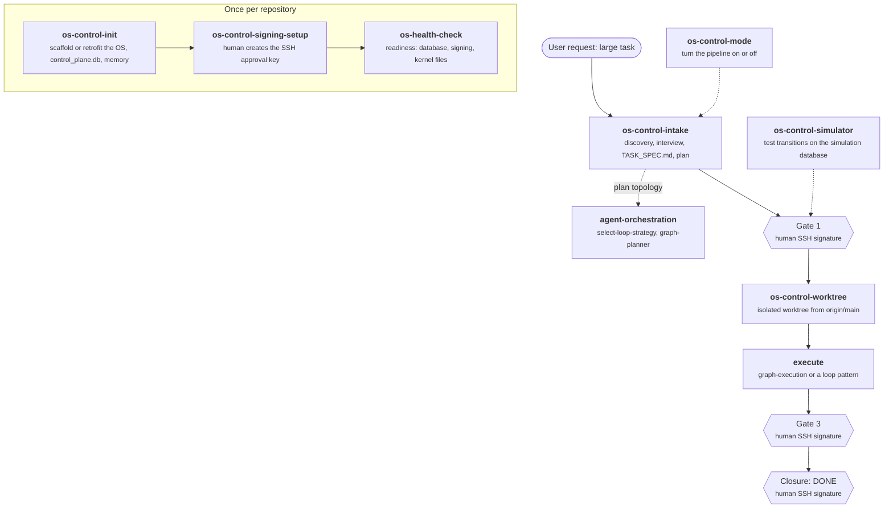
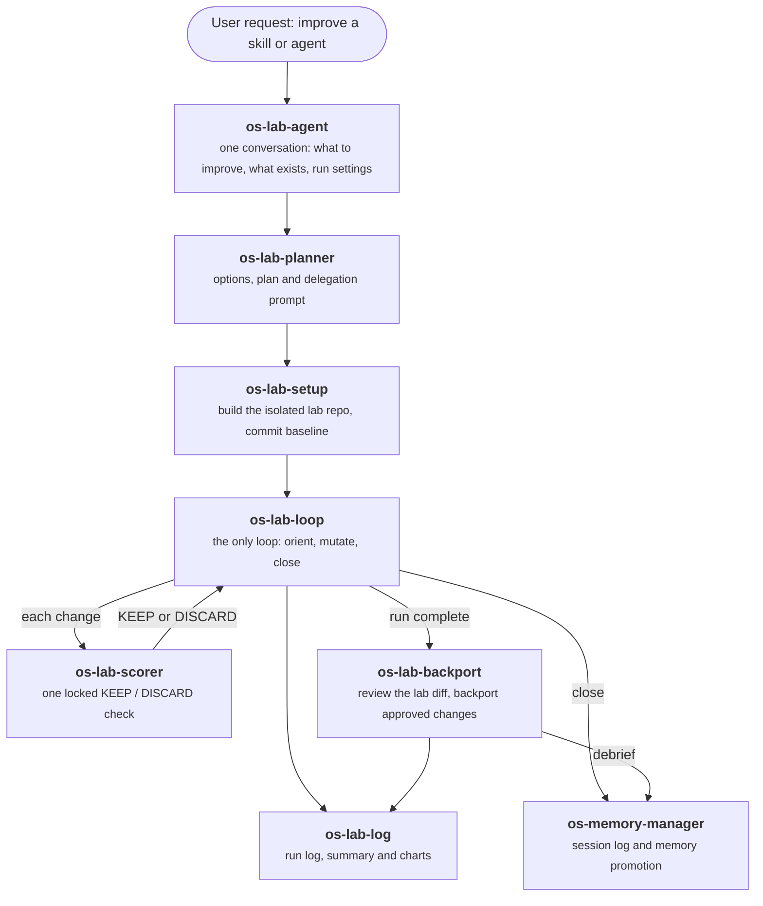

# Agentic OS Skill Map

Read this before routing to, recommending, or handing off to any `agent-agentic-os` skill. It says
what each of the 20 skills does, grouped by purpose and function into two clusters, and how the
clusters relate. For Cluster 1 and Cluster 2 side by side, see
[two-improvement-paths.md](two-improvement-paths.md).

A project installs only part of this plugin. Check `.agents/ownership/agent-agentic-os.json`
(`should_install`) and `ls .agents/skills/<name>` before relying on any skill.

## Contents

- [The clusters at a glance](#the-clusters-at-a-glance)
- [How the clusters relate](#how-the-clusters-relate)
- [Cluster 1: Control Plane](#cluster-1-control-plane)
- [Cluster 2: Skill Improvement Lab](#cluster-2-skill-improvement-lab)

## The clusters at a glance

| Cluster | Skills | Job | Scope |
|---|---|---|---|
| Cluster 1: Control Plane | 7 | Run large engineering tasks under signed human gates | Any repository, any kind of work |
| Cluster 2: Skill Improvement Lab | 13 | Plan, run and verify experiments that improve skills and agents | Skills and agents in this ecosystem |

## How the clusters relate

**Cluster 1: Control Plane stands alone.** It is a general task pipeline: it does not depend on
Cluster 2. The one link runs the other way: when Cluster 2 updates or creates a skill, it registers
that work as a control-plane task (`agent_control.py`, task type `EVOLUTION`) and logs a prior-art
scan, so lab changes pass the same gate. Its state is `context/control_plane.db`; its authority is
the human's SSH signature at Gate 1, Gate 3 and closure. It borrows execution patterns from the
separate `agent-orchestration` plugin (`select-loop-strategy`, `graph-planner`, `graph-execution`).

**Cluster 2: Skill Improvement Lab works on the ecosystem's own skills and agents.** Its state lives
in the files `context/kernel.py` maintains: `context/events.jsonl`, `context/.locks/`,
`context/memory.md`, the improvement ledger and the experiment log. `os-architect` is its front door, and `os-guide` explains how these pieces fit together.

```text
                         ┌───────────────────────────────────────────┐
 Cluster 1               │ os-init ─► work-intake ─► Gate 1          │
 Control Plane           │   ─► worktree-manager ─► execute          │   context/control_plane.db
 (independent)           │   ─► Gate 3 ─► closure (DONE)             │   + human SSH key
                         │ os-signing-setup, transition-simulator,   │
                         │ os-control-plane-mode, os-health-check    │
                         └───────────────────────────────────────────┘

                         os-architect (front door)
                           │  plan a change: os-evolution-planner
                           │  check it landed: os-evolution-verifier
                           ▼
 Cluster 2   os-eval-lab-setup ─► os-improvement-loop ⇄ os-eval-runner
 Skill            ─► os-eval-backport ─► os-experiment-log ─► os-improvement-report
 Improvement Lab  close and debrief: os-memory-manager     explain it: os-guide
                  (context/events.jsonl, context/.locks/, context/memory.md)
```

`os-init` belongs to Cluster 1 but also installs the kernel files (`context/kernel.py`, memory folders)
that Cluster 2 uses. `os-health-check` belongs to Cluster 1 but also reports on those kernel files.

## Cluster 1: Control Plane

General-purpose pipeline for large work in any repository. Big tasks use it; quick tasks can switch it off.

### Proposed naming (not yet applied)

How Cluster 1 works today, with proposed names. The `os-control-` prefix groups the skills that set up,
run or govern the pipeline. `os-health-check` keeps its name because it reports on the whole OS, not
only the control plane.



| Current skill or agent | Proposed name | Note |
|---|---|---|
| `os-init` | `os-control-init` | Renamed; also installs the kernel files Cluster 2 uses |
| `work-intake` | `os-control-intake` | Renamed |
| `worktree-manager` | `os-control-worktree` | Renamed; listed in `plugin-retention.json` `protected_defaults` |
| `os-signing-setup` | `os-control-signing-setup` | Renamed |
| `transition-simulator` | `os-control-simulator` | Renamed |
| `os-control-plane-mode` | `os-control-mode` | Renamed |
| `os-health-check` | `os-health-check` | Kept: reports on the whole OS |
| `agentic-os-setup` (agent) | `os-control-setup-agent` | Renamed; wraps `os-control-init` |

Result: no merges or retirements; 7 skills, 6 renamed.

### Current skills

| Skill | What it does |
|---|---|
| `os-init` | Probes a repository (fresh, complete, or drifted), interviews for stack and AI platforms, makes `AGENTS.md` the single instruction file, creates the 3-layer memory and `context/control_plane.db`, and sets up the simulation signing identity. Wrapped by the `agentic-os-setup` agent. |
| `work-intake` | Front door for every non-trivial task. Read-only discovery, at most one question per turn, registers the task, writes the four-pillar `TASK_SPEC.md` (the job, the why, guardrails, definition of done) and stages the plan: `INTAKE -> INTERVIEW -> DRAFT_PLAN -> PLAN_REVIEW -> AWAITING_APPROVAL`. |
| `worktree-manager` | Picks the runtime's native worktree facility, or a portable `.worktrees/<task-id>` based on fresh `origin/main`. Reconciles uncommitted state and reports cleanup commands. |
| `os-signing-setup` | Walks the human through creating the SSH signing key and `allowed_signers` that authorize Gate 1, Gate 3 and closure, then runs a signing self-test. The agent never signs. |
| `transition-simulator` | Tests the control-plane state machine without touching real state: deterministic simulation, or cheap-model dry runs that grade what the agent asks, runs, and hands to the human. Uses the separate simulation database and key. |
| `os-control-plane-mode` | Turns Cluster 1 on or off as one unit (member skills and rule, the commit and push guards, the declared mode) and reports its status. |
| `os-health-check` | Deterministic readiness and liveness report, run by `os-init` and the control plane's setup checks: signing and identity readiness, plus the kernel's event log, hook errors, memory size and stale locks. |

## Cluster 2: Skill Improvement Lab

Targeted work on this ecosystem's skills and agents: plan a change, make one skill measurably better
against a locked eval set, and verify the result.

### Proposed consolidation (not yet applied)

How Cluster 2 would work with one agent, six skills, and `os-memory-manager` as the shared close step.
Proposed names use an `os-lab-` prefix so the cluster's skills read as one workflow and sort together.
The agent holds the conversation; the skills do the steps.



| Current skill or agent | Proposed name | Note |
|---|---|---|
| `os-architect` | `os-lab-agent` + `os-lab-planner` | Merged: its interview moves to `os-lab-agent`; its audit and routing become the planner's first step |
| `os-evolution-planner` | `os-lab-planner` | Merged: brainstorm options, write the plan and delegation prompt |
| `os-evolution-verifier` | Retired | `os-lab-planner` routing evals cover it |
| `os-environment-probe` | Retired | `cli-agents:project-setup` builds the provider capability profile |
| `os-eval-lab-setup` | `os-lab-setup` | Renamed |
| `os-improvement-loop` | `os-lab-loop` | Renamed; absorbs the Mode 1 loop from `os-eval-runner` |
| `os-eval-runner` | `os-lab-scorer` | Renamed; keeps only the single KEEP / DISCARD check |
| `os-skill-improvement` | `os-lab-scorer` | Merged: becomes its single-pass mode |
| `os-eval-backport` | `os-lab-backport` | Renamed |
| `os-experiment-log` | `os-lab-log` | Renamed |
| `os-improvement-report` | `os-lab-log` | Merged: becomes its charts |
| `os-memory-manager` | `os-memory-manager` | Kept: manages repository memory, not only the lab's |
| `os-guide` | Retired | This map and `two-improvement-paths.md` cover orientation |
| `os-architect-agent` (agent) | `os-lab-agent` | Merged: the single interactive front door |
| `improvement-intake-agent` (agent) | `os-lab-agent` | Merged: its run-settings interview becomes part of the same conversation |
| `os-architect-tester-agent` (agent) | Retired | Routing is tested through `os-lab-planner`'s evals |

Result: 13 skills become 7 (six `os-lab-*` skills plus `os-memory-manager`), and 3 agents become 1 (`os-lab-agent`).

### Current skills

| Skill | What it does |
|---|---|
| `os-architect` | Front door for evolution work. Classifies intent (pattern abstraction, research application, lab setup, capability gap, multi-loop), audits what already exists, then orchestrates existing skills, updates via `os-evolution-planner`, or creates new ones. Lab requests go to the `improvement-intake-agent`. |
| `os-evolution-planner` | `os-architect`'s update step. Brainstorms two or three approaches with the cheapest available model, checks the target for standard gaps, and writes a task plan plus a delegation prompt to `tasks/todo/`. Dispatches only after user confirmation. |
| `os-evolution-verifier` | `os-architect`'s check step. Confirms that `os-architect` actually produced artifacts, not just text: dispatches it in simulation, checks files and handoff blocks, and logs PASS or FAIL through `os-experiment-log`. |
| `os-environment-probe` | Detects which AI CLIs are really available (Claude, Copilot, Agy, Cursor) and writes `context/memory/environment.md`, which `os-architect` and `os-evolution-planner` read to choose a delegation backend. |
| `os-eval-lab-setup` | Builds an isolated lab repository for one skill: copies the plugin with links resolved, renders `eval-instructions.md`, commits a baseline, and offers manual or autonomous launch. |
| `os-eval-runner` | The scorer. Ensures `evals.json` and `program.md` exist, then either runs the autoresearch loop (propose, evaluate, keep or discard) or a single-shot KEEP/DISCARD check, with a holdout overfitting check. |
| `os-improvement-loop` | The full cycle: orient from the ledger and history, execute, verify independently with `evaluate.py`, decide KEEP or DISCARD, then close with surveys, ledger update and memory promotion through `os-memory-manager`. |
| `os-skill-improvement` | A focused RED-GREEN-REFACTOR pass on one skill: baseline the failure, state a hypothesis, patch `SKILL.md`, require a KEEP verdict, close edge cases. |
| `os-eval-backport` | After a lab run, reads the lab's progress log and diff, classifies each change (accept, adapt, reject, review), applies approved changes to the master plugin source, and records learnings through `os-memory-manager`. |
| `os-experiment-log` | Append-only log of runs in `context/experiment-log/`, with `append`, `query` and `summary` modes. |
| `os-improvement-report` | Reads the experiment log, aggregates score progression and renders a chart and summary under `context/memory/reports/`. |
| `os-memory-manager` | The close and debrief step of `os-improvement-loop` and `os-eval-backport`: writes the dated session log, promotes vetted facts to `context/memory.md` with conflict checks, and archives when the file exceeds 50,000 bytes, all under the kernel's `memory` lock. |
| `os-guide` | Answers "how does the OS work" questions from its reference docs (memory layers, context folder, loop scheduling, hooks) and points the user to the right skill. |
