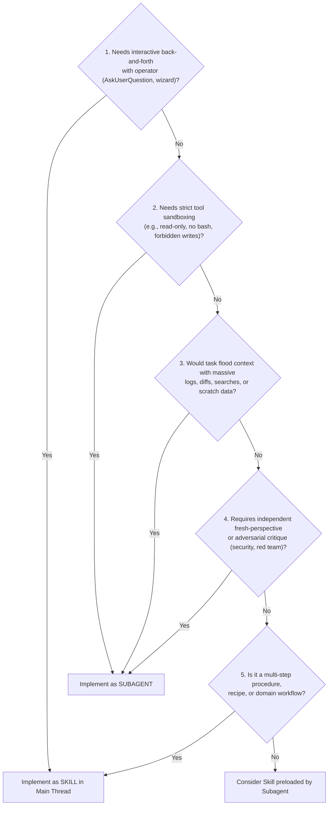

# Skills vs. Subagents Decision Framework & Diagnostic Guide

Authoritative architectural framework for determining whether a given agent capability should be implemented as an **Agent Skill** (`SKILL.md`), an **Autonomous Subagent** (`agents/*.md`), or a **Subagent Preloading Skills** (`skills:`).

Based on official Anthropic Claude Code & Platform specifications (*Extend Claude with skills*, *Create custom subagents*, and *Steering Claude Code*).

---

## Contents

- [1. Executive Summary & Core Definitions](#1-executive-summary--core-definitions)
- [2. The 5-Question Diagnostic Decision Tree](#2-the-5-question-diagnostic-decision-tree)
- [3. The Three Critical Anthropic Refinements](#3-the-three-critical-anthropic-refinements)
- [4. Comparison Matrix: Skills vs. Subagents](#4-comparison-matrix-skills-vs-subagents)
- [5. Combining Skills and Subagents (The Anthropic Pattern)](#5-combining-skills-and-subagents-the-anthropic-pattern)
- [6. Audit Considerations for Skill and Agent Reviewers](#6-audit-considerations-for-skill-and-agent-reviewers)

---

## 1. Executive Summary & Core Definitions

A frequent architectural mistake in multi-agent authoring is treating "skills" and "subagents" as interchangeable wrappers or assuming every persona needs a separate subagent. Anthropic draws a precise operational boundary:

- **Agent Skill (`SKILL.md`)**: A reusable procedure or domain capability that plays out **inside the main conversation thread** so the operator can see and steer each step. A skill pre-approves tools via `allowed-tools` to streamline execution, but it **does not** sandbox tools.
- **Subagent (`agents/*.md`)**: An isolated worker that runs in its **own independent context window** with a custom system prompt, independent permissions, and **enforced tool sandboxing** via `tools`. It returns only its final output to the main conversation.

---

## 2. The 5-Question Diagnostic Decision Tree

When evaluating a new capability or auditing an existing inventory, walk through these five diagnostic questions in order:

### Question 1: Interactivity & Operator Steering
- **Question**: Does this workflow require back-and-forth interaction with the human operator, iterative requirement discovery, confirmation menus, or wizard prompts?
- **Decision**: **Must be a SKILL in the main thread.**
- **Why**: In Claude Code, `AskUserQuestion` is disabled inside subagents, and foreground subagents block the main conversation until completion. Interactive solution architecture, business analysis interviews, and guided setup wizards fail when isolated in subagents.

### Question 2: Tool Sandboxing & Permission Constraints
- **Question**: Does the task require hard restrictions on tool access (e.g. read-only auditing, forbidding Bash commands, denying filesystem write tools)?
- **Decision**: **Must be a SUBAGENT.**
- **Why**: A skill's `allowed-tools` field is merely a pre-approval grant that skips confirmation prompts; it **cannot** restrict Claude from using other tools. A subagent's `tools` frontmatter field is the only mechanism that enforces a true tool sandbox.

### Question 3: Context Window Conservation & Isolation
- **Question**: Would executing this task flood the main conversation with dozens of search results, compile logs, git diffs, or transitory file readings that the operator will never reference again?
- **Decision**: **Must be a SUBAGENT.**
- **Why**: Subagents run in isolated context windows. Heavy search, code crawling, or compilation happens in the subagent's temporary context, returning only a synthesized summary to the main thread.

### Question 4: Fresh-Perspective & Adversarial Stance
- **Question**: Does the task require an unbiased second opinion, independent code review, simplification audit, security red-teaming, or parallel evaluation?
- **Decision**: **Must be a SUBAGENT.**
- **Why**: Operating in the main thread introduces conversational bias and sycophancy from earlier planning turns. A subagent inspects the target code with fresh eyes and an adversarial system prompt.

### Question 5: Reusable Knowledge & Shared Procedures
- **Question**: Is this a procedure or standard operating procedure that multiple agents or workflows might need to execute?
- **Decision**: **Build as a SKILL.**
- **Why**: Anthropic explicitly recommends building shared domain capabilities as skills so that any Claude instance or subagent can load them on demand.

---

## 3. The Three Critical Anthropic Refinements

Recent analysis of Anthropic's platform specifications establishes three vital corrections to legacy multi-agent conventions:

### Refinement 1: Persona Alone Does NOT Justify a Subagent
- *Legacy Mistake*: Creating a subagent file solely to give Claude a "Solution Architect", "Test Engineer", or "UX Designer" persona.
- *Anthropic Rule*: A persona is simply a system prompt style. Anthropic justifies subagents strictly by **context isolation**, **tool permissions**, **parallelism**, and **fresh-perspective review**. If an agent does not need tool restrictions or context isolation, its instructions belong in a skill.

### Refinement 2: Interactive Facilitators Must NOT Be Subagents
- *Legacy Mistake*: Creating subagents for interactive requirements elicitation, solution architecture interviewing, or test setup wizards.
- *Anthropic Rule*: Back-and-forth iterative refinement belongs in the main thread where the operator can see, steer, and answer questions. Subagents cannot ask questions interactively (`AskUserQuestion` is unavailable).

### Refinement 3: A Skill's `allowed-tools` is NOT a Sandbox
- *Legacy Mistake*: Assuming declaring `allowed-tools: Read, Grep` in `SKILL.md` prevents Claude from editing files or running Bash.
- *Anthropic Rule*: `allowed-tools` only pre-approves tools to reduce user prompts. It does not restrict tool availability. If you must guarantee that an agent cannot mutate files, you must author a subagent with `tools: Read, Grep, Glob`.

---

## 4. Comparison Matrix: Skills vs. Subagents

| Dimension | Agent Skill (`SKILL.md`) | Autonomous Subagent (`agents/*.md`) |
| :--- | :--- | :--- |
| **Execution Thread** | Runs inside main conversation thread | Runs in isolated child context window |
| **Operator Steering** | High: Operator sees and steers every step | Low: Autonomous execution until final return |
| **Interactivity (`AskUserQuestion`)** | Fully supported (interactive wizards, menus) | Forbidden / Disabled |
| **Tool Permissions** | Pre-approves tools (`allowed-tools`); no restriction | Sandboxes tools (`tools`); restricts available capabilities |
| **Context Impact** | Consumes tokens in main conversation | Zero pollution of main conversation context |
| **Parallelism** | Sequential inside the active turn | Supports parallel concurrent dispatch |
| **Primary Use Cases** | Domain workflows, migration procedures, setup guides | Code review, security audit, log analysis, batch reads |

---

## 5. Combining Skills and Subagents (The Anthropic Pattern)

Anthropic officially endorses combining skills and subagents using the `skills:` frontmatter field in subagents:
> *"With `skills` in a subagent, the subagent controls the system prompt and loads skill content."*

This pattern is **not** a forbidden pointer-wrapper stub. A pointer-wrapper stub is an empty agent that does nothing except say *"Please run skill X"*. The valid Anthropic pattern is:
1. **The Subagent**: Owns an adversarial or specialized system prompt ("You are a security auditor...") and enforces strict tool sandboxing (`tools: Read, Grep, Glob`).
2. **The Preloaded Skills**: Preloads domain skills via `skills:` (e.g., `skills: enforcing-coding-conventions, assessing-sharepoint-sites`) so the sandboxed agent has access to domain checklists without duplicating markdown.

---

## 6. Audit Considerations for Skill and Agent Reviewers

When auditing repository skills and subagents (`audit_skill.py` and `audit_sub_agent.py`):

1. **Flag Interactive Prompts in Subagents**:
   If an agent's system prompt instructs it to "interview the user", "ask the user for requirements", or "walk the user through options interactively", flag it as a finding:
   > *Finding: Interactive procedures belong in a skill in the main thread; subagents cannot interactively query the operator.*
2. **Verify Tool Bounds in Subagents**:
   Every subagent must declare explicit `tools` frontmatter. If a subagent requests unrestricted tools (`Bash, Read, Write, Edit, Glob, Grep`) without context isolation or adversarial review justification, flag it as a candidate for skill consolidation.
3. **Verify `disable-model-invocation: true` on Side-Effecting Skills**:
   For skills that perform irreversible side effects (publishing releases, deploying infrastructure, executing migrations), verify whether `disable-model-invocation: true` is configured so that the skill is only invoked intentionally by name.
4. **Enforce Lean Router Size Limits**:
   While Anthropic docs cite a 500-line ceiling for `SKILL.md`, this ecosystem enforces a strict **100-line router ceiling**. Any skill exceeding 100 lines must partition procedures into `references/modes/<mode>.md`.
