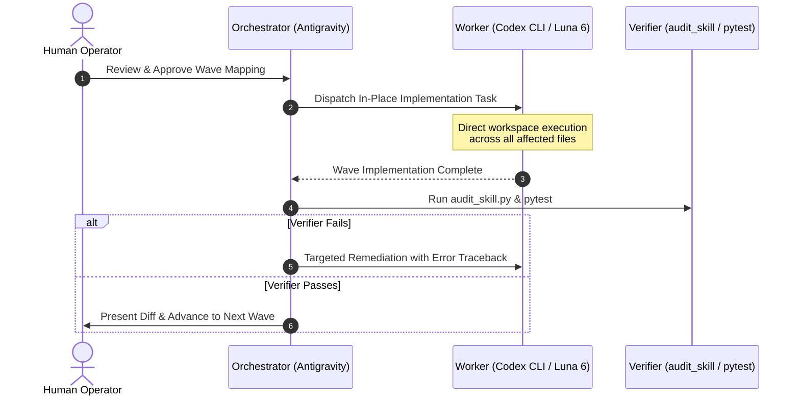

# Legacy Plugin to APM Migration Guide: The Interactive Master Playbook

Authoritative, interactive engineering playbook for converting legacy agent plugins (micro-skills, copy manifests, `symlinks.json`, `uvx plugin-add` stubs) into clean, self-contained, modal packages managed natively by Microsoft Agent Package Manager (APM).

This playbook encapsulates the full operational rigor of the 123-skill consolidation in `agent-plugins-skills` and the 108-skill consolidation in `sharepoint-knowledge-workbench`. It is designed to guide an agent through refactoring any downstream repository (e.g. SharePoint, Oracle Forms, bespoke enterprise systems) interactively, wave by wave.

---

## Contents

- [1. Core Philosophy: Why Staging Overlays Failed](#1-core-philosophy-why-staging-overlays-failed)
- [2. Phase 1: Interactive Discovery & Repository Intake](#2-phase-1-interactive-discovery--repository-intake)
- [3. Phase 2: Wave-by-Wave Mapping & Interactive Review](#3-phase-2-wave-by-wave-mapping--interactive-review)
- [4. Phase 3: The 8-Step Migration Lifecycle](#4-phase-3-the-8-step-migration-lifecycle)
- [5. Phase 4: Knowledge-Parity Assurance Matrix](#5-phase-4-knowledge-parity-assurance-matrix)
- [6. Phase 5: Deterministic Pre-Purge Accounting Check](#6-phase-5-deterministic-pre-purge-accounting-check)
- [7. Phase 6: Delegated Execution (Orchestrator and Worker Pattern)](#7-phase-6-delegated-execution-orchestrator-and-worker-pattern)
- [8. Phase 7: Scope Discipline & Git Hygiene](#8-phase-7-scope-discipline--git-hygiene)
- [9. Phase 8: Downstream Consumer Transition Cheat Sheet](#9-phase-8-downstream-consumer-transition-cheat-sheet)
- [10. Anti-Patterns & Common Pitfalls to Avoid](#10-anti-patterns--common-pitfalls-to-avoid)

---

## 1. Core Philosophy: Why Staging Overlays Failed

Early attempts to bridge legacy plugins to APM attempted to preserve hundreds of hyper-granular micro-skills by wrapping them in build-time staging pipelines (`scripts/apm_build_pipeline.py`) and copy manifests (`symlinks.json` with `strategy: "copy"`). While this eliminated broken symlinks on Windows, real-world deployment revealed fatal operational flaws:
1. **Maintainer Edit Hazard**: Maintainers frequently edited ephemeral copies inside `.claude/skills/` or `skills/<skill>/scripts/` instead of canonical source files, losing work upon re-materialization.
2. **Context Window Exhaustion**: Having 100+ granular micro-skills flooded the LLM's system prompt with tool definitions, drastically degrading routing precision and wasting tokens.
3. **Ghost Files on GitHub**: Materialized copies excluded via `.git/info/exclude` caused cloned repositories on GitHub to appear broken or missing critical scripts.

### The Modern Golden Path: Cohesive Modal Consolidation
Instead of wrapping fragmented micro-skills in fragile copy manifests, the authoritative standard is **Cohesive Modal Consolidation**:
- **Solution A (Modal Hub Consolidation)**: Collapse clusters of related micro-skills into a single, cohesive domain hub.
- **Solution B (1-to-1 Resource Co-location)**: Move scripts, assets, and tests directly into the owning skill as real, git-tracked physical files.
- **Zero Copy Manifests & Zero Symlinks**: Clean, self-contained spoke architecture that installs natively across all agent harnesses.

---

## 2. Phase 1: Interactive Discovery & Repository Intake

Every repository has its own history, design aspirations, runtime constraints, and hidden pitfalls. **Never begin restructuring files autonomously.** The agent must first conduct an interactive intake interview to uncover these nuances.

### The 5-Dimension Intake Questionnaire
Before writing code or manifests, present these structured questions to the operator:

1. **Target Repository & Baseline State**:
   - What is the absolute path, active branch, and Git status of the target repository?
   - Are there uncommitted changes or active worktrees that need resolution first?
2. **Current Footprint & Granularity**:
   - How many legacy plugins and micro-skills exist in `plugins/`?
   - What copy-manifest infrastructure is present (`symlinks.json`, `plugin-sources.json`, `skills-lock.json`, `.agents/`)?
3. **Design Aspirations & Target Architecture**:
   - Is the goal a single unified package (e.g. `@sharepoint/sharepoint-workbench`) or a small set of focused domain plugins?
   - What are the major domain hubs envisioned (e.g., Setup, Assessment, Conversion, Publishing, Migration)?
4. **Unique Repository Pitfalls & Caveats**:
   - Are there deep documentation or operational dependencies on existing skill names (e.g., Oracle Forms repositories where teams or scripts rely on legacy names)?
   - Are there runtime prerequisites (PowerShell 7+, PnP.PowerShell, Python virtual environments, Node.js)?
   - Are there Windows-specific symlink text stubs or platform-specific scripts?
5. **Downstream Consumers & Data Boundaries**:
   - Which external projects consume these skills (e.g. `jag-csb-intranet`)?
   - Which local paths represent customer data, secrets, or ledgers that must remain **strictly untouched** (e.g., `inventory/`, `config*.psd1`, `context/`)?

---

## 3. Phase 2: Wave-by-Wave Mapping & Interactive Review

Consolidating 50–100+ micro-skills all at once is high-risk and overwhelms human review. Partition the migration into **logical, staged waves** (typically 4 to 8 waves), and review them **one wave at a time**.

### The Canonical Mapping Plan Table
For each wave, author an explicit mapping proposal and present it to the operator before touching files:

```markdown
### Wave N Proposal: <Domain Name> (e.g., Site Build & Publishing)
**Legacy Scope**: `plugins/legacy-plugin` (33 micro-skills)
**Target Outcome**: 2 modal hub skills (`managing-sharepoint-schema`, `publishing-sharepoint-pages`)

| Legacy Micro-Skill | Target Consolidated Hub | Target Mode (`references/modes/`) | Absorbed Assets / Scripts | Special Invariants & Caveats |
|:---|:---|:---|:---|:---|
| `sp-site-columns` | `managing-sharepoint-schema` | `site-columns` | `scaffold_site_column.py` | Preserves field type mappings |
| `sp-content-types` | `managing-sharepoint-schema` | `content-types` | `scaffold_content_type.py` | Must run after site-columns |
| `sp-page-publish` | `publishing-sharepoint-pages` | `page-publication` | `publish_spo_page.ps1` | Requires `-ConfirmToken` gate |
| `sp-text-webpart` | `publishing-sharepoint-pages` | `rte-sanitization` | `sp_text_webpart_html.py` | Normalizes CKEditor tables |
```

### The Human Checkpoint
Prompt the operator:
> *"Does this Wave N mapping align with your operational workflow? Are there specific edge cases, prompt guards, or parameter options in these retiring skills that require special attention before we consolidate?"*

Incorporate human feedback, refine the mapping, and proceed to execution only after approval.

---

## 4. Phase 3: The 8-Step Migration Lifecycle

Once a wave mapping is approved, execute using the standardized 8-step lifecycle:

```
[1. Ledger CSV] ──► [2. Consolidate Hub] ──► [3. Co-locate Files] ──► [4. Evals & Schema]
                                                                              │
[8. Retire Old] ◄── [7. Consumer Matrix] ◄── [6. Pre-Purge Check] ◄── [5. Multi-Gates]
```

1. **Step 1: Inventory Ledger Initialization**:
   - Log every affected file into `master_migration_inventory.csv` (`Old Path, New Path, Action, Notes`).
2. **Step 2: Construct Modal Hub Spoke**:
   - Create `skills/<hub-skill>/SKILL.md` (< 100 lines) with metadata and mode dispatch table.
   - Author dedicated `references/modes/<mode>.md` files for each absorbed capability.
3. **Step 3: Self-Contained Resource Co-location**:
   - Move scripts and assets directly into `skills/<hub-skill>/scripts/` and `skills/<hub-skill>/references/`.
   - Never leave shared scripts at the plugin root. Real Git-tracked physical files only.
4. **Step 4: APM Manifest & Eval Schemas**:
   - Author `evals/evals.json` and `evals/task-success.json` as root JSON arrays (`[...]`).
   - Align subagent colors (`cyan`, `blue`, `purple`, `green`, `yellow`, `red`, `magenta`).
5. **Step 5: Deterministic Multi-Layer Verification**:
   - Run `audit_skill.py <path> --mode source`.
   - Run unit tests with `pytest`.
6. **Step 6: Pre-Purge Accounting Check**:
   - Run deterministic comparison script ensuring 100% of source files exist at target paths.
7. **Step 7: Downstream Consumer Refactor Matrix**:
   - Update consumer transition cheat sheet (1:1 matrix).
8. **Step 8: Retire Legacy Micro-Skills**:
   - Execute `git rm -rf` on retired folders only after Steps 1–7 pass.

---

## 5. Phase 4: Knowledge-Parity Assurance Matrix

Consolidation must **never drop knowledge, prompt guards, or review rules** established in retiring skills. Maintain an explicit checklist:

| Dimension | Verification Requirement |
| :--- | :--- |
| **Prompt Guards & Constraints** | All "DO NOT", "NEVER", and confirmation token requirements (`-ConfirmToken`) from legacy `SKILL.md` files must appear in the target mode file. |
| **Parameter Flags & CLI Syntax** | All CLI switches, environment variables, and config paths must be documented in `references/modes/<mode>.md`. |
| **Review Delimiters** | Structured review blocks (e.g. `PLAN REVIEW:`, `VERIFICATION:`) must be preserved verbatim. |
| **Error Recovery & Fallback** | Fallback trees and retry policies from legacy docs must be co-located under `references/`. |
| **Relative Markdown Links** | Subdocument links must be valid relative paths: `../<ref>.md` for sibling docs, `../../scripts/<script>` for scripts. |

---

## 6. Phase 5: Deterministic Pre-Purge Accounting Check

**Never delete legacy directories based on intuition.** Before deleting any legacy directory, execute an automated Python check verifying 100% file coverage:

```python
import csv
from pathlib import Path

def verify_accounting(csv_path: Path, repo_root: Path):
    with open(csv_path, "r", encoding="utf-8") as f:
        reader = csv.DictReader(f)
        for row in reader:
            if row["Action"] in ("MOVED_TO_SKILL", "CONSOLIDATED_INTO_SKILL"):
                target = repo_root / row["New Path"]
                if not target.exists():
                    raise FileNotFoundError(f"Missing target file: {target}")
    print("Pre-purge check PASSED: 100% of files accounted for.")
```

In the SharePoint Workbench refactor, this verified **760 out of 760 files** before running `git rm -rf`, guaranteeing zero data loss.

---

## 7. Phase 6: Delegated Execution (Orchestrator and Worker Pattern)

Large-scale refactorings across dozens of files should not be executed manually in tiny turns. Pair an **Orchestrator** with a high-throughput **Worker**:



### Delegation Invariants
- **Direct Workspace Write Access**: Give the worker direct file-editing capabilities. Do **not** restrict it with `--isolated` or force code proposals to `/tmp`.
- **Zero Autonomous Commits by Worker**: The worker never runs `git commit` or `git push`. Git state hygiene is caller-managed by the Orchestrator.
- **Worker Preference**: For fast, deterministic multi-file edits, prefer **Codex CLI** (`codex exec` with Luna 6 / `gpt-5.6-luna` at medium reasoning effort).

---

## 8. Phase 7: Scope Discipline & Git Hygiene

Deploying APM packages requires strict scope discipline:

| Scope | Appropriate For | Why | Command |
| :--- | :--- | :--- | :--- |
| **Global Scope**<br>(`~/.apm/apm.yml`) | **Universal Developer Infrastructure** | Tools that apply to *every* repo (control plane, memory, orchestrator, authoring). | `apm install <abs-path> --global --target ...` |
| **Local Project Scope**<br>(`<repo>/apm.yml`) | **Domain-Specific Tooling** | Tools specific to one domain (SharePoint, Oracle Forms, specific APIs). | `apm install <pkg> --target ...` |

### Critical Scope Invariants
1. **Never Install Domain Packages Globally**: Installing domain skills globally bloats the system prompt in non-domain projects (e.g. general Python or React apps) and causes false-positive tool routing.
2. **Absolute Path for Local `--global`**: APM `0.33.0` rejects relative paths with `--global`. Use the full path:
   ```bash
   apm install /Users/.../plugins/my-plugin --global --target claude,copilot,codex,antigravity
   ```
3. **Consuming Project Git Hygiene**: Projects using local APM installs must exclude deployed harnesses in `.gitignore`:
   ```gitignore
   # APM Client Harnesses & Deployed Agents (ephemeral local copies)
   .agents/
   .claude/skills/
   .codex/
   .github/agents/
   apm_modules/
   ```
4. **Package Layout: Full APM-Native (`.apm/` Primitives)**:
   In the target package, primitives belong inside `.apm/` (`.apm/skills/`, `.apm/agents/`, `.apm/hooks/`, `.apm/prompts/`) with `type: full` declared in `apm.yml`. Never maintain duplicate root `skills/` or `agents/` directories alongside `.apm/`, and track `.apm/` in Git.


---

## 9. Phase 8: Downstream Consumer Transition Cheat Sheet

When consolidating micro-skills, downstream consumer projects (e.g. `jag-csb-intranet`) will break if they attempt to invoke retired skill names. Author a dedicated Consumer Refactoring Plan (e.g. `csb_intranet_sp_migration_refactor_plan.md`):

### Standard Transition Matrix Format
```markdown
## 1:1 Skill & Workflow Transition Matrix

| Legacy Micro-Skill | Consolidated Hub Skill | Target Mode / Command | What Changed / Notes |
|:---|:---|:---|:---|
| `sp-navigation-sync` | `managing-sharepoint-navigation` | `diff-navigation`<br>`sync-navigation` | Uses canonical `navigation_plan.py`. Requires `-ConfirmToken PROVISION-SPO-NAV`. |
| `sp-dynamic-aspx-page-migration` | `publishing-sharepoint-pages` | `dynamic-aspx-page-publication` | Same 7-stage workflow; outputs to modern canvas. |
| `sp-document-library-upload` | `managing-sharepoint-lists-and-libraries` | `library-upload-orchestration` | Powered by `library_migration_ledger.py`. |
```

Include exact before-and-after command snippets so automated scripts and developer workflows transition effortlessly.

---

## 10. Anti-Patterns & Common Pitfalls to Avoid

1. ❌ **Skipping the Intake Interview**: Starting to refactor without asking about the repo's unique documentation dependencies or customer data locations leads to breaking critical workflows.
2. ❌ **Bulk Autonomous Deletions**: Deleting legacy directories before verifying that 100% of source files exist at new paths risks irrecoverable file loss.
3. ❌ **Monolithic Conversions**: Attempting to convert 100+ skills in a single prompt turn. Always partition into 4–8 staged waves and review each wave interactively.
4. ❌ **Editing Deployed Copies**: Modifying files in `.agents/skills/` or `~/.claude/skills/` instead of source code under `plugins/`.
5. ❌ **Installing Domain Skills Globally**: Cluttering unrelated projects with domain-specific tools.
6. ❌ **Neglecting Consumer Mapping**: Failing to provide downstream repositories with a 1:1 transition matrix.
