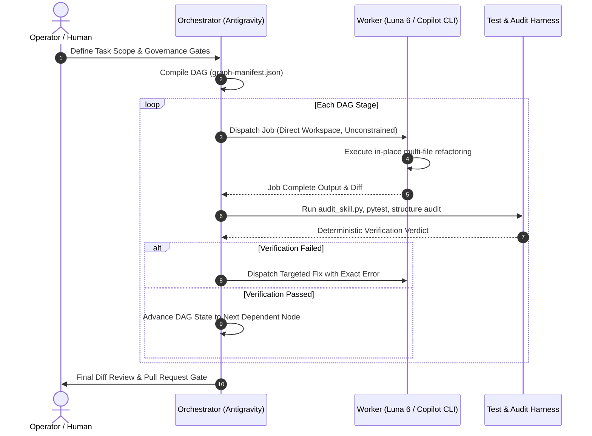

# Delegated DAG Refactoring Playbook: Graph Planner + Luna 6 Worker Pattern

Operational playbook for executing large-scale repository refactoring and skill consolidation by pairing the **Orchestrating Agent Work** Graph Planner (`antigravity`) with high-throughput external CLI workers (**Luna 6** / `copilot-cli` / `codex-cli`).

---

## 1. Proven Track Record & Architectural Context

This pattern was pioneered and proven during the complete architectural refactoring of `sharepoint-knowledge-workbench` ([PR #35](https://github.com/bcgov/sharepoint-knowledge-workbench/pull/35)):
- **Scope**: Consolidated **108 micro-skills** across **7 legacy plugins** into **1 unified plugin** (`@sharepoint/sharepoint-workbench`), **11 modal domain skills**, and **9 subagents**.
- **Results**: Eliminated **739 copy-manifest entries** (0 broken symlinks), passed **11/11 skill audits**, passed **9/9 subagent audits**, passed **26/26 unit tests**, and merged cleanly into `main` with zero regressions.

---

## 2. Division of Labor: Orchestrator vs. Tactical Worker



### The Orchestrator (`antigravity`)
- **Role**: Architect, Topologist, Gatekeeper, and Adversarial Critic.
- **Responsibilities**:
  1. Author and compile the execution DAG into `graph-manifest.json` using [graph-planning.md](graph-planning.md).
  2. Enforce pre-execution verifier hashes and schema locking.
  3. Formulate self-contained worker prompts containing explicit source-to-target mapping tables.
  4. Perform strict post-job deterministic verification (`audit_skill.py`, `audit_plugin_structure.py`, `pytest`).
  5. Manage Git operations (branching, commits, PR creation); never delegate git commits to the worker.

### The Worker (`luna 6` / `codex-cli`)
- **Engine**: `codex-cli` (preferred for downstream refactoring) or `copilot-cli` with `gpt-5.6-luna` or `gpt-6-luna` (medium reasoning effort).
- **Role**: High-Throughput In-Place Implementation Engine.
- **Responsibilities**:
  1. Direct in-place file operations across all affected source files in one pass.
  2. Synthesizing modal `SKILL.md` files (< 100 lines) dispatching to `references/modes/<mode>.md`.
  3. Moving scripts, tests, assets, and JSON schemas into single owning skill spoke directories.
  4. Authoring root array evals (`evals/evals.json` and `evals/task-success.json`).

---

## 3. Core Operational Invariants

1. **Direct Workspace Access (No Intermediate Buffers)**:
   Do **not** isolate the worker with artificial `--isolated` flags, and do **not** force it to write code proposals to `/tmp` files. Allow the worker direct write access to project files in place to prevent slow, piecemeal micro-iterations.
2. **Zero Git Operations in Worker Context**:
   The worker environment must never execute `git add`, `git commit`, `git merge`, or `git push`. All commit hygiene and state transitions are strictly caller-managed by the Orchestrator.
3. **Pre-Purge Accounting Matrix**:
   Never delete legacy directories without first executing an automated comparison script verifying 100% of source files exist at destination paths.
4. **Deterministic Verification Gate Between Stages**:
   A DAG stage cannot advance until its verifier script returns exit code `0`. If an audit fails, the orchestrator dispatches a targeted remediation prompt with the exact error traceback.

---

## 4. Reusable Blueprint for Downstream Consuming Repositories

When applying this pattern to subsequent consuming repositories (e.g. `jag-csb-intranet`):

### Stage 1: Dependency & APM Bootstrap (DAG Root)
- Author project `apm.yml` declaring required packages.
- Run local APM installation:
  ```bash
  apm install /path/to/package --target claude,copilot,codex,antigravity
  ```
- Configure `.gitignore` to prevent committing ephemeral deployed agent directories (`.agents/`, `.claude/skills/`, `.codex/`, `.github/agents/`, `apm_modules/`).

### Stage 2: Manifest & Legacy Code Purge (Sequential Mutation)
- Run worker to remove legacy in-repo micro-skills and copy manifests (`symlinks.json`).
- Verify that customer state (`inventory/`, `config*.psd1`, `context/`) remains untouched.

### Stage 3: Workflow Refactoring & Script Migration (Parallel Reads / Linear Writes)
- Worker maps legacy skill invocations to consolidated hub modes based on `master_migration_inventory.csv`.
- Worker updates `AGENTS.md` and migration documentation to reference consolidated skills.

### Stage 4: Deterministic Audit & PR Closure (Terminal Barrier)
- Orchestrator verifies skill compliance (`audit_skill.py --mode installed`).
- Run dry-run verification against local repository inventories.
- Open pull request for operator review and merge.
